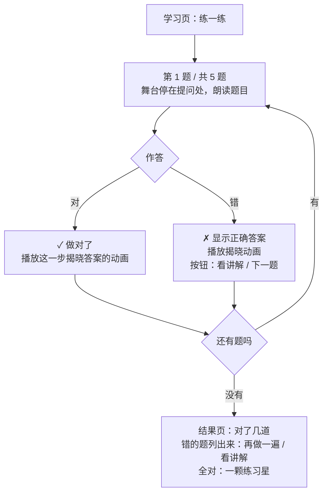

# 动画学堂 · 习题功能评估

> 版本：v1（评估稿，2026-11-16）。对应[需求池](./需求池.md)第 2 条“习题”和第 3 条“错题本”。
> 性质：**评估和方案，不是排期**。按需求池的规则，排进阶段之前不改代码；确认要做时，把第 4–6 节写进[小学版页面规格](./小学版页面规格.md)，再从需求池移走。
> 结论先行：**建议做，而且比当初估计的便宜**——数学 3.0 做完后，出题、判对错、动手方式都已经有了，习题主要是“把同一套东西换一种用法”，不需要写题库。

---

## 1. 结论

| 问题 | 结论 |
|---|---|
| 值不值得做 | 值得。现在孩子“看懂了”之后没有地方检验“会不会”；“自己做”只做一道、有提示、不计对错，不算练习 |
| 什么时候做 | 数学 3.1 批次完成、孩子试用一周之后（开发文档里的检查点）。那时有 50 个左右知识点可练，也知道孩子用新动手方式顺不顺 |
| 怎么出题 | **不写题库**。每个知识点已经有参数（`params`）、算出来的值（`derived`）、出题范围（`explore`）和动手做（`try`）；习题 = 自动换一组数字 + 只做其中“要孩子答”的步骤 |
| 每个知识点要额外写多少 | 大多数知识点**一行不用加**；想调整题量、去掉不适合当题目的步骤时，加一小段 `practice` 配置 |
| 工作量 | 约 12–15 人日（含错题本）。其中界面约一半 |
| 和现有原则冲突吗 | 不冲突：不要账号、不联网、不收集数据，成绩只存本机（和学习记录一样） |

需求池里留的四个问题，建议答案见第 3 节；需要你拍板的事项在第 8 节。

---

## 2. 现在有什么可以直接用

需求池写这条的时候（阶段 1），这些能力还不存在，所以当时判断“是另一类产品能力”。现在情况变了：

| 做习题需要的 | 现在的情况 |
|---|---|
| 题目从哪来 | 每个知识点的 `explore` 定义了“讲得通的数字范围”，`content:check` 已经保证范围内每种组合都能正确画出来、算出来 |
| 答案是什么 | `try` 里已经写了每一步的正确答案（`choose.answer`、拖几个、点哪个、转到多少），而且是用参数算出来的 |
| 怎么作答 | 7 种动手方式：点选答案、拖动、点选零件、转动、分类、拖到位、按面值凑数（后 5 种是数学 3.0 新做的） |
| 判对错 | 每种方式的判定都是纯函数（3.0 的任务卡要求），可以直接调用 |
| 随机换题 | “自己做”已经会从所有组合里随机挑、不和上一道重复 |
| 自动检查 | 自动走查（F10）已经能用标准答案自动做完每一步，习题上线后可以用同样的办法自动检查“每道题都有解” |

**“自己做”和“习题”的区别**——这决定了习题不是重复功能：

| | 自己做（已有） | 习题（要做） |
|---|---|---|
| 目的 | 学会方法 | 检验会不会、练熟 |
| 题量 | 1 道，整道题走完全部步骤 | 一组 5 道（可配置） |
| 提示 | 做错给提示、高亮、演示 | 第一次作答不给提示；答错后才讲 |
| 计对错 | 不计，做完就得星 | 记录每道对错、正确率 |
| 做错之后 | 引导到做对为止 | 记入错题本，之后重做 |

---

## 3. 需求池里四个问题的建议答案

| 问题 | 建议 | 理由 |
|---|---|---|
| 题型先做哪几种 | 第一版只用**已有的 7 种动手方式**，不做新题型（不做填空键盘、不做口算计时、不做竖式手写） | 这 7 种已经覆盖“选、拖、点、转、分、摆、凑”，新题型每种都要设计输入和判分，放到第二版看需要再加 |
| 一次几道 | 一组 5 道，约 3–5 分钟；低年级（一、二年级）3 道 | 小学生一次专注时间短；题量放 `site.yaml`，可调 |
| 答错后怎么办 | 立刻告诉对错 → 显示正确答案 → 可以点“看讲解”，直接跳到动画里对应的那一步（带着这道题的数字） | 这是本产品比普通题库强的地方：每道题都有对应的动画讲解，不用另写解析 |
| 要不要限制次数 | 不限制。每次的题都是新换的数字，重复做有意义 | 也没有账号和排行榜，没有刷分的动机 |

---

## 4. 方案

### 4.1 一道题是什么

一道题 = **一个知识点 + 一组参数 + 其中一个要孩子做的步骤**。

以凑十法为例（参数：大数 a、小数 b；有 4 个要孩子做的步骤）：

| 步骤 | 变成题目 |
|---|---|
| “十格框里还空着几格？” | a = 8 时：选 2 |
| “把 6 拆成 2 和几？” | a = 8、b = 6 时：选 4 |
| “把 2 个橙色圆片拖进十格框” | 拖动题 |
| “10 + 4 等于几？” | 选 14 |

出题时画面直接停在那一步提问的时刻（现有“自己做”已经能从任意步骤开始，前面的讲解不播），孩子只看到题目需要的画面。

**两种出题粒度**，按知识点的特点选（配置里指定，默认第一种）：

| 粒度 | 做法 | 适合 |
|---|---|---|
| `step` 单步题 | 每道题随机一组数字，只问其中一步 | 步骤之间相对独立的：认数、比大小、读图、概念判断 |
| `whole` 整题 | 每道题随机一组数字，把所有要做的步骤连着做完算一道，全部做对才算对 | 步骤前后相扣的算法：凑十法、竖式、通分再相加 |

### 4.2 配置：`practice`（可选）

知识点文件里加一个可选字段。**不写也能练**：有 `try` 又有 `explore`（或 `presets`）的知识点自动可练，默认单步题、全部 `try` 步骤都出。

```yaml
practice:
  mode: whole            # step（默认）单步题 / whole 整题
  count: 5               # 一组几道，不写用 site.yaml 的默认值
  steps: [2, 3, 5]       # 只用这几步出题（步骤序号）；不写 = 全部有 try 的步骤
  exclude: [4]           # 或者：排除这几步（和 steps 二选一）
  params:                # 练习时的出题范围；不写就用 explore 的范围
    - { param: a, min: 6, max: 9 }
    - { param: b, min: '11 - a', max: 9 }
  enabled: false         # 这个知识点不出习题（纯演示类）
```

`content:check` 要增加的检查：

- 可练的知识点，能出的不同题目不少于 `count` 道（否则一组里会重复）；不够时报错并建议扩大范围或减少 `count`。
- 每一种会被抽到的（参数组合 × 步骤），用标准答案能做对——直接复用自动走查的自动作答。
- 单步题的每一步，提问时画面上不能已经有答案（规格 P3 的现有规则，习题里更重要）。

### 4.3 哪些知识点能练

| 情况 | 处理 |
|---|---|
| 有 `try`，有 `explore` | 自动可练 |
| 有 `try`，只有 `presets` | 可练，题目在几个例子里轮换；例子少于题量时，一组的题量自动减到例子数 × 可出题的步骤数 |
| 有 `try`，没有任何可变参数 | 只有固定的几道题（每个 `try` 步骤一道）；题量 = 步骤数，做过一遍后提示“这个知识点的题都做过了” |
| 没有 `try` | 没有“练一练”入口 |

按数学开发手册的 195 个脚本统计（其中 `count-on` 的配置在开发文档里，另算）：127 个有 `explore` 或 `presets`，可以反复练；68 个是固定题。固定题的知识点以概念认识为主（认识图形、计量单位整理），题少是合理的。

### 4.4 一组练习的流程



规则：

- **每道题只有一次作答机会**（多选、拖动、分类这类多步操作，以“提交时的整体结果”为准：拖动、分类中途放错一次即算错，但允许继续做完，保证孩子看到正确的结果）。
- 作答前不给提示、不高亮目标；工具条里没有“教我”“演示”。
- 答完立即反馈；答错时把正确答案标出来（复用现有“看我做一遍”的画面）。
- “看讲解”：带着这道题的参数切到“看一看”，从这一步开始播放；看完回到练习的下一题。
- 中途退出：这一组作废，不记成绩，已经答错的题仍进错题本。
- 一组里不出现完全相同的题（同参数同步骤）；尽量覆盖不同的步骤（先把每个可出题的步骤各出一道，再随机补足）。

### 4.5 界面改动

| 位置 | 改动 |
|---|---|
| P3 学习页的学习方式 | 在“看一看 / 跟着做 / 自己做”后面加第四个：**练一练**。没有可练内容时不显示 |
| P3 标题区的星星 | 加第四颗“练习星”（见 4.6）；没有可练内容的知识点仍是三颗或一颗 |
| 练习中的舞台 | 左上角显示“第 2 / 5 题”，替换原来的“时长 · 步数”；没有播放控制条和进度条；右下角工具条只保留分享以外的“全屏” |
| 练习中的字幕区 | 题目文字（就是 `try.task`）；答完显示对错和两个按钮 |
| 结果页 | 在舞台位置显示：对了几道（星星或对勾排成一排）、错题列表（每条：题目文字 + “再做一遍”“看讲解”）、“再练一组”“回到讲解” |
| P2 知识点卡片 | 已练过的显示最近一次的正确率小标记（如“4/5”）；没练过不显示 |
| P5 个人中心 | 学习统计加“练习过的知识点数”“错题本（n 道）”入口 |
| 新页面：错题本 `/me/mistakes` | 见 4.7 |

全部遵守规格 2.8（紧凑、内容为空不占位、淡入 ≤ 0.3 秒、三种宽度检查）；文字放 `texts.yaml`，题量等数值放 `site.yaml`。

### 4.6 星星和“已学完”

两种做法，建议用 A：

| | A（建议）：练习星不计入“已学完” | B：练习星计入“已学完” |
|---|---|---|
| 规则 | “已学完”仍然是前三颗星都满；练习星单独显示，一组全对才点亮 | 四颗星都满才算已学完 |
| 好处 | 不改变已有的学习记录和规则；练习是“加分项”，孩子没有压力 | “学完”的含义更扎实 |
| 坏处 | 学完和会做是两个状态，要在界面上分清 | 已经“学完”的知识点会变回“未学完”，孩子和家长会困惑；固定题少的知识点练习星意义不大 |

练习星的显示：最近一次一组的正确率按比例填色（和其他星一样），全对填满；只增不减（再练一次错了不扣）。

### 4.7 错题本

| 项目 | 规则 |
|---|---|
| 记什么 | 答错的题：知识点 id、参数、步骤序号、答错的时间、答错次数。**不存画面**，重做时由参数重新生成 |
| 入口 | 个人中心；练习结果页 |
| 列表 | 按知识点分组，每条显示题目文字（代入参数后的 `try.task`）和知识点名；可以按年级、学科筛选 |
| 重做 | 点开直接进入这道题（同样只有一次机会）；做对 → 标记“已掌握”，从列表移到“已掌握”分组（保留 30 天后自动清除）；做错 → 留在错题本，次数加 1 |
| 上限 | 最多 200 道（`site.yaml`），超出时删最早“已掌握”的，再删最早的 |
| 知识点改了怎么办 | 重做时如果这个参数组合已不在出题范围内、或步骤序号对不上，这条错题自动作废并移除（不报错） |
| 清除 | 设置页“清除学习记录”同时清除练习成绩和错题本；另加单独的“清空错题本” |

### 4.8 本机数据

沿用学习记录的存储方式（本机，不上传）。新增两块：

```ts
// 每个知识点一条练习记录
interface PracticeRecord {
  lessonId: string;
  rounds: number;          // 练过几组
  best: number;            // 最好的一组的正确率 0–1
  last: number;            // 最近一组的正确率
  lastAt: number;
}

// 错题
interface Mistake {
  lessonId: string;
  params: Record<string, number | string>;
  step: number;            // 步骤序号（知识点内）
  wrongCount: number;
  firstAt: number;
  lastAt: number;
  masteredAt?: number;     // 重做对了的时间
}
```

导出备份、导入要包含这两块（设置页已有的备份功能）。

---

## 5. 分期

| 期 | 内容 | 估算（人日） |
|---|---|---|
| **第一期：练一练** | `practice` 配置和检查；出题（抽参数、抽步骤、去重）；练习流程和反馈；结果页；练习星；本机记录；P3、P2 的界面改动 | 约 8 |
| **第二期：错题本** | 错题记录、错题本页面、重做和“已掌握”、个人中心入口、备份导入 | 约 4 |
| **第三期（看需要）** | 新题型：数字键盘填空（竖式逐格填、直接写得数）、限时口算；按错题推荐“再看一遍哪个知识点” | 另行评估 |

第一期可以独立上线。前提：数学 3.0 已合并（需要它的动手方式和自动作答）。

---

## 6. 验收（第一期）

- [ ] 凑十法（整题模式）：一组 5 道的数字各不相同；全部做对得到练习星，刷新后还在。
- [ ] 比大小（单步题模式）：一组里各题的数字不同；答错一道，立即显示正确符号，结果页列出这道错题。
- [ ] 答错后点“看讲解”，进入“看一看”并且用的是这道题的数字，从对应步骤开始；看完回到下一题。
- [ ] 作答前画面上、字幕里都没有答案；工具条里没有“教我”“演示”。
- [ ] 没有 `try` 的知识点（如早期纯演示的知识点）没有“练一练”。
- [ ] 只有固定题的知识点：题量等于可出题的步骤数；做完提示题都做过了。
- [ ] `pnpm content:check`：把某个知识点的出题范围缩到不足 5 道，报错并指出知识点。
- [ ] 电脑、iPad、手机三种宽度下，练习界面没有大块空白，按钮好点。
- [ ] 关掉朗读时题目不朗读；“减少动态效果”时反馈不带动画。

---

## 7. 风险

| 风险 | 对策 |
|---|---|
| 单步题脱离上下文，孩子看不懂在问什么 | 默认把提问步骤之前的画面全部摆好（已有机制）；写知识点时 `try.task` 要能单独读懂（数学开发手册的脚本基本满足，上线前按知识点抽查）；不适合的步骤用 `practice.exclude` 去掉 |
| 点选题可以猜（3 选 1 有 1/3 的概率蒙对） | 一组全对才给星；数字答案的干扰项是“最接近的数”（已有逻辑）；第三期再考虑填空题型 |
| 做练习变成压力，偏离“看懂为什么”的定位 | 练习星不计入“已学完”（4.6 的 A）；不显示排名、不倒计时、不扣分；结果页的措辞以鼓励为主 |
| 拖动、分类题“中途放错算错”孩子觉得不公平 | 第一次进入练习时用一句话说明“练习里每道题只有一次机会”；误触（拖起来又放回原处）不算作答 |
| 知识点改动后旧错题对不上 | 错题只存参数和步骤，重做时校验，不合法就作废（4.7） |
| 数学 3.1 之后的知识点还没写完，现在定 `practice` 格式会不会返工 | 不会：`practice` 是可选字段，绝大多数知识点不需要写；格式里用到的都是现有概念（步骤序号、参数范围） |

---

## 8. 需要你决定的事

| # | 问题 | 我的建议 |
|---|---|---|
| 1 | 做不做、什么时候做 | 做；排在数学 3.1 完成、孩子试用之后。可以和数学 3.2 之后的批次并行（改的是播放器和页面，不碰零件和知识点配置） |
| 2 | 练习星要不要计入“已学完” | 不计入（4.6 的 A） |
| 3 | 每道题几次机会 | 一次；答错立即给答案和讲解入口 |
| 4 | 一组几道 | 5 道，一、二年级 3 道 |
| 5 | 错题本是否和第一期一起做 | 分开：第一期先上线练一练，用一两周，再做错题本 |
| 6 | 科学知识点要不要练 | 要，机制相同；但科学的固定题比例更高（概念判断为主），练习更像“小测验” |

确认后，我把第 4–6 节整理进页面规格（新增“练一练”和“错题本”两节），并按数学开发手册的格式写成任务卡。
