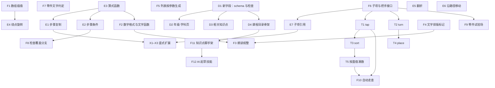

# A · 前置工作任务卡（3.0 批次 + 零件扩展）

> 先读 [README](./README.md) 的工作方式和完成标准。每张卡的“依赖”必须先合并。
> 卡片编号：F = 前置工作（开发文档 4.6），D = 新字段与页面（开发文档 5.1、5.2、6.2、6.4、7.4），E = 引擎扩展（开发文档 4.1），T = 动手方式（开发文档 4.2），X = 现有零件扩展（开发文档 4.4）。

## 0. 依赖与顺序



**推荐的开工顺序**（同一行可以并行）：

1. F6、F7、F1、F5、E3、D1、F4
2. E7、E1、E2、E4、E5、E6、F2、D2、D3、D4
3. T1、T2、F3、F8、F9、F11
4. T3、T4、X1、X4、X5、X6、X7、X8、F12
5. T5、X2、X3
6. F10（3.1 批次开始前必须完成）

F13（样板知识点）不是单独的卡，写在 B 文件每个零件卡里。

---

## F1 顶层属性与数组插值

- **依赖**：无　**分支**：`dev/phase3-engine-array-blend`　**估时**：0.5 天
- **目标**：`set` 等动作能让“同样形状的数组”平滑变化（多边形顶点、统计图数据、线段图长度），从而所有连续变化都只用顶层属性。

**改动文件**

- `packages/templates/src/scene/evaluate.ts`：`blend()`（现在只处理数字、坐标、颜色）。
- `packages/templates/src/scene/scene.test.ts`：新增用例。
- `packages/content/lessons/scene.md`：`set` 一行补“数组按元素连续变化”。

**规则**

```
blend(from, to, t):
  两个都是有限数字              → lerp
  两个都是坐标 [x, y]           → 按分量 lerp（现有）
  两个都是颜色                  → 现有颜色插值
  两个都是数组且长度相同         → 按下标递归 blend（元素可以是数字、坐标、数组）
  其他（长度不同、对象、字符串）  → 现有规则：t < 0.5 取 from，否则取 to
```

- 对象（`{ … }`）里的字段**不**递归插值——这是有意的（开发文档 4 节开头）。
- 递归深度不超过 3 层（`lens` 是二维数组、`points` 是坐标数组，够用）；超过时按“其他”处理。

**测试**

1. `[1, 2, 3]` → `[3, 4, 5]`，t = 0.5 得 `[2, 3, 4]`。
2. 坐标数组 `[[0,0],[10,0]]` → `[[0,10],[10,10]]`，t = 0.5 得 `[[0,5],[10,5]]`。
3. 二维数组 `[[1,1],[2]]` → `[[3,3],[4]]`，t = 0.5 得 `[[2,2],[3]]`（注意 `[1,1]` 本身也像坐标，结果一致即可）。
4. 长度不同 `[1,2]` → `[1,2,3]`：t = 0.4 得 from，t = 0.6 得 to。
5. 对象 `{ a: 1 }` → `{ a: 3 }`：t = 0.4 得 from（不插值）。
6. 用一个 `polygon` 以外的现有零件写回归测试：`set: { target: g, filled: 6 }` 仍正常（数字插值不受影响）。

**验收**

- [ ] 上面 6 个测试通过；`scene.md` 已更新。

---

## F2 数字格式与文字函数

- **依赖**：E3　**分支**：`dev/phase3-core-format`　**估时**：1 天
- **目标**：讲解、零件文字里代入的数字不出现浮点误差；能由参数生成汉字读法、时间、带分数、固定小数位。

**现状**（已核对代码）：`packages/core/src/fill.ts` 的 `valueOf()` 对**算式**做了 `toFixed(6)` 去误差，但 `{S}` 这种**直接引用参数名 / 派生值**时原样 `String(v)`，派生值是 `0.1 + 0.2` 时会显示 `0.30000000000000004`。

**改动文件**

- `packages/core/src/fill.ts`：数字转文字统一走新函数 `formatNumber(v)`；支持文字函数。
- `packages/core/src/format.ts`（新建）：`formatNumber`、`cn`、`fixed`、`time`、`hm`、`mixed` 的实现。
- `packages/core/src/format.test.ts`（新建）、`packages/core/src/index.ts`（导出）。
- `packages/content/lessons/scene.md`：在“重复与算式”一节后加“数字格式与文字函数”。

**规则**

1. `formatNumber(v)`：`Number(v.toPrecision(10))` 后转字符串；去掉末尾多余的 0（`2.50` → `2.5`）；负号用 `−`（U+2212，和讲解里的减号一致）。所有数字代入（参数名、派生值、算式）都走它。
2. 文字函数只能作为 `{}` 里**最外层**的调用（文字函数之间可以互相嵌套，如 `sel` 里套 `sel`、`cn`），数字参数是算式：

| 函数 | 结果 | 例子 |
|---|---|---|
| `fixed(x, k)` | 保留 k 位小数，**保留**末尾 0 | `{fixed(2.5, 2)}` → `2.50` |
| `cn(n)` | 汉字读法（小学读数规则） | `3005` → 三千零五；`40020` → 四万零二十；`100000000` → 一亿；`1.25` → 一点二五；`−5` → 负五；`0` → 零；`10` → 十；`12` → 十二；`110` → 一百一十 |
| `time(m)` | 分钟数 → `h:mm` | `{time(185)}` → `3:05`；超过 1440 取模 |
| `hm(m)` | 分钟数 → `h 时 mm 分`；整点只写 `h 时` | `{hm(185)}` → `3 时 05 分`；`{hm(180)}` → `3 时` |
| `mixed(a, b)` | 假分数 a/b → 带分数标记 | `{mixed(7, 4)}` → `[1 3/4](frac)`；整除时得整数 `{mixed(8,4)}` → `2`；真分数 → `[3/4](frac)` |
| `sel(c, x, y)` | 条件选文字：c 为真（非 0）得 x，否则得 y；x、y 是用引号括起来的文字（单引号或双引号），也可以是另一个文字函数 | `{sel(a > b, '>', sel(a < b, '<', '='))}`；`{sel(carry, '要进位', '不用进位')}` |

3. `cn()` 的读法规则（必须全部实现）：按四位一级（个级、万级、亿级）读；每级末尾的 0 不读；每级中间连续的 0 只读一个“零”；某一级全是 0 且后面还有非零数字时读一个“零”（`100005` → 十万零五）；最高位是十位的“一十”读作“十”（`10`、`15`、`100000` 十万），但不在最高位时读“一十”（`110` 一百一十）；小数部分逐位读（`0.05` 零点零五）。“两”和“二”：千位上的 2 读“两”（`2000` 两千、`2700` 两千七百）；万级、亿级的数只有一位且是 2 时读“两”（`20000` 两万、`200000000` 两亿、`22000` 两万两千）；其余读“二”（`200` 二百、`12` 十二、`120000` 十二万）。“两”字放 `texts.yaml` 的 `num.two`。
4. “文字”中的汉字（零、一…九、十、百、千、万、亿、点、负、时、分）**不写在代码里**：放 `texts.yaml` 新分组 `num`（键：`digits`（"零一二三四五六七八九"）、`units`（"十百千"）、`groups`（"万亿"）、`point`、`minus`、`hour`、`minute`），代码用 `t()` 读取。

**测试**

1. `formatNumber(0.1 + 0.2)` = `0.3`；`formatNumber(2.50)` = `2.5`；`formatNumber(-3)` = `−3`；`formatNumber(1e-7)` = `0.0000001`。
2. 派生值 `S: 0.1 + 0.2`，讲解 `{S}` 代入后是 `0.3`（回归：原来是长串）。
3. `cn` 至少 24 个用例（另加 2000 两千、2700 两千七百、20000 两万、22000 两万两千、200 二百、120000 十二万）：0、5、10、12、20、105、110、1000、1001、1010、3005、10000、40020、100005、120000、1000000、10000000、100000000、230000000、305000060、1.25、0.05、−5。
4. `fixed(2.5, 2)`、`fixed(3, 1)` = `3.0`；`time(0)` = `0:00`、`time(185)`、`time(1500)` = `1:00`；`hm(180)`、`hm(185)`、`hm(5)` = `0 时 05 分`。
5. `mixed(7,4)`、`mixed(8,4)`、`mixed(3,4)`、`mixed(9,4)` = `[2 1/4](frac)`。
6. `sel(3 > 2, '>', '<')` = `>`；嵌套 `sel(a > b, '>', sel(a < b, '<', '='))` 在 a = b 时得 `=`；`sel` 的结果用在 `choose.answer`（整个值是 `{sel(...)}`）时得到文字答案。
7. 文字函数不在最外层（`{cn(a) + 1}`）时保持原样不代入，并且 `content:check` 报错“文字函数只能单独写在 {} 里”。

**验收**

- [ ] 测试全部通过；`texts.yaml` 新分组有用、约定检查通过；`scene.md` 已写。

---

## F3 朗读规整与 speak 字段

- **依赖**：F2、F4　**分支**：`dev/phase3-speech-readas`　**估时**：1 天
- **目标**：朗读时分数、负数、时间、单位、运算符读对；需要时可以给某一步单独写朗读文字。

**现状**：`packages/runtime/src/services/speech.ts` 的 `speak()` 直接朗读传入的文字；调用方是 `runtime/src/player/useTimeline.ts`（约第 129 行）。`core` 的 `Step` 已有 `narration` 字段（为空时朗读 `desc`）。

**改动文件**

- `packages/content/src/schema.ts`：步骤加可选 `speak: text`；`site.yaml` 的 `speech` 节加 `readAs`（`[{ match: string, say: string }]`）。
- `packages/content/src/animation.ts`：`speak` 代入参数后放进 `Step.narration`。
- `packages/runtime/src/services/readAs.ts`（新建）：`toSpeech(text, rules)`：先去掉颜色 / blank 标记（只保留文字；blank 读作“几”——这个字放 `texts.yaml` 的 `num.blank`），再按规则依次替换。
- `packages/runtime/src/services/speech.ts`：`speak()` 之前调用 `toSpeech()`（规则从 `site.yaml` 读）。
- `packages/runtime/src/services/readAs.test.ts`（新建）。
- `packages/content/site.yaml`：写入默认规则（下表）。
- `packages/content/lessons/scene.md`：讲解与朗读一节说明 `speak` 和读法规则。

**默认规则**（写进 `site.yaml` 的 `speech.readAs`，顺序即应用顺序）

| match（正则） | say | 例子 |
|---|---|---|
| `\[(\d+) (\d+)/(\d+)\]\(frac\)` | `$1又$3分之$2` | 1¾ → 一又四分之三（数字由 TTS 读） |
| `\[(\d+)/(\d+)\]\([^)]*frac[^)]*\)` | `$2分之$1` | |
| `(\d+)/(\d+)` | `$2分之$1` | 3/4 → 4分之3 |
| `(\d+):(\d{2})` | `$1时$2分` | 15:05 → 15时05分 |
| `−(\d)` | `负$1` | −5 → 负5 |
| `≈` | `约等于` | |
| `×` | `乘` | |
| `÷` | `除以` | |
| `cm\[2\]\(sup\)` / `dm…` / `m\[2\]\(sup\)` | `平方厘米` / `平方分米` / `平方米` | 每个单位一条 |
| `cm\[3\]\(sup\)` 等 | `立方厘米` 等 | |
| `km` / `cm` / `mm` / `kg` / `g` | `千米` / `厘米` / `毫米` / `千克` / `克` | 按“长的单位先替换”的顺序写 |
| `%` | `（前面的数）` → 用 `(\d+(?:\.\d+)?)%` → `百分之$1` | 25% → 百分之25 |
| `°` | `度` | |
| `π` | `派` | |

> 规则里的中文写在 `site.yaml`（内容配置），不是代码；约定检查只管代码。

**测试**

1. 每条默认规则至少一个用例；组合用例：`3/4 + 1/4 = 1` → `4分之3 + 4分之1 = 1`（“+”“=”由 TTS 读，不替换）。
2. `[7](blank)` → 读作 `几`；`[4](@r1)` → `4`。
3. 步骤写了 `speak`：朗读用 `speak`，字幕仍显示 `say`。
4. `readAs` 为空数组时原样朗读（不报错）。

**验收**

- [ ] 在浏览器里打开一个含分数的知识点（可临时用 fraction-intro 的本地副本），听一遍读法正确；测试通过。

---

## F4 文字排版标记（上标、行内分数）

- **依赖**：无　**分支**：`dev/phase3-text-markup`　**估时**：1.5 天
- **目标**：文字里能写 cm²、m³、S = πr²、行内竖排分数、带分数。

**现状**：`packages/blocks/src/parts/text.tsx` 的 `richSpans()` 解析 `[文字](词 词 …)`，词可以是颜色名、`@id`、`blank`。

**改动文件**

- `packages/blocks/src/parts/text.tsx`：`Span` 增加 `sup?: boolean`、`frac?: { whole?: string; num: string; den: string }`；`richSpans()` 识别词 `sup`、`frac`；渲染、宽度估算（`textWidth`）、包围盒都支持。
- `packages/blocks/src/parts/markRect.ts`：颜色底块、blank 框对 `frac` 段按分数的实际宽高画。
- `packages/templates/src/scene/check.ts`：`RICH` 检查认识新词；`frac` 的内容必须是 `a/b` 或 `w a/b`（整数）。
- 测试：`packages/blocks/src/parts/text.test.ts`（新建）。
- `scene.md`：颜色强对应一节的表格加两行。

**画法**

- `sup`：字号 × 0.6，基线上移 字号 × 0.4；宽度按 0.6 倍字号估算。
- `frac`：分子、分母字号 × 0.7，上下排列，中间一条横线（线宽 = 字号 × 0.06，颜色同文字），横线宽 = max(分子宽, 分母宽) + 字号 × 0.2；整体垂直居中于文字的中线；带分数的整数部分用原字号写在左边，间隔 字号 × 0.1。行高随之增加：有 `frac` 的行，包围盒高度 = 字号 × 1.6。
- 可以和颜色、`@id`、`blank` 组合：`[3/4](red frac)`、`[3/4](frac blank)`（blank 时画一个分数形状的空框：上下两个小空框 + 横线）。

**测试**

1. `richSpans('cm[2](sup)')` 得两段，第二段 `sup: true`。
2. `richSpans('[1 3/4](red frac)')` 得 `frac: { whole: '1', num: '3', den: '4' }`、颜色 red。
3. 宽度：`textWidth` 对含 frac 的文字比同字符数的普通文字窄（分子分母叠放）。
4. 包围盒：含 frac 的 `text` 零件高度 = size × 1.6。
5. `check`：`[3/](frac)` 报错并指出位置。

**验收**

- [ ] 在零件试验场（若 F9 未完成，用一个临时 draft 知识点）看 `S = πr[2](sup)`、`[3/4](frac) + [1/4](frac) = 1`、`[2 1/3](frac)` 显示正确，四个主题截图。

---

## F5 零件内列表按参数生成

- **依赖**：无　**分支**：`dev/phase3-list-repeat`　**估时**：0.5 天
- **目标**：零件属性里的列表能随出题参数变化长度（物品个数、数据个数）。

**改动文件**

- `packages/templates/src/scene/repeat.ts`：新增 `expandLists(props, scope)`：深度遍历零件属性，数组元素是 `{ repeat: '…', … }` 时按次数展开，元素内 `{i}` 为第几个（从 1 开始），展开后去掉 `repeat` 键。在 `expandObjects` 之后对每个零件调用。
- `packages/core/src/params.ts`：函数 `range(from, to, step)`——**返回数组**，只能作为整个值 `'{range(1, n, 1)}'` 使用（`fillParams` 识别“整个字符串是 `{range(...)}`”时返回数组）。
- `packages/templates/src/scene/check.ts`：展开后的列表为空时报错（指出参数组合）；`repeat` 次数上限沿用 `MAX_REPEAT`（50）。
- 测试：`scene.test.ts`、`params.test.ts`。
- `scene.md`：“重复与算式”一节加例子。

**写法**

```yaml
- id: fruits
  type: item-set
  items:
    - { repeat: '{a}', asset: apple, tags: { kind: apple } }
    - { repeat: '{b}', asset: pear, tags: { kind: pear } }
- id: bars
  type: chart
  kind: bar
  values: '{range(2, 2 * n, 2)}'   # n = 4 时为 [2, 4, 6, 8]
```

**测试**

1. a = 3、b = 2 时 `items` 展开成 5 项，顺序是 3 个 apple、2 个 pear；`{i}` 在每组内从 1 开始。
2. `range(1, 5, 1)` = `[1,2,3,4,5]`；`range(2, 8, 2)` = `[2,4,6,8]`；`range(5, 1, 1)` = `[]`。
3. 次数为 0 的元素被去掉；整个列表为空时 check 报错。
4. 嵌套 `repeat`（元素里再写 repeat）时 check 报错“不能嵌套”。

**验收**

- [ ] 测试通过；`scene.md` 已写。

---

## F6 子项与把手的统一接口

- **依赖**：无（**所有新零件、E7、T1、T2 都依赖它，最先做**）　**分支**：`dev/phase3-part-subitems`　**估时**：2 天
- **目标**：零件声明“哪些部分可以单独引用 / 点选”“哪些属性可以拖动”，播放器统一处理高亮、点中、拖动、键盘和读屏。

**改动文件**

- `packages/blocks/src/base.ts`：`PartDef` 增加两个可选方法和类型：

```ts
export interface Subitem {
  /** 子项名（不含零件 id），如 'bar.2'、'v1'、'd0' */
  name: string;
  /** 舞台坐标的包围盒（点中判定、高亮框都用它） */
  box: Box;
  /** 读屏名称的参数（如序号、数值），名称模板在 texts.yaml 的 a11y.subitem */
  label?: string;
  /** 数值（tap 按条件点时的 {n}；money 的面值；item-set 的 value） */
  value?: number;
  /** 类别（sort 用，来自 item-set 的 tags） */
  tags?: Record<string, string>;
}

export interface Handle {
  /** 改哪个属性（顶层属性名） */
  prop: string;
  /** 把手当前位置（舞台坐标） */
  at: Point;
  /** 拖动方式：rotate 绕 center 转；drag 跟手移动 */
  kind: 'rotate' | 'drag';
  center?: Point;
  /** 由指针位置算出属性的新值（不负责吸附，吸附由播放器按 step 做） */
  valueAt(pointer: Point): number;
  /** 属性的取值范围 */
  min: number;
  max: number;
  /** 改数组属性时的下标（polygon 顶点，见 B12） */
  index?: number;
  /** 由指针位置直接算出新的属性集合（polygon 顶点、protractor 整体拖动）；有它时不调用 valueAt，turn（T2）不使用这类把手 */
  apply?(p: Props, pointer: Point): Props;
}

export interface PartDef {
  // ……现有字段
  subitems?(p: Props): Subitem[];
  handles?(p: Props): Handle[];
}
```

- `packages/blocks/src/index.ts`：导出 `Subitem`、`Handle`，以及工具函数 `findSubitem(def, props, name)`（支持 `*` 通配：`bar.*`）。
- `packages/templates/src/scene/SceneView.tsx`：
  1. 高亮：零件的 `highlight` 之外，新增帧数据 `subHighlights: { id, name, value }[]`，按子项 `box` 画同一套高亮框（`scene.highlight` 样式）。
  2. 点选层：当 `tryIt` 带 `tap` 时，在零件之上画透明的命中矩形（`box` 外扩 `scene.tryIt.tapPadding`），点中时回调 `tryIt.onTap(id, name)`。
  3. 把手层：当 `tryIt` 带 `turn` 时，在目标零件的把手位置画把手（圆点，半径 `scene.tryIt.turnHandle`，填充 accent、白色描边、阴影走现有 `--shadow` 风格的 SVG filter），拖动时调用 `handle.valueAt()`，回调 `tryIt.onTurn(value, done)`。
- `packages/templates/src/scene/evaluate.ts`：`SceneObject` 不变；`sceneFrame` 产出的帧增加 `subHighlights`（由 E7 填充，本卡先留空数组）。
- `packages/runtime/src/template.ts`：`StageTry` 增加可选 `onTap?(id: string, sub?: string): void`、`onTurn?(value: number, done: boolean): void`、`tapped?: string[]`（已点对的，画成保持描边）、`turnValue?: number`。
- `packages/content/texts.yaml`：`a11y.subitem`（`{name}`）、`a11y.handle`（`拖动调整{name}`）。
- `packages/content/site.yaml` + `schema.ts`：`scene.tryIt` 加 `tapPadding: 12`、`turnHandle: 22`、`snapMs: 200`、`placeTolerance: 24`、`rotateStep: 45`。
- 测试：`packages/blocks/src/subitems.test.ts`（新建）、`packages/templates/src/scene/scene.test.ts`。
- 给**一个现有零件**实现 `subitems()` 作为参考实现：`grid`（子项 `row.<n>`、`col.<n>`、`cell.<行>.<列>`，对应 X8 的一部分）；给 `clock` 实现 `handles()`（把手：分针末端，prop `time`，kind rotate，center = 钟面中心，`valueAt` 把角度换算成分钟，保持当前小时）——这两个作为后续零件的模板。

**键盘与读屏**

- 点选层的每个命中矩形是 `<g role="button" tabIndex={0} aria-label=…>`，回车 / 空格触发 `onTap`；Tab 顺序 = `subitems()` 返回的顺序。
- 把手是 `role="slider"`，`aria-valuemin/max/now`；左右 / 上下方向键按 `step` 改值并调用 `onTurn(value, false)`，回车调用 `onTurn(value, true)`。

**测试**

1. `findSubitem(grid, props, 'cell.2.3')` 返回第 2 行第 3 列的格子，box 正确；`'row.*'` 返回全部行。
2. `clock.handles()` 在 3:00 时把手位于 12 点方向的分针末端；把指针放到 3 点方向，`valueAt` 得 3:15（195 分钟）。
3. SceneView 渲染：`tryIt.tap` 存在时有命中矩形，个数 = 可点子项数；没有 `tap` 时没有命中层（快照或查询 DOM）。
4. 不实现 `subitems` 的零件，`findSubitem` 返回 undefined，不报错。

**验收**

- [ ] 测试通过；`scene.md` 新增“子项”一节（写法 `零件id.子项名`、通配 `*`、各零件的子项名见零件表）；README 名词表与此一致。

---

## F7 零件自带文字的约定

- **依赖**：无　**分支**：`dev/phase3-part-labels`　**估时**：0.5 天
- **目标**：零件画面里固定出现的文字统一放 `site.yaml` 的 `scene.parts.<type>.labels`，代码里没有中文。

**改动文件**

- `packages/content/lessons/scene.md`：零件一节开头加约定：“零件自带的文字（方向、星期、数位名、单位、月份）放 `labels`，默认值在 `site.yaml`，知识点可以覆盖。”
- `scripts/conventions/rules.ts`：新增检查：`packages/blocks/src/parts/*.tsx` 里出现 `labels` 默认值以外的中文时报错（现有“代码里写死的中文”规则已覆盖，确认 parts 目录在检查范围内即可；不在就加上）。
- `docs/小学数学开发手册/B-新零件任务卡与视觉规格.md`：已按此约定写好各零件的 `labels`，本卡只需核对。

**验收**

- [ ] 在 `blocks/src/parts/` 下临时写一个中文字符串，`pnpm check:conventions` 报错；删掉后通过。

---

## F8 检查覆盖所有分支

- **依赖**：E2　**分支**：`dev/phase3-check-coverage`　**估时**：1 天
- **目标**：`content:check` 抽样参数组合时，保证每个参数的两端、每个 `when` 的真和假都被检查到。

**现状**：`packages/core/src/params.ts` 的 `exploreCombos()` 组合超过 `limit`（400）时按固定间隔抽样；调用方 `packages/content/src/load.ts` 约第 348 行。

**改动文件**

- `packages/core/src/params.ts`：`exploreCombos()` 抽样规则改为：① 先放入“每个参数取最小值 / 最大值，其他参数取标准值”的组合；② 放入全部参数都取最小、都取最大的组合；③ 其余按间隔抽样补到 `limit`。新增导出 `whenCoverage(lesson, combos)`：对每个带 `when` 的步骤统计真 / 假出现次数。
- `packages/content/src/load.ts`：先对**全部**组合（不抽样，最多 20000 个；超过时报错要求缩小 `explore` 范围）只计算 `when` 的真假（很便宜，不渲染），找出每个 `when` 的一个真组合和一个假组合加入抽样集合；再对抽样集合做完整检查。某个 `when` 在全部组合里恒真或恒假时报错：“第 n 步的 when 在所有参数组合下都为真（或假），这一步要么去掉 when，要么检查条件”。
- 测试：`params.test.ts`、`load.test.ts`。

**测试**

1. 两个参数各 1–99：组合 9801 个，抽样结果包含 (1, 标准)、(99, 标准)、(标准, 1)、(标准, 99)、(1,1)、(99,99)。
2. 步骤 `when: '{a % 10 + b % 10 >= 10}'`：抽样集合里至少有一个使它为真、一个为假的组合。
3. `when: '{a > 100}'`（a 最大 99）报“恒为假”。
4. 组合超过 20000 报错并给出参数名。

**验收**

- [ ] 测试通过；对现有全部知识点跑 `pnpm content:check` 仍通过，耗时增加不超过 30%（在合并说明里写前后耗时）。

---

## F9 零件试验场

- **依赖**：F6　**分支**：`dev/phase3-dev-parts`　**估时**：1.5 天
- **目标**：本地开发时打开 `/dev/parts`，能查看每个零件、调属性、看子项和把手。

**改动文件**

- `apps/web/src/pages/DevPartsPage.tsx`（新建）+ `DevParts.module.css`。
- `apps/web/src/App.tsx`：只在 `import.meta.env.DEV` 时注册路由 `/dev/parts`（生产构建里不能出现这个页面，用动态 `import()` 并被 tree-shake）。
- `packages/blocks/src/index.ts`：导出 `allParts()`（已注册零件列表）。

**页面**

- 左栏：零件列表（type + 中文名），点击切换。
- 中间：800 × 450 的舞台，按 `site.yaml` 的默认属性画出当前零件，`at` 放在舞台中心（`anchor: start` 的放在 (100, 80)）。上方一排主题切换（四个动画主题）+ 浅 / 深界面切换。
- 右栏：属性编辑。属性列表来自 `PartDef.props`；数字属性显示滑块 + 输入框（范围：默认值的 0–3 倍，0–1 的属性用 0–1），布尔属性用开关，其他属性用 YAML 文本框（失焦时解析）。
- 三个开关：显示包围盒（虚线框）、显示子项（每个子项画框并写子项名）、显示把手（画把手并可拖动，拖动时右栏数值同步）。
- “复制配置”按钮：把当前属性复制成知识点 `objects` 的一项（YAML）。
- 页面文字放 `texts.yaml` 的 `dev` 分组（开发页也遵守约定检查）。

**验收**

- [ ] `pnpm dev` 下可以打开；`pnpm build` 后的产物里搜不到 DevPartsPage（在合并说明里写检查方法）；对 `clock`、`grid` 能看到 F6 的把手和子项。

---

## F10 自动走查 `pnpm check:lessons`

- **依赖**：T1–T5（自动作答需要）、F6　**分支**：`dev/phase3-lesson-walkthrough`　**估时**：3 天
- **目标**：自动对每个知识点截图、走完三种学习方式、找出常见问题，生成报告。195 个知识点不再靠人工逐个截图。

**改动文件**

- `scripts/lessons/walk.ts`（新建）：Playwright 脚本（用环境里已装的 Chromium：`require('playwright')`，`chromium.launch()`）。
- `scripts/lessons/report.ts`（新建）：生成 `test-results/lessons/index.html`。
- `package.json`：`"check:lessons": "tsx scripts/lessons/walk.ts"`。
- `apps/web/src/learn/LessonPlayer.tsx`：开发模式（`import.meta.env.DEV`）下在 `window.__lessonTest` 暴露测试接口（生产构建不包含）：

```ts
interface LessonTestApi {
  steps(): number;
  goto(index: number): void;                  // 跳到某步的结尾画面（暂停）
  mode(m: 'watch' | 'follow' | 'self'): void;
  pending(): TrySpec | undefined;              // 当前等待孩子做的 try
  solve(): Promise<void>;                      // 用标准答案完成当前 try（choose 点正确选项；drag/sort/place/tap/turn 直接调用对应回调）
  frameObjects(): { id: string; type: string; box: Box; text?: string }[]; // 当前画面零件的包围盒与文字
  stage(): { width: number; height: number };
}
```

- `.gitignore`：`test-results/`。
- `scripts/conventions/allow.ts`：为 `scripts/lessons/report.ts` 加一条例外，原因写“开发用的走查报告页，不是产品界面文案”（约定检查覆盖所有 `.ts` 文件）。报告里的文字只写在 `report.ts` 一个文件里；`walk.ts` 的终端输出用英文。

**走查内容（每个知识点）**

1. 启动 `pnpm dev`（脚本自己启动并等待端口），打开 `/learn/<年级>/math/<id>`。
2. 三种视口：1280 × 800、820 × 1180、390 × 844。每种视口下：对每一步 `goto(i)` 后截图（deviceScaleFactor 1）。
3. 检查（任一不满足记为问题）：
   - 控制台没有 error、页面没有未捕获异常；
   - 每个零件包围盒在舞台范围内（允许超出 4 像素）；
   - 文字零件之间包围盒不重叠（交叠面积 > 较小者的 10% 算重叠）；
   - 舞台左上角 140 × 40 的区域（“时长 · 第几步”）里没有文字零件；
   - 有 `try` 的步骤，在提问时刻（`ask` 之前）画面上的所有文字里不包含该 try 的答案文字（choose 的 answer；数字答案按“独立的数字”匹配，避免 13 匹配到 3）。
4. 跟着做：`mode('follow')`，从第 1 步播放，遇到 `pending()` 就 `solve()`，直到结束；记录是否卡住（单步超过 30 秒）。
5. 自己做：`mode('self')`，同上；然后改一次参数（取 `explore` 每个控件的最大值）再做一遍。
6. 报告：每个知识点一行：三种视口的第 1、中间、最后一步缩略图，问题列表（带步骤号和截图链接）。全部无问题时命令退出码 0，否则 1。

**参数**：`--lesson <id>`（只查一个，可多次）、`--changed`（只查相对 `origin/main` 改动过的知识点文件，CI 用）、`--no-self`（跳过自己做）。

**测试**

- 对 `make-ten`、`clock-basics`、`circle-area` 跑通且无问题；人为在一个临时 draft 知识点里把文字放到舞台外、在提问步骤提前写出答案，脚本能报出这两个问题。

**验收**

- [ ] 对现有全部已上线知识点运行，结果无问题（如有问题，记录在合并说明里并另开修复卡）；运行时间写进合并说明。

---

## F11 知识点脚手架 `pnpm lesson:new`

- **依赖**：D4　**分支**：`dev/phase3-lesson-new`　**估时**：0.5 天

**改动文件**：`scripts/lessons/new.ts`（新建）、`scripts/lessons/template.yaml`（新建）、`package.json`（`"lesson:new": "tsx scripts/lessons/new.ts"`）。

**行为**：`pnpm lesson:new <年级> <id>`

1. 在 `packages/content/curriculum/math/grade<年级>.yaml` 里找 `{ id: <id>, title: … }`；找不到报错“先在课程目录里写上这个知识点”；已经是纯 id（已有文件）报错。
2. 生成 `packages/content/lessons/math/g<年级>/<id>.yaml`：第一行 schema 注释；`id`、`title`（取目录的 title）、`summary: ''`、`status: draft`、`duration: 1分钟`、`tags: []`、`cover: { text: '' }`、`related: []`、`template: scene`、`stage: { width: 800, height: 450 }`、`params: {}`、`objects: []`、`steps: []`、`keyPoints: []`，每个字段上方一行中文注释说明。骨架内容放在模板文件 `scripts/lessons/template.yaml` 里（yaml 不在约定检查范围内），脚本读取模板、替换 id 和 title 后写出——约定检查覆盖所有 `.ts` 文件（包括 `scripts/`），所以脚本代码里不写中文。
3. 把目录里那一行改成 `- <id>`，保留原来的缩进和顺序。
4. 打印下一步提示：脚本位置（C 文件哪一节）、`pnpm content:check`、`pnpm check:lessons --lesson <id>`。

**测试**：在临时目录（复制一份 content）里跑：生成文件内容正确、目录被改写、重复运行报错。

---

## F12 AI 起草技能

- **依赖**：F11　**分支**：`dev/phase3-skill-draft-lesson`　**估时**：0.5 天

**改动文件**：`.claude/skills/draft-lesson/SKILL.md`（新建）。

**内容**（技能文件按 Claude Code 技能格式写，frontmatter 的 `name: draft-lesson`、`description` 写明“按开发手册的知识点脚本写出一个数学知识点的 yaml”）：

1. 输入：知识点 id。
2. 步骤：读 `CLAUDE.md` → 读本手册 README 第 2–4 节 → 在 C 文件里找到这个 id 的脚本 → 读开发文档 5.2 和 `packages/content/lessons/scene.md` → `pnpm lesson:new` → 按脚本写配置（讲解原文照抄，零件、动作照写）→ `pnpm content:check` → `pnpm check:lessons --lesson <id>` → 按开发文档 8.1 逐条自查 → 提交。
3. 硬规则：不改代码；脚本里没写的零件属性用默认值；脚本有错（数学错误、零件不存在）时停下报告，不自行改讲法。

**验收**：用这个技能写一个“随时”批次的知识点（如 `compare-within-10`），走完全流程。

---

## D1 新字段：schema、检查、索引

- **依赖**：无　**分支**：`dev/phase3-content-fields`　**估时**：1 天
- **规格**：开发文档 5.1、5.2、7.4。

**改动文件**

- `packages/content/src/schema.ts`：
  - `curriculumSchema` 单元：`term: z.union([z.literal(1), z.literal(2)]).optional()`、`domain: z.string().optional()`，加 `describe` 说明。
  - `gradesSchema` 学科：`domains: z.array(z.object({ id, name: text }).strict()).optional()`。
  - 知识点 schema：`related: z.array(lessonId).max(4).optional()`。
  - `site.yaml`：`learning.term: { firstFromMonth: int 1–12, secondFromMonth: int 1–12 }`（必填，yaml 里给全）。
- `packages/content/src/load.ts`：
  - 目录：同一文件里 `term` 全写或全不写，`domain` 同理；`domain` 必须在该学科 `domains` 里；学科没有 `domains` 时不能写 `domain`。
  - 知识点 `related`：每个 id 存在（任一知识点文件或任一目录里的 `{ id, title }`）、不等于自己、不重复。
- `packages/content/src/catalog.ts`：`CatalogEntry.units[]` 加 `term?`、`domain?`；`LessonMeta` 加 `related?: string[]`；`ContentIndex` 带上学科的 `domains`。
- `packages/content/curriculum/grades.yaml`：数学加 `domains`（数与代数、图形与几何、统计与概率）。
- `packages/content/site.yaml`：`learning.term: { firstFromMonth: 9, secondFromMonth: 2 }`。
- `pnpm content:schema` 重新生成 `schemas/`。
- 测试：`load.test.ts`、`catalog` 相关测试。

**测试**

1. 目录里一个单元写 `term`、另一个没写 → 报错，指出文件和单元。
2. `domain: algebra`（不在 domains 里）→ 报错。
3. 科学目录写 `domain` → 报错（科学没有 domains）。
4. `related: [make-ten, make-ten]` → 报重复；`related: [自己]` → 报错；`related: [not-exist]` → 报不存在；`related` 里写目录中 `{ id, title }` 形式的 id → 通过。
5. 索引里能读到 `term`、`domain`、`related`、`domains`。

**验收**

- [ ] 现有内容不改也能通过（字段都可选）；测试通过；JSON Schema 已更新。

---

## D2 年级·学科页：上下册与领域标签

- **依赖**：D1　**分支**：`dev/phase3-subject-term`　**估时**：1.5 天
- **规格**：开发文档 6.2。

**改动文件**

- `apps/web/src/pages/SubjectPage.tsx`、`Pages.module.css`（或该页的 CSS 模块）。
- `apps/web/src/styles/global.css`：`:root` 和深色主题块各加 `--domain-tag-mix`（浅 14%、深 28%）。
- `packages/content/texts.yaml`：`lesson.term_1`（上册）、`lesson.term_2`（下册）。
- `docs/小学版页面规格.md` P2：页面元素表加“上下册切换”“领域标签”两行，交互规则、验收照开发文档 6.2 写入。

**实现要点**

- 分段按钮：目录所有单元都有 `term` 且两册都有单元时显示；默认册 = 当前月份在 [`firstFromMonth`, 12] ∪ [1, `secondFromMonth` − 1] 时为上册，否则下册；网址参数 `?term=1|2` 优先；切换用 `navigate({ search }, { replace: true })`。
- 领域标签：单元标题后的小块，`background: color-mix(in srgb, var(--subject-color) var(--domain-tag-mix), transparent)`（学科色变量沿用页面现有的写法；没有就在页面根元素用 `style={{ '--subject-color': 学科色 }}` 设置——这是数据驱动的颜色，不算写死颜色值），文字 `--ink`，字号 `--fs-xs`，内边距 2px 8px，圆角 8px。
- 新出现的内容淡入 ≤ 0.3 秒，照顾“减少动态效果”（项目现有的 CSS 写法）。

**测试**

- 组件测试（项目现有测试方式）：两册都有时显示切换；`?term=2` 时只渲染下册单元；科学页不显示切换和标签。
- 月份默认值的纯函数单独测试：9、12、1 月 → 上册；2、8 月 → 下册。

**验收**

- [ ] 开发文档 6.2 的三条验收通过；三种宽度、深色主题截图。

---

## D3 学习页：相关知识点

- **依赖**：D1　**分支**：`dev/phase3-lesson-related`　**估时**：1 天
- **规格**：开发文档 6.4。

**改动文件**

- `apps/web/src/pages/LessonPage.tsx`（或 `learn/LessonPlayer.tsx` 里要点区之后、上一个 / 下一个之前的位置）、对应 CSS 模块。
- `packages/content/src/catalog.ts`：新增 `relatedOf(index, lessonId)`：按 `related` 顺序返回 `{ id, title, grade, subject, available }`，过滤掉不可见的（线上未发布）。
- `texts.yaml`：`lesson.related`（相关）、`lesson.related_grade`（`{title}（{grade}）`）。
- `docs/小学版页面规格.md` P3：页面元素表加“相关知识点”一行。

**实现要点**：一行“相关：”+ 链接，链接之间用 ` · ` 分隔；手机上自然换行；列表为空时整块不渲染；点击用普通路由跳转（新增历史）。

**测试**：`relatedOf` 的纯函数测试（顺序、过滤未发布、跨年级带年级名）；页面渲染测试（空时无 DOM）。

**验收**：开发文档 6.4 的两条验收。

---

## D4 课程目录骨架

- **依赖**：D1　**分支**：`dev/phase3-curriculum-math`　**估时**：1 天
- **规格**：开发文档 5.1（一年级示例）和第 3 节全部表格。

**改动文件**：`packages/content/curriculum/math/grade1.yaml` … `grade6.yaml`（4、5 年级是新文件）。

**做法**

1. 按开发文档第 3 节每个年级的表，从上到下：上册单元在前、下册在后；表里的“单元”列 = 单元 id 和标题（去掉〔数〕等领域标记，领域写进 `domain`：〔数〕→ number、〔形〕→ geometry、〔统〕→ stats）。
2. 已上线的知识点写纯 id；其余写 `{ id, title }`，`title` = 表里“知识点”列去掉 ★。
3. 已有单元保持原 id、补 `term` 和 `domain`，按表的位置排列。
4. 表里单元列写了“（已有）”的就是已有单元；单元列为空的行属于上面最近的单元。

**测试**：`pnpm content:check` 通过；写一个一次性的核对脚本（不提交），确认六个文件里知识点 id 总数 = 206、其中纯 id 11 个，和开发文档 2.3 一致，结果写进合并说明。

**验收**

- [ ] 本地打开六个年级的数学页，单元、知识点顺序与开发文档一致，未上线的显示“即将上线”；首页数字不把“即将上线”算进已上线。
- [ ] 首页加载的内容索引增加不超过 30 KB（gzip，开发文档第 10 节第 8 条），写出测量方法和结果。

---

## E1 步骤按次数复制

- **依赖**：E3　**分支**：`dev/phase3-engine-step-repeat`　**估时**：1 天

**改动文件**

- `packages/content/src/schema.ts`：步骤加可选 `repeat: z.union([z.number().int(), z.string()])`。
- `packages/content/src/animation.ts`：`lessonToAnimation()` 里，在 `fillParams` 之前展开步骤：遇到 `repeat` 的步骤，按次数复制，每份的作用域 = 参数 + `{ i }`，对这一步单独 `fillParams`（这样步骤里的 `{i}`、`{digit(a, i - 1)}` 都能算）；展开后再做 E2 的过滤。
- `packages/content/src/load.ts`：检查时同样先展开再检查；展开后步数为 0 或超过 `scene.maxSteps`（`site.yaml` 新增，20）报错。
- 学习记录：不需要改（记录按展开后的序号，规格已规定换题从头开始）。
- 测试：`lessons.test.ts` 或新建 `animation.test.ts`。
- `scene.md`：新增“步骤复制与条件”一节。

**写法**

```yaml
steps:
  - repeat: '{len(a)}'           # a 有几位就复制几步
    title: 第 {i} 位
    say: '{digit(a, i - 1)} 加 {digit(b, i - 1)}……'
    do:
      - set: { target: calc, show: '{i}' }
```

**测试**

1. a = 345 时复制 3 步，每步 `{i}` 为 1、2、3，标题“第 1 位”…；a = 12 时 2 步。
2. 不写 `repeat` 的步骤不受影响；`repeat: 0` 的步骤消失。
3. 展开后超过 20 步报错。
4. 步骤里的 `try` 也被正确代入 `{i}`。

---

## E2 步骤条件 `when`

- **依赖**：E3　**分支**：`dev/phase3-engine-step-when`（可以和 E1 同一分支）　**估时**：0.5 天

**改动文件**：同 E1（`schema.ts` 步骤加 `when: string`；`animation.ts` 展开后按 `when` 过滤；`load.ts` 检查）。

**规则**：`when` 是 `'{算式}'`，结果为 0 时去掉这一步；和 `repeat` 同时写时，每份单独判断（可以用 `{i}`）；算式写错时 check 报错。

**测试**：`when: '{carry > 0}'` 在 carry = 0 / 1 时步数不同；`repeat` + `when: '{digit(a, i - 1) > 0}'` 只保留非零位。

---

## E3 算式函数扩充

- **依赖**：无　**分支**：`dev/phase3-expr-functions`　**估时**：1 天

**改动文件**：`packages/core/src/params.ts`（`FUNCS`、`tokenize`、`evalTokens`）、`params.test.ts`、`scene.md`（算式一节）。

**新增**

| 内容 | 规则 |
|---|---|
| `digit(n, k)` | `floor(abs(n) / 10^k) % 10`；k 为负时取小数位：`digit(3.45, -1)` = 4（先 `round(n × 10^−k)` 去误差） |
| `len(n)` | 整数部分位数，`len(0)` = 1 |
| `gcd(a, b)`、`lcm(a, b)` | 非负整数；有 0 时 `gcd(a,0)=a`、`lcm(a,0)=0` |
| `isPrime(n)` | 1 / 0；n < 2 为 0 |
| `dec(n, k)` | 四舍五入保留 k 位小数，返回数字（`dec(2.345, 2)` = 2.35；先乘 10^k 后加 1e-9 再 round，避免 2.345 的浮点问题） |
| `pow(a, b)` | 整数次幂 |
| 比较 `> < >= <= == !=` | 结果 1 / 0；优先级低于加减 |
| 逻辑 `&&`、`||`、`!` | 结果 1 / 0 |
| 条件 `c ? x : y` | 最低优先级，右结合 |
| `range(from, to, step)` | 见 F5（返回数组，只能作为整个值使用） |

- `tokenize` 的正则要加入 `> < = ! ? : & |` 两字符运算符；`exprNames()` 同步支持（检查配置用）。
- 文字函数（F2 的 `cn`、`fixed` 等）不在这里，属于 F2。

**测试**：每个函数 3 个以上用例（含边界）；优先级：`1 + 2 > 2` = 1、`a > 1 ? 10 : 20`、`1 < 2 && 3 < 2` = 0；写错（`1 >`）返回 undefined。

---

## E4 绕点旋转

- **依赖**：F1　**分支**：`dev/phase3-engine-rotate-around`　**估时**：1 天

**改动文件**：`templates/src/scene/actions.ts`（`rotate` 的参数加 `around`）、`evaluate.ts`（`apply` 里的 rotate）、`check.ts`、测试、`scene.md`。

**规则**

- `rotate: { target, by | to, around }`。`around` 是坐标 `[x, y]` 或子项 `'tri1.v2'`（取子项 box 的中心；`v<n>` 子项的 box 是以顶点为中心的小方块，所以中心就是顶点）。子项按**动作开始时**的位置取。
- 实现：零件的 `rotate` 属性照常变化（绕自身中心转），同时把 `at` 绕 `around` 转同样的角度——两者叠加等价于绕 `around` 旋转。对 `polygon` 这类用 `points` 定位的零件，直接把每个顶点绕 `around` 转（不改 `rotate`），这样转完以后顶点坐标就是真实位置，后续动作能接着用。
- 零件定义加一个可选标记 `PartDef.rotatesPoints?: true`（polygon、path 设为 true），引擎据此选择两种实现之一。

**测试**：矩形 `at: [100, 100]` 绕 `[0, 100]` 转 180° 后 `at` = `[−100, 100]`、`rotate` = 180；三角形绕自己的 v1 转 90° 后顶点坐标正确；t = 0.5 时在中间位置。

---

## E5 翻折 `flip`

- **依赖**：无　**分支**：`dev/phase3-engine-flip`　**估时**：1.5 天

**改动文件**：`actions.ts`（新动词 `flip`，参数 `target`、`axis`）、`evaluate.ts`、`SceneView.tsx`（渲染时套变换）、`check.ts`、`site.yaml`（`scene.actionSeconds.flip: 0.8`）+ `schema.ts`、测试、`scene.md` 动作表。

**规则**

- `axis: [[x1, y1], [x2, y2]]`（两点确定的对称轴）。过程参数 e∈[0,1]：e = 0 原样；e = 0.5 时零件在垂直于轴的方向被压扁到 0（贴在轴上）；e = 1 时是镜像。实现为变换矩阵：沿轴方向不变，垂直于轴方向缩放 `cos(πe)`（从 1 到 −1）。
- 结束后：对 `rotatesPoints` 零件，把顶点替换为镜像后的坐标；其他零件记录一个 `mirror` 状态（新的通用属性 `mirrorAxis`，SceneView 渲染时套用），保证后续步骤画面正确。
- 文字零件翻折后文字会镜像——知识点里不要翻折文字（check 对 `text`/`label` 的 flip 报警告）。

**测试**：三角形沿竖直轴 x = 200 翻折后顶点 x 坐标镜像；e = 0.5 时所有顶点到轴的距离为 0；矩形（非 points 零件）翻折后 `mirrorAxis` 被设置。

---

## E6 沿路径移动 `follow`

- **依赖**：无（`path` 零件做好后 `path: route1` 写法才能用；本卡先支持坐标列表，再在 B 的 path 卡里接上）　**分支**：`dev/phase3-engine-follow`　**估时**：1 天

**改动文件**：`actions.ts`（新动词 `follow`：`target`、`path`、`draw`）、`evaluate.ts`、`check.ts`、`site.yaml`（`scene.actionSeconds.followPer100: 0.6`）、测试、`scene.md`。

**规则**

- 匀速：按折线总长度参数化，e 对应走过的长度比例；默认 `ease: linear`（不是先快后慢）。
- 零件的 `at` 沿路径移动（零件的锚点对准路径点）。
- `draw: route1`：同步把 path 零件的 `draw` 设为 e。
- 默认时长 = 路径总长 / 100 × `followPer100` 秒。

**测试**：两段折线（长 100 和 300）在 e = 0.25 时位于第一段终点；默认时长计算正确；`draw` 同步。

---

## E7 子项引用（高亮、颜色）

- **依赖**：F6　**分支**：`dev/phase3-engine-subitem-ref`　**估时**：1 天

**改动文件**：`actions.ts`（`highlight`、`unhighlight`、`color` 的 target 允许 `id.子项`）、`evaluate.ts`（帧的 `subHighlights`、子项颜色覆盖 `subColors: { id, name, color }[]`）、`SceneView.tsx`（画子项高亮框；子项颜色交给零件——`Render` 的 props 里多一个 `_subColors` 映射，零件按子项名查颜色）、`check.ts`（子项名必须是这个零件 `subitems()` 能返回的，按每种参数组合检查；支持 `*`）、`choose.show` 也允许子项、测试、`scene.md`。

**测试**：`highlight: grid1.row.2` 时帧里有一个子项高亮且 box 正确；`highlight: grid1.row.*` 全部行；`highlight: grid1.row.9`（只有 3 行）check 报错；`keep: true` 跨步保留。

---

## T1 tap 点选零件

- **依赖**：F6　**分支**：`dev/phase3-try-tap`　**估时**：2 天
- **规格**：开发文档 4.2（T1）、6.3。

**改动文件**

- `packages/runtime/src/template.ts`：`TrySpec` 加 `tap?: { answer?: string[] | string; among?: string[]; pick?: number | string; valid?: string }`。
- `packages/content/src/schema.ts`：`trySchema` 加 `tap`，并把“`drag` 和 `choose` 写一个”的互斥规则改为“`drag`、`choose`、`tap`、`turn`、`sort`、`place` 只能写一个”。
- `packages/templates/src/scene/check.ts`：`checkTry` 加 tap 检查（开发文档 4.2 表）；按条件点时对每种参数组合统计满足 `valid` 的子项数 ≥ `pick`。
- `packages/templates/src/scene/SceneView.tsx`：使用 F6 的点选层；`among` 决定哪些子项可点。
- `apps/web/src/learn/LessonPlayer.tsx`：tap 的判定、逐级引导（复用现有 `miss()`、`showTarget`、`startDemo()`）、完成后进入 `solved`。
- `packages/content/texts.yaml`：`try.tap_wrong`、`try.tap_more`。
- `apps/web/src/learn/Lesson.module.css` 或舞台 CSS：点对后的描边、点错抖动（`@keyframes`，≤ 0.3 秒，减少动态效果时不抖）。
- 测试：`scene.test.ts`（check）、`core` 的判定函数测试（把判定写成纯函数 `tapResult(spec, tapped, subitems, scope)` 放 `core/src/tap.ts`）。
- `scene.md` 动手做一节、规格 P3 交互规则。

**判定**

- 指定答案：点中的子项在 `answer` 里 → 加入 `tapped`；全部点中 → 做对。点中不在 `answer` 里 → 做错一次（`miss`）。
- 按条件：被点子项的 `value` 代入 `valid`（变量名 `n`，其余是参数）为真 → 加入 `tapped`；`tapped` 数量达到 `pick` → 做对；为假 → 做错一次。重复点同一个不计。
- “看我做一遍”：依次点亮答案（按条件时取满足条件的前 `pick` 个）。
- 提示：做错第 `targetAfterMisses` 次起，答案子项轻微闪烁（用 subHighlights，闪烁复用 `scene.blank` 的周期）。

**测试**：`tapResult` 覆盖：单答案对 / 错、多答案逐个点完、按条件点 3 个、重复点同一个、点不可点的子项（忽略）。

**验收**：写一个 draft 知识点（`cardinal-ordinal` 的最小版本：一排 5 个圆片，点出第 3 个），三种学习方式走通，键盘可操作。

---

## T2 turn 转动把手

- **依赖**：F6　**分支**：`dev/phase3-try-turn`　**估时**：2 天

**改动文件**：同 T1 的同类文件：`TrySpec.turn?: { target: string; prop: string; answer: number | string; tolerance?: number | string; step?: number | string }`；schema；check（目标零件 `handles()` 里有这个 `prop`；`answer` 经零件 `normalize` 后在 [min, max] 内）；SceneView 把手层；LessonPlayer 判定和引导；`texts.yaml` 的 `try.turn_close`、`try.turn_wrong`；纯函数 `turnResult(spec, value)` 放 `core/src/turn.ts`；`scene.md`；规格 P3。

**判定**：松手（`onTurn(value, true)`）时：先吸附到 `step` 的整数倍（`snapMs` 动画）；`|value − answer| ≤ tolerance`（默认 0）→ 做对；≤ 2 × tolerance 或 ≤ 2 × step → 提示“快对了”（不计做错）；否则做错一次，属性弹回到这一步开头的值。“看我做一遍”：属性从当前值连续变化到 `answer`。`answer` 是字符串时先经零件的 `normalize`（如钟表 `'3:30'` → 210）。

**测试**：吸附、容差、快对了、弹回；钟表 `answer: '3:30'` 正常。

**验收**：draft 知识点：钟面拨到 3:30（复用 F6 给 clock 做的把手），三种方式走通，键盘可操作，手机上把手好拖。

---

## T3 sort 分类拖放

- **依赖**：T1（复用判定框架）、`item-set` 零件（B 文件）　**分支**：`dev/phase3-try-sort`　**估时**：2 天

**改动文件**：`TrySpec.sort?: { from: string; by: string; bins: Record<string, string> }`；schema；check（`from` 是 item-set；每个物品 `tags[by]` 都在 `bins` 里；筐零件存在）；`evaluate.ts` 新增 `sortFrame()`（类似 `dragFrame`：已放好的物品画在筐里，按筐内顺序排成网格，每行 `floor(筐宽 / 物品格子)` 个）；SceneView 拖动（复用 drag 的指针处理：拖起放大 `liftScale`、`touch-action: none`）；LessonPlayer 判定；`texts.yaml` 的 `try.sort_wrong`；纯函数 `sortResult` 放 `core/src/sort.ts`；`scene.md`；规格 P3。

**判定**：放进的筐 = 物品类别对应的筐 → 留下；否则弹回、做错一次；全部放完 → 做对。`do` 里对应的标准做法：知识点用 `move` 把每个物品移到筐里（或 E1/F5 的 repeat）；“看我做一遍”时按 `bins` 依次放。

**测试**：`sortResult` 全对、放错、部分完成；`sortFrame` 中物品在筐里的位置。

**验收**：draft 知识点（`classify-single` 最小版：6 个水果按颜色放进 2 个筐）。

---

## T4 place 拖到位

- **依赖**：T2（复用旋转把手）、`polygon` 零件（B 文件）　**分支**：`dev/phase3-try-place`　**估时**：2 天

**改动文件**：`TrySpec.place?: { target: string; to: [number, number] | string; rotate?: number | string }`；schema；check（`do` 里有把 target 移到 `to` 的 `move`，写了 `rotate` 时还要有转到该角度的 `rotate`；坐标一致）；SceneView（拖动整体；写了 `rotate` 时选中后在零件旁出现旋转把手，拖动吸附到 `rotateStep` 的整数倍，点一下转一档，R 键转一档）；LessonPlayer；`texts.yaml` 的 `try.place_rotate`、`try.place_wrong`；纯函数 `placeResult` 放 `core/src/place.ts`；`scene.md`；规格 P3。

**判定**：松手时零件锚点到 `to` 的距离 ≤ `placeTolerance` 且角度（取模 360）与 `rotate` 相同 → 吸附到准确位置、做对；位置对角度不对 → 停在原处，提示“转一转再放”（不计做错）；位置不对 → 弹回、做错一次。目标虚线轮廓：任务里写了 `showGoal: true` 时画（开发文档 6.3：说了放到哪里的才画），轮廓 = 零件在目标位置和角度下的形状，`line` 色虚线。

**测试**：`placeResult` 位置 / 角度组合；角度 −90 与 270 视为相同。

**验收**：draft 知识点（平行四边形割补：把剪下的三角形拖到右边拼成长方形）。

---

## T5 drag 按面值凑数

- **依赖**：T3、`money` 零件（B 文件）　**分支**：`dev/phase3-try-drag-sum`　**估时**：1.5 天

**改动文件**：`TrySpec.drag` 加 `sum?: number | string`（写了 `sum` 时不用 `count`）；schema；check（`from` 是 money 或带 `value` 的 item-set；`sum` 能由 `from` 的面值组合凑出——用动态规划判断，按每种参数组合）；拖动与放回（柜台里的可以拖回钱包）；LessonPlayer 判定（实时显示“已付 × 元”——放在字幕框任务文字后面，文字 `try.sum_paid`：`已付 {n} 元`）；`texts.yaml` 的 `try.sum_over`、`try.sum_left`、`try.sum_paid`；纯函数 `sumResult` 放 `core/src/sum.ts`；`scene.md`。

**判定**：柜台里面值之和 = `sum` → 做对；> `sum` → 提示“多了，拿回来一些”（不计做错，允许拖回）；停下超过 `remindMs` 且 < `sum` → 提示“还差 n 元”。“看我做一遍”：贪心取面值（从大到小）凑出 `sum`。

**测试**：`sumResult`；凑不出时 check 报错；贪心演示序列。

**验收**：draft 知识点（买一个 8 元的玩具，钱包里有 5 元 1 张、1 元 5 枚）。

---

## X1 竖式：减法

- **依赖**：E1、E7　**分支**：`dev/phase3-columncalc-sub`　**估时**：2 天

**改动文件**：`packages/blocks/src/parts/columncalc.tsx`、`columncalc.test.ts`、`site.yaml`（无新默认值则不改）、`scene.md` 零件表。

**规则**

- `op: '−'`（也接受 `-`）。被减数在上、减数在下，右对齐；横线下写差。
- 步骤（`show` 每加 1 写出一步）：从个位起每一位一步：① 够减：直接写差；② 不够减：先在被减数的高一位上方画退位点（实心小圆，半径 = 字号 × 0.08，accent 色），这一位上方写小号“10 + 原数”形式的提示（小字 `1x`，如 13，字号 × 0.5，accent），再写差；高一位减时用“原数 − 1”（在原数字上方写小号的新值）。③ 连续退位：高一位是 0 时，它变成 9（上方写小 9），再向更高位借。
- 计划函数 `columnCalcPlan(p)` 扩展：返回每一步的 `{ place, borrow: boolean, chainFrom?: number }`，供 E1 的 `repeat` 和 E2 的 `when` 使用（讲解要知道哪一位退位）；同时导出纯函数 `subtractionSteps(a, b)` 给知识点作者在 `derived` 里用不了时参考（文档里写清各位是否退位的算式：`borrow0 = digit(a,0) < digit(b,0)`）。
- 子项：`r<行>c<列>`（行：0 被减数、1 减数、2 差；列：个位 0、十位 1…）、`borrow.<列>`（退位点）。
- `blank`：子项名列表，如 `[r2c0]`（差的个位空着）。

**测试**：52 − 27（个位退位）、305 − 128（中间有 0 的连续退位）、600 − 1（连续退位两次）、45 − 23（不退位）每一步的画面元素（退位点位置、小字）；`blank` 时该格画空框。

**验收**：零件试验场里 `show` 从 0 拖到最大，过程正确；四个主题截图。

---

## X2 竖式：除法（长除法）

- **依赖**：X1　**分支**：`dev/phase3-columncalc-div`　**估时**：3 天

**规则**

- `op: '÷'`。版式（中国小学标准写法）：除数在左，被除数在右，二者之间画“厂”形除号（竖线 + 横线，横线在被除数上方，竖线在被除数左侧，竖线上端略弯）；商写在横线上方，与被除数对应位对齐。
- 每一个商位四小步（`show` 每加 1 进一小步）：① **商**：在商的对应位写数字；② **乘**：在下方写 商 × 除数 的积，右端与当前被除数的那一位对齐；③ **减**：画一条短横线，写出差；④ **落**：把被除数的下一位“落”下来写在差的右边（画一个小箭头从被除数那一位指下来，0.3 倍字号，line 色）。最后一位没有“落”。
- 商的最高位：被除数最高位不够除时，商从下一位开始写（第一个商位前没有 0）。中间某位不够除时商 0：这一位的“乘、减”两小步省略（版面上不写 0 的乘积），直接落下一位——这符合教材的简写；`plan` 里标记 `zero: true`。
- `trial`：`trial: { place, value }` 写了时，该商位先写 `value`（试商），下一小步把它划掉并在上方写正确的商（用于调商 `div-adjust`）。
- 余数：最后一次减的差就是余数；有余数时在算式下方写“…… 余数”不需要（竖式里就是最后的差），横式结果由知识点自己写 text。
- 小数除法见 X3。
- 子项：`q<列>`（商的各位）、`step<n>.prod`、`step<n>.diff`、`dividend.c<列>`、`divisor`。

**测试**：84 ÷ 4、96 ÷ 3（无余数）、85 ÷ 4（有余数）、612 ÷ 3（商中间 0）、120 ÷ 4（商末尾 0）、156 ÷ 12、384 ÷ 48（试商 7 改 8 的 trial）每一小步的元素位置。

**验收**：同 X1。

---

## X3 竖式：小数、多位数乘法、简写、blank

- **依赖**：X1　**分支**：`dev/phase3-columncalc-decimal`　**估时**：2.5 天

**规则**

- `decimals: [da, db]`：a、b 分别有几位小数（`a`、`b` 仍写成数字 2.5、0.38 也可以——零件从数值推断小数位数；写了 `decimals` 以它为准，用于保留末尾 0 的情况，如 2.50）。
- 加减：小数点对齐，位数不同时在末尾补灰色小 0（dim 色）表示补位；结果的小数点与上面对齐；结果末尾的 0 用 dim 色并在讲解里说明可以去掉。
- 乘法：先按整数写和算（右对齐，不对齐小数点），积写完后最后一小步在积上点小数点（从右数 da + db 位，位数不够时在前面补 0，补的 0 用 accent 色）。
- 除法：除数是整数时商的小数点和被除数的小数点对齐（商的小数点在“商”的小步出现）；被除数除尽前位数不够时末尾添 0 继续除（添的 0 用 dim 色）。除数是小数时：第一小步把除数、被除数的小数点同时右移（画小弧形箭头，原小数点淡出），变成整数除数再除。
- `×` 支持三位数 × 两位数；`trimZeros: true` 时因数末尾的 0 写在右侧外面（不参与乘），最后一小步把 0 补到积的末尾（`mult-3x2` 用）。
- 所有 op 都支持 `blank`（子项名列表）。

**测试**：2.5 + 3.86、10 − 2.35、0.8 × 3、0.25 × 0.4（积前补 0）、350 × 24（trimZeros）、22.4 ÷ 4、1 ÷ 4（添 0）、2.52 ÷ 0.6（小数点移动）每一步的元素。

---

## X4 数轴扩展

- **依赖**：无　**分支**：`dev/phase3-numberline-ext`　**估时**：1.5 天

**改动文件**：`packages/blocks/src/parts/math.tsx`（numberline）、测试、`scene.md`。

**规则**

- `labels: integer | decimal | fraction | time`：刻度文字的写法。decimal 用 `formatNumber`；fraction 用 F4 的行内分数（分母 = 1 / step 的整数，约分到最简，整数刻度写整数）；time 用 `time(m)`。
- `from` 可以为负；负数刻度写 `−3`。0 刻度加粗（线宽 × 1.5）。
- `layers: [{ labels, step?, offset? }]`：在主刻度下方依次多画几行刻度文字（每行下移 字号 × 1.4），`step` 不写时与主刻度相同；用于“小数 / 分数 / 百分数”对照（百分数用 `labels: percent`，`0.25` 写成 `25%`）。
- `zoomFrom`、`zoomTo`、`zoomScale`：`zoomScale > 1` 时在下方 字号 × 3 处画一条放大的数轴（长度 = 原长 × 0.8），只包含 `zoomFrom`–`zoomTo`，刻度细分为原 step / 10；用两条 line 色虚线连接原数轴上的这一段两端和放大轴两端。
- `hop` 动作加 `color`（弧线和标签颜色）。
- 子项：`tick.<值>`（刻度点，值用 formatNumber 后的字符串）、`zoom`。

**测试**：负数刻度文字；fraction 刻度 0、1/4、1/2、3/4、1；layers 两行；zoom 的放大轴位置与包围盒；hop color。

---

## X5 钟表扩展

- **依赖**：F6（把手已在 F6 做了参考实现）　**分支**：`dev/phase3-clock-ext`　**估时**：1 天

**规则**：`seconds`（0–59.999，可连续；写了就画秒针：细线，red，比分针长 10%，尾部有短配重）；时间连续变化时秒针由 `seconds` 单独控制（不从 `time` 推算）。`hour24: true`：在 12 个数字外圈再画一圈小号数字 13–24（字号 × 0.55，dim 色，24 写在 12 外面）。把手：分针末端（prop `time`，已有）、时针末端（prop `time`，拖时针按 1 分钟 = 0.5° 换算，保持吸附到 `step`）、秒针末端（prop `seconds`）。

**测试**：秒针角度；hour24 的 13 在 1 外面；三个把手的 valueAt。

---

## X6 分数条 / 分数圆扩展

- **依赖**：无　**分支**：`dev/phase3-fraction-ext`　**估时**：1.5 天

**规则**

- `wholes`（整数 ≥ 1）：并排画几个整体（分数圆横排，间距 = 半径 × 0.3；分数条竖排，间距 = 高 × 0.4），`take` 可以超过 `parts`，按顺序涂满前面的整体再涂后面的（7/4：第一个圆涂满 4 份、第二个涂 3 份）。
- `subdivide`（≥ 1，可连续）：每份再平均分成 `subdivide` 份。连续变化时，新增的分割线从 0 长度长出来（例如从 1 到 2，新线的长度 = 小数部分 × 全长），整数时是完整分割；`take` 的含义随之按细分后的份数计算（知识点里要同时 `set take`）。
- 子项：`part.<n>`（第 n 份，整体之间连续编号）、`whole.<n>`。

**测试**：wholes = 2、parts = 4、take = 7 的涂色；subdivide 1→2 中途的线长；子项个数。

---

## X7 线段扩展（端点样式与延长）

- **依赖**：无　**分支**：`dev/phase3-line-ext`　**估时**：0.5 天

**规则**：`ends: [left, right]`，每端 `point`（画实心端点，半径 = 线宽 × 1.5）或 `open`（不画端点）；`extend`（0–1）：`open` 的一端向外延长，延长后的端点 = 原端点 + 方向 × `extend` × （到舞台边界的距离），延长部分与原线同样式；`extend = 1` 时到舞台边并在边缘渐隐（最后 30 像素不透明度从 1 到 0）。现在的 `line` 不画端点，为了不改变已上线知识点：**`ends` 不写时不画端点**，只有写了 `point` 的那一端才画。

**测试**：两种端点、extend 0.5 的长度、已上线知识点画面不变（回归）。

---

## X8 方格扩展

- **依赖**：F6（子项已在 F6 做了参考实现）　**分支**：`dev/phase3-grid-ext`　**估时**：0.5 天

**规则**：`cells: [[行, 列], …]`（从 1 开始）指定涂色的格子，和 `filled` 二者写一个（都写时 check 报错）；子项 `row.<n>`、`col.<n>`、`cell.<行>.<列>`（F6 已做）。

**测试**：cells 涂色位置；与 filled 同时写报错。

---

## 问题记录

（接手者在这里追加：卡号、问题、建议。维护人处理后在开发文档或本手册里修正，并删除本条。）
