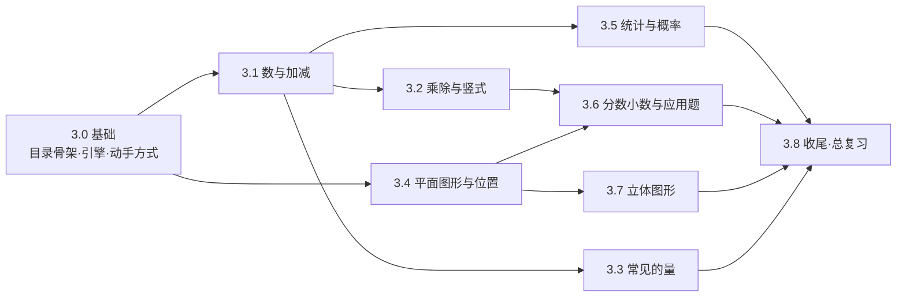

# 动画学堂 · 小学数学知识点开发文档

> 版本：v1（草案，2026-11-08）
> 适用：教学平台方案的**阶段 3（小学批量）**中的数学部分——把小学 1–6 年级数学的全部知识点做成动画。
> 上位文档：[小学版页面规格](./小学版页面规格.md)（页面行为与验收，**冲突时以它为准**）、[小学版需求设计](./小学版需求设计.md)（范围与配置格式）、[教学平台方案](./教学平台方案.md)（架构与阶段路线）。
> 写法参考：[场景模板 scene.md](../packages/content/lessons/scene.md)（零件与动作）、[templates.md](../packages/content/lessons/templates.md)（参数模板）、[lessons/README.md](../packages/content/lessons/README.md)。
> 本文档只做规划和规格，不含代码。文中的配置写法、字段名、零件属性名和子项名都是**已确定的**，实现时照写；`src/schema.ts`、`scene.md` 与本文档保持一致。实现中如果某个写法确实行不通，先改本文档（写明原因），再改代码。
> 已确认的决定（2026-11-08）：课程目录新增 `term`、`domain` 字段，知识点新增 `related` 字段；人民币用简化的示意图。全部决定汇总在第 10 节。

---

## 0. 怎么用这份文档

| 你要做的事 | 看哪几节 |
|---|---|
| 了解全貌、排期 | 1 现状 → 2 总体规划 → 9 工作量 |
| 开发某一个知识点 | 3 知识点总表（找到它的 id、零件、动手方式）→ 5 配置规范 → 7.1 开发流程 → 8.1 验收清单 |
| 开发一个新零件 / 新动手方式 | 4 新增能力规格 → 7.2 / 7.3 开发流程 → 8.2 验收清单 |
| 改页面 | 6 页面设计（只有少量改动，其余沿用规格 P2、P3） |

**四条总原则**（和 CLAUDE.md 一致，这里只强调和本文相关的部分）：

1. **知识点只写配置**：一个知识点 = `lessons/math/g<年级>/<id>.yaml` + 课程目录里的一行 + 需要时的素材。知识点的提交里不应出现代码改动。
2. **缺什么零件就先做零件**：零件、动作、动手方式是一次性的代码工作，做好之后所有知识点都能用。零件和知识点分开两个分支、两次合并（沿用阶段 2 的 `block` / `lesson` 分支习惯）。
3. **配置优先**：零件的默认属性、颜色、时长、容差都放 `site.yaml` 的 `scene` / `player`；界面文字放 `texts.yaml`；代码里不写中文、不写颜色值（见 CLAUDE.md“配置优先”）。
4. **已经上线的知识点不动**：本文只规划新增。已上线的 11 个数学知识点保持原样（含它们所在的单元 id），新知识点围绕它们补齐。

---

## 1. 现状盘点

### 1.1 已上线的数学知识点（不需要再动）

| 文件 | 知识点 | 模板 / 主要零件 | 对应清单里的位置 |
|---|---|---|---|
| `math/g1/make-ten.yaml` | 凑十法 | scene：counters（十格框）、split-calc | 一上 · 20 以内进位加法（核心方法） |
| `math/g1/clock-basics.yaml` | 认识钟表 | clock 模板 | 一上（教材的“认识钟表”）；二下“时、分”的前置 |
| `math/g1/borrow-ten.yaml` | 借十法（破十法） | scene：counters、split-calc | 一下 · 20 以内退位减法 |
| `math/g1/level-ten.yaml` | 平十法 | scene：counters、split-calc | 一下 · 20 以内退位减法 |
| `math/g2/mult-meaning.yaml` | 乘法的意义 | scene：counters（点阵） | 二上 · 乘法的初步意义 |
| `math/g2/break-ten.yaml` | 破十法（两位数减一位数） | scene：counters、split-calc | 一下 · 两位数减一位数（退位）；二上 · 100 以内退位减法 |
| `math/g2/divide-equal.yaml` | 平均分与除法 | scene：counters（盘子）、deal | 二上 · 除法的初步意义 |
| `math/g3/fraction-intro.yaml` | 认识分数 | fraction 模板 | 三上 · 几分之一、几分之几 |
| `math/g3/mult-column.yaml` | 两位数乘两位数的竖式 | scene：column-calc | 三下 · 两位数乘两位数（笔算） |
| `math/g3/rect-area.yaml` | 长方形的面积 | scene：grid | 三下 · 长方形、正方形的面积 |
| `math/g6/circle-area.yaml` | 圆的面积 | scene：circle-cut | 六上 · 圆的面积 |

它们所在的单元：g1 `add-within-20`、`subtract-within-20`、`clock`；g2 `multiplication-1`、`subtract-within-100`、`division-1`；g3 `fraction`、`multiplication-2`、`area`；g6 `circle`。**新知识点要加进这些单元时，往 `lessons` 列表里追加即可，不改单元 id**（学习记录、分享链接不受影响）。

### 1.2 现有能力（可以直接用）

| 类别 | 已有 |
|---|---|
| 模板 | `scene`（摆零件 + 每步动作，绝大多数知识点用它）、`fraction`、`clock`（由参数生成画面） |
| 零件 | text/number/formula、fraction、label、counters（row/column/grid/tenframe；圆片/方块/小棒；盘子 capacity）、tenframe、numberline（marks、pointer）、clock、digital-clock、fraction-circle、fraction-bar、grid、shape（rect/circle/triangle/sector）、line、arrow、arc、image、circle-cut、particles、sun-shadow、battery/bulb/switch/wire、column-calc（`×`、`+`）、thermometer、split-calc |
| 动作 | show/hide、highlight/unhighlight、move、split、merge、set（任意属性连续变化）、rotate（绕自身中心）、scale、color、count、hop（数轴跳）、wait、deal（一个一个分）、repeat（复制动作）、ask（提问点） |
| 动手方式 | `drag`（拖计数块到目标，支持多目标 `each`）、`choose`（单选/多选，数字答案自动出选项） |
| 机制 | `params` / `derived`（四则运算、括号、`%`、min/max/floor/ceil/round/abs）、`explore`（自己做的出题控件，范围可写式子）、`presets`、颜色强对应（`[4](@r1)`）、`blank`（要答的数画成闪烁空框）、`cover`、手机贴合内容（fit）、`content:check` 遍历所有参数组合 |

### 1.3 差距概览

把清单里的全部知识点逐个过了一遍（详见第 3 节），现有能力能直接做的约 23 个（约占新增的 1/8，主要是数的运算里用计数块、数轴、拆分图能讲清楚的），其余都缺零件或动手方式。缺口集中在：

| 缺口 | 影响的知识点（举例） |
|---|---|
| **十进制块与计数器**（小棒捆、方块条片、数位表） | 100 以内 / 万以内 / 大数的认识，口算乘除，进位退位的“为什么” |
| **竖式扩展**（减法、除法、小数、三位数乘两位数） | 二至五年级全部笔算 |
| **平面几何**（任意多边形、角、量角器、路径、方格坐标、绕点旋转与翻折） | 角、周长、平行与垂直、三角形、多边形面积推导、图形的运动、数对 |
| **立体图形**（长方体/圆柱/圆锥的伪 3D、展开、小正方体堆叠） | 认识立体图形、观察物体、表面积、体积、圆柱圆锥 |
| **统计图表**（象形、条形、折线、扇形、统计表、正比例图像） | 一至六年级全部统计内容 |
| **应用题画面**（线段图、行程） | 倍、相遇、分数应用题、工程问题、比、百分数 |
| **常见的量**（人民币、天平/秤、直尺、日历、方向） | 人民币、质量、长度、年月日、方向与位置 |
| **步骤数随参数变化**（竖式每一位一步、递等式每一步） | 所有“位数可变”的算法类知识点 |
| **新动手方式**：点选零件（tap）、转动把手（turn）、分类拖放（sort）、拖到位（place） | 序数、分类、量角、拨钟、七巧板、割补、平移旋转 |
| **目录与知识点元数据**：上下册（`term`）、领域（`domain`）、相关知识点（`related`） | 每个年级 30 多个知识点需要按册分组；跨年级的前置、进阶知识点需要互相链接 |

**处理方式（已确定）**：不新增“参数模板”，继续以 `scene` 为主，先做 **13 项前置工作（4.6：引擎基础 8 项、生产工具 5 项）**，再补 **3 个配置字段（5.1、5.2）+ 7 项引擎扩展 + 5 种动手方式 + 25 个新零件 + 6 个零件扩展**（第 4 节），人民币用简化的示意图（4.3）。这些做完之后，全部知识点都只写配置。

---

## 2. 总体规划

### 2.1 知识点怎么拆

清单上的一条（如“数的运算：多位数乘一位数（口算、笔算竖式、估算）”）往往对应多个知识点文件。拆分规则：

| 规则 | 说明 |
|---|---|
| 一个知识点讲清一件事 | 1–3 分钟、4–8 步；一句讲解不超过约 30 字（自校清单） |
| 方法不同就拆开 | 口算、笔算、估算各一个；凑十法、接着数、交换加数各一个 |
| 难点优先做深 | 第 3 节标 ★ 的是常见理解难点，排在批次前面，动画要讲“为什么” |
| 纯记忆、纯练习的内容不单独做 | 如“口诀背诵”只做“口诀怎么来的、有什么规律”；单纯的计算练习留给需求池里的“习题” |
| 每个知识点至少 1 处动手做 | 优先 2–4 处；数字能换的写成参数并配 `explore`，自己做时能换题 |

### 2.2 跨年级重复的知识点

课程目录要求**一个知识点 id 只能出现在一个年级的目录里**（`load.ts` 会报“在目录里出现了两次”），文件位置也必须和目录的年级一致。清单里有几处同一主题在不同年级出现，处理方式：

| 主题 | 处理 |
|---|---|
| 平均数（三下、四上） | 三下 `average-meaning`（意义、移多补少、先合后分）；四上 `average-apply`（平均数的特点、受极端值影响） |
| 小数的意义与性质、小数加减（四下、五上） | 只在四下做（`decimal-meaning`、`decimal-property`、`decimal-add-sub`）；五上从小数乘法开始，用 `related`（见 5.2）链接回四下 |
| 分数的基本性质（四下、五下） | 放五下 `fraction-basic-property`（和约分通分在一起）；四下只做分数的意义、分数与除法 |
| 观察物体（二上、四上、四下） | 三个不同的知识点：单个物体从不同方向看 → 小正方体组合的三视图 → 根据视图搭立体图形 |
| 平行四边形和梯形（四上、四下） | 四上讲特征；四下讲底和高、图形之间的关系 |
| 图形的运动（五上、五下） | 五上：轴对称、平移、旋转的认识；五下：绕点旋转 90°、画旋转后的图形 |
| 折线统计图（四下、五下） | 四下单式；五下复式 |
| 人民币（一下、二上） | 一下认识与换算、简单购物；二上复杂购物 |
| 时间（二下、三上、三下） | 二下时分秒；三上秒与经过时间；三下 24 时计时法 |
| 除法笔算（三上、三下） | 三上两位数、三位数除以一位数与验算；三下商中间或末尾有 0 |
| 混合运算（四上、四下） | 四上运算顺序与括号；四下三步混合运算解决问题 |

> 清单的年级安排和人教版大体一致，个别位置不同（如“比例、正比例”清单放在六上）。**目录以清单为准，不另按某个教材版本调整。**

### 2.3 规模

| 年级 | 上册 | 下册 | 合计 | 其中已上线 |
|---|---|---|---|---|
| 一年级 | 18 | 17 | 35 | 4 |
| 二年级 | 15 | 13 | 28 | 3 |
| 三年级 | 18 | 19 | 37 | 3 |
| 四年级 | 18 | 15 | 33 | 0 |
| 五年级 | 18 | 19 | 37 | 0 |
| 六年级 | 18 | 18 | 36 | 1 |
| **合计** | | | **206** | **11（新增 195）** |

（数字按第 3 节的表统计；一年级的“认识钟表”按已上线算在一上。）

### 2.4 阶段与批次

全部工作属于教学平台方案的**阶段 3（小学批量）**，按“先能力、后内容；能力按依赖分批”排成 9 个批次。每个批次先做零件（block 分支），再做这批知识点（lesson 分支）。

| 批次 | 内容 | 新能力（第 4 节） | 知识点数 |
|---|---|---|---|
| **3.0 基础** | 前置工作 F1–F13（4.6）；全部课程目录骨架（未写的知识点显示“即将上线”）；目录新字段 `term` / `domain`、知识点新字段 `related`；P2 上下册分组、P3 相关知识点；引擎扩展；动手方式 tap / turn / sort / place / 按面值凑数 | F1–F13，E1–E7，T1–T5 | 0（骨架上线后 6 个年级都能看到完整目录） |
| **3.1 数与加减** | 1–2 年级数的认识、加减法（口算到竖式） | item-set、number-bond、base-ten、place-value、number-chart、expr-steps、table；column-calc 减法、numberline 扩展 | 37 |
| **3.2 乘除与竖式** | 口诀、表内除法、有余数除法、多位数乘除、小数乘除 | column-calc 除法 / 小数 / 多位数 | 15 |
| **3.3 常见的量** | 人民币、质量、长度、时间、年月日 | money、balance、ruler、calendar；clock 扩展 | 20 |
| **3.4 平面图形与位置** | 平面图形、角、线、周长、面积、多边形面积、图形的运动、方向、数对、圆 | polygon、path、angle、protractor、coordinate-grid、direction、circle-draw；line 扩展 | 36 |
| **3.5 统计与概率** | 分类、统计表、象形 / 条形 / 折线 / 扇形统计图、平均数、可能性 | chart、chance（table 在 3.1） | 16 |
| **3.6 分数小数与应用题** | 分数、小数的意义，分数运算，倍、相遇、工程、比、百分数 | tape-diagram、track、fraction-area；fraction-bar / fraction-circle 扩展 | 25 |
| **3.7 立体图形** | 认识立体图形、观察物体、长方体正方体、圆柱圆锥 | solid、cube-stack | 13 |
| **3.8 收尾** | 负数、比例尺、方向与距离、六下总复习 | 全部复用 | 10 |
| **随时** | 只用现有零件的知识点，穿插在各批次之间做 | — | 23 |



- 3.4 只依赖 3.0，可以和 3.1 并行；3.3 用到 3.1 扩展的数轴和计数器，排在 3.1 之后。
- 第 3 节“批次”一列写“随时”的知识点只用现有零件，任何时候都能做，适合穿插在等零件的间隙。
- 每个批次结束：这批知识点全部 `published`，在电脑、iPad、手机上走通三种学习方式，`pnpm test`、`pnpm build` 通过。

### 2.5 分支与提交

按 CLAUDE.md 的分支命名，阶段前缀是 `phase3`：

| 工作 | 分支名示例 | 提交里应该有的文件 |
|---|---|---|
| 新字段（term、domain、related） | `dev/phase3-content-fields` | `schema.ts`、`grades.yaml`、`load.ts`/`catalog.ts` 的检查与索引、P2/P3 页面、`texts.yaml`、测试、规格 P2/P3 |
| 课程目录骨架 | `dev/phase3-curriculum-math`（在新字段合并之后） | `curriculum/math/grade*.yaml` |
| 引擎扩展 | `dev/phase3-engine-step-repeat`、`dev/phase3-engine-rotate-around` | `templates/src/scene/*`、`core/src/params.ts`、测试、`scene.md` |
| 动手方式 | `dev/phase3-try-tap`、`dev/phase3-try-turn` | 播放器、`schema.ts`、`site.yaml`、`texts.yaml`、测试、`scene.md`、规格 P3 |
| 新零件 | `dev/phase3-block-base-ten` | `blocks/src/parts/<零件>.tsx` + `.test.ts`、`blocks/src/index.ts`、`site.yaml` 的 `scene.parts`、`scene.md` |
| 知识点 | `dev/phase3-lesson-count-on`（一个或同一单元的几个） | `lessons/math/g*/<id>.yaml`、课程目录、素材与 `manifest.yaml`、`lessons/README.md` 的“已上线” |

一个分支只做一件事；合并到 `main` 后再开下一条。知识点分支的提交里出现代码改动，说明缺了能力，应该拆出去先做零件。

---

## 3. 知识点总表

**怎么读这张表**

- **单元**：课程目录里的单元 id 和标题，〔数〕〔形〕〔统〕是领域（数与代数、图形与几何、统计与概率，见 5.1 的 `domain`）。同一单元只在第一行写。**已有单元**照旧使用。
- **id**：知识点 id = 文件名，文件放 `lessons/math/g<年级>/<id>.yaml`。✅ = 已上线，不动。
- **知识点**：★ = 常见理解难点，同批次里先做、讲深。
- **动画怎么讲**：核心画面和顺序，写知识点时按它展开成步骤（讲“为什么”，不是只演示算法）。
- **零件**：带 `*` 的是第 4 节要新增或扩展的零件；不带的已有。
- **动手做**：`choose` 点选答案、`drag` 拖动、`tap` 点选零件、`turn` 转动把手、`sort` 分类拖放、`place` 拖到位（后四种见 4.2）。
- **出题参数**：写成 `params` + `explore` 的数，自己做时孩子能调；“—”表示不换题（有 `presets` 时用它给几个例子）。表里写了范围的照写；只写了参数名的，写知识点的人按下面三条定范围，**不需要再确认**：① 数不超过该册的教学范围（一上 20 以内，一下、二上 100 以内，二下 10000 以内，三年级起按单元标题，如“三位数乘两位数”）；② 只开放这个方法讲得通的组合（例如凑十法大数 6–9），讲不通的组合用 `min`/`max` 式子排除；③ `content:check` 遍历全部组合通过。
- **批次**：见 2.4；“随时”= 只用现有零件。

### 3.1 一年级

#### 一年级上册

| 单元 | id | 知识点 | 动画怎么讲 | 零件 | 动手做 | 出题参数 | 批次 |
|---|---|---|---|---|---|---|---|
| `numbers-10` 10 以内数的认识〔数〕 | `count-to-10` | 1–10 的认、读、写 | 一组组物品出现，逐个点数（被数到的高亮，数字跟着递增）；数完的个数 = 数字；数字、点子图、物品三者同色对应 | item-set*、counters、text | choose（有几个）、tap（点出 n 个） | n：1–10 | 3.1 |
| | `compare-within-10` | ★比大小（＞ ＝ ＜） | 两排物品上下一一对应连线，多出来的那几个高亮 → 谁多；符号开口朝多的一边；相等时没有多余 | counters、line、text | choose（选符号） | a、b：0–10 | 随时 |
| | `cardinal-ordinal` | ★几个和第几个 | 一排小动物：“4 个”圈住前 4 个，“第 4 个”只圈 1 个；从左数、从右数，第几个会变 | item-set*、highlight | tap（点出第 n 个）、choose | n：1–8；方向：左 / 右 | 3.1 |
| | `zero` | 0 的认识 | 盘子里的桃一个个被拿走直到一个也没有 → 0；直尺、数轴上 0 是起点 | counters（盘子）、numberline | choose | — | 随时 |
| | `order-within-10` | 10 以内数的顺序 | 数轴上从 0 跳到 10；某个数的前一个、后一个；比 5 大的数都在 5 右边 | numberline、hop | choose | n：1–9 | 随时 |
| | `compose-10` | ★10 以内数的组成（分与合） | n 个圆片分成两堆，按顺序列出所有分法（1 和 n−1、2 和 n−2…），分合图逐行出现；一组分法反过来也成立 | counters、number-bond* | choose（n 可以分成 a 和几）、drag（分一分） | n：2–10 | 3.1 |
| `add-sub-10` 10 以内的加减法〔数〕 | `add-meaning` | 加法的意义（合起来） | 左边 a 个、右边 b 个，合并到一起 → a + b；算式里的数和两堆圆片同色 | counters、merge、text | drag（合起来）、choose | a、b：a + b ≤ 10 | 随时 |
| | `sub-meaning` | 减法的意义（去掉） | 一共 a 个，拿走 b 个（飞走、变淡）→ 还剩几个；拿走的和减数同色 | counters、split、hide | drag（拿走）、choose | a：2–10，b：1–a | 随时 |
| | `add-sub-by-bond` | ★借助数的组成计算 | 分合图“7 可以分成 3 和 4”→ 3 + 4 = 7、4 + 3 = 7、7 − 3 = 4、7 − 4 = 3（一图四式）逐个点亮对应部分 | number-bond*、text | choose | 总数：3–10，部分：1–总数−1 | 3.1 |
| `add-within-20` 20 以内的进位加法（已有）〔数〕 | `make-ten` ✅ | 凑十法 | — | — | — | — | — |
| | `count-on` | 点数法与接着数 | 先“全部从 1 数”（慢），再“记住大数接着往后数”：数轴指针停在大数，往后跳 b 下，每跳一下少一个橙色圆片 | counters、numberline、hop | choose | a：6–9，b：11−a–9 | 随时（完整配置见 5.7） |
| | `commute-add` | 交换加数的位置 | 3 + 9：两堆圆片交换位置，总数不变 → 3 + 9 = 9 + 3；大数在前更好凑十 | counters、move、split-calc | choose | a：2–5，b：11−a–9 | 随时 |
| `clock` 认识钟表（已有）〔数〕 | `clock-basics` ✅ | 认识钟表 | — | — | — | — | — |
| `compare-quantity` 比一比〔形〕 | `compare-height-length` | ★比高矮、比长短 | 两根小棒一端对齐才能比；先演示“不对齐看错了”，再对齐；三样东西比：先两两比 | shape、image、line | tap（点出更长的）、place*（把一端对齐） | 两根长度：3–10 格，不相等 | 3.4 |
| | `compare-size-weight` | 比大小、比轻重 | 两张图重叠比大小；跷跷板 / 天平往下沉的一边重；比的结果能传递（A 比 B 重、B 比 C 重） | shape、balance* | tap、choose | — | 3.3 |
| `solids-intro` 认识立体图形〔形〕 | `solids-intro` | 长方体、正方体、圆柱、球 | 生活中的物品（盒子、魔方、罐子、皮球）淡出成立体图形；推一推：球往哪都能滚、圆柱能滚也能立、长方体正方体能放稳 | image、solid* | tap（点出圆柱）、sort*（物品分到四类） | — | 3.7 |
| `classify-1` 分类与整理〔统〕 | `classify-single` | 按一个标准分类 | 一堆物品按颜色（或形状）分到几个筐；分完数一数，填进简单的统计表；每样只能分进一个筐 | item-set*、shape、table* | sort* | 物品的个数 | 3.1 |
| | `classify-count` | 分类后数一数、比一比 | 分好的物品排成一列列（像象形统计图），哪一类最多、多几个一眼看出 | item-set*、chart*（picto） | choose | 物品的个数 | 3.5 |

> 一上 18 个（含已上线 2 个）。

#### 一年级下册

| 单元 | id | 知识点 | 动画怎么讲 | 零件 | 动手做 | 出题参数 | 批次 |
|---|---|---|---|---|---|---|---|
| `numbers-100` 100 以内数的认识〔数〕 | `count-to-100` | ★数数：十个一是十，十个十是一百 | 一根根数小棒，数到 10 根捆成一捆；一捆一捆地数，数到 10 捆是 100；接着数时“九十九再添一是一百” | base-ten*（捆） | drag（把 10 根捆成一捆）、choose | — | 3.1 |
| | `place-value-100` | ★数的组成与数位读写 | 计数器上十位拨 3 颗、个位拨 5 颗 → 35；个位没有珠子写 0 占位（40 和 4 不一样）；位置不同，意义不同 | place-value*、base-ten* | tap*（拨珠：点十位 / 个位加一颗）、choose | 十位：1–9，个位：0–9 | 3.1 |
| | `order-compare-100` | 数的顺序与大小比较 | 百数表横看加 1、竖看加 10；比较两个数先比十位，十位相同再比个位 | number-chart*、numberline | tap*（在百数表里点出某数）、choose | a、b：10–99 | 3.1 |
| `subtract-within-20` 20 以内的退位减法（已有）〔数〕 | `borrow-ten` ✅ | 借十法（破十法） | — | — | — | — | — |
| | `level-ten` ✅ | 平十法 | — | — | — | — | — |
| | `think-add-for-sub` | ★想加算减法 | 13 − 9：分合图里 13 分成 9 和几？→ 想 9 + 4 = 13，所以 13 − 9 = 4；天平两边一样重的画面帮助理解“加减互逆” | number-bond*、counters | choose | a：11–18，b：a−9–9 | 3.1 |
| `add-sub-100-oral` 100 以内的加法和减法（一）〔数〕 | `tens-add-sub` | 整十数加减整十数 | 3 捆 + 2 捆 = 5 捆 → 30 + 20 = 50；“几个十加几个十” | base-ten* | choose | 两个整十数，和 ≤ 100 | 3.1 |
| | `two-digit-add` | ★两位数加一位数、整十数 | 小棒按数位排成两列：个位和个位加、整十和整十加（相同数位对齐）；个位满十捆成一捆送到十位 | base-ten*、place-value* | drag（满十捆起来）、choose | a：10–89，b：1–9 或整十 | 3.1 |
| | `two-digit-sub` | 两位数减一位数、整十数（不退位） | 个位减个位、十位减十位；退位的情况链接到 `break-ten` | base-ten* | drag（拿走）、choose | a：11–99，b：1–9 或整十 | 3.1 |
| | `column-intro` | 竖式初步 | 小棒的两列变成竖式的两列：数位对齐、从个位算起，横式和竖式一一对应 | column-calc*（+、−）、base-ten* | choose（每一位写几） | 两位数加减一位数 / 两位数 | 3.1 |
| | `continuous-add-sub` | 连加、连减与加减混合 | 公交车上下车：车上的人随每站变化，算式一步步写出来；从左往右依次算，前一步的结果是下一步的开头 | item-set*、expr-steps* | choose | 每站上下的人数 | 3.1 |
| `money-1` 认识人民币〔数〕 | `money-intro` | ★认识元、角、分与换算 | 1 元硬币换成 10 个 1 角（一个个排开），1 角换成 10 个 1 分；同样是 1 元可以有好几种组成 | money* | drag*（换钱：凑够面值）、choose | — | 3.3 |
| | `money-shopping-1` | 简单的购物计算 | 价格牌 → 付钱 → 找回多少；付法不止一种；“几元几角”的加减先元和元、角和角 | money*、text | drag*（付出正好的钱）、choose | 价格：1–20 元，整元或几元几角 | 3.3 |
| `shapes-2d` 认识平面图形〔形〕 | `shapes-2d-intro` | 长方形、正方形、三角形、圆 | 把立体图形的一个面“印”在纸上，印出的形状飞到一边，命名；生活中找一找 | solid*、shape | tap、sort* | — | 3.7 |
| | `shapes-compose` | 图形的拼组 | 两个同样的三角形拼成正方形、长方形、大三角形；正方形对折成两个三角形；数一数图里有几个三角形 | polygon*（翻折、绕点旋转） | place*（拼一拼） | — | 3.4 |
| `classify-2` 分类与整理〔统〕 | `classify-multi` | 按不同标准分类 | 同一堆东西先按颜色分、再按形状分，两次结果不同，但每次总数都一样 | item-set* | sort*（两次，标准不同） | — | 3.1 |
| | `data-collect-1` | 简单数据的收集与整理 | 小朋友投票选喜欢的水果：每票画一个○（或“正”字一笔），整理成统计表，回答“哪种最多、多几票” | table*（正字记录）、item-set* | choose | 票数 | 3.5 |

> 一下 17 个（含已上线 2 个）。

### 3.2 二年级

#### 二年级上册

| 单元 | id | 知识点 | 动画怎么讲 | 零件 | 动手做 | 出题参数 | 批次 |
|---|---|---|---|---|---|---|---|
| `add-within-100` 100 以内的加法（二）〔数〕 | `column-add-100` | ★进位加法竖式 | 竖式和小棒同步：个位满十捆成一捆，竖式上十位写一个小 1（进位）；十位相加时别忘了加进位 | column-calc、base-ten* | choose（每一位） | 两个两位数，个位相加 ≥ 10 | 3.1 |
| `subtract-within-100` 100 以内的退位减法（已有）〔数〕 | `break-ten` ✅ | 破十法 | — | — | — | — | — |
| | `column-sub-100` | ★退位减法竖式 | 个位不够减：从十位拆一捆变成 10 根（十位上点退位点），10 加原来的个位再减；十位要先减去退走的 1 | column-calc*（−）、base-ten* | choose（每一位） | 被减数个位 < 减数个位 | 3.1 |
| `multiplication-1` 表内乘法（一）（已有）〔数〕 | `mult-meaning` ✅ | 乘法的意义 | — | — | — | — | — |
| | `times-table-2-5` | 2～5 的乘法口诀 | 点阵一行行增加，每多一行多 n 个，口诀表对应的一句点亮；5 的口诀积的个位是 0、5 交替 | counters（点阵）、table* | choose（几乘几得几） | n：2–5，行数：1–9 | 3.2 |
| `multiplication-2-table` 表内乘法（二）〔数〕 | `times-table-6-9` | ★6～9 的乘法口诀 | 用记得的口诀推出新的：7 × 6 是 7 × 5 再加一个 7（点阵多出一行）；9 的口诀“积的十位加个位等于 9” | counters（点阵）、table* | choose | n：6–9，行数：1–9 | 3.2 |
| | `times-table-map` | 乘法口诀表的规律 | 整张口诀表：沿对角线对称（3 × 4 和 4 × 3 是同一句）、斜线上是相同因数；横着看每格多一个因数 | table* | tap*（点出某个积在哪一格）、choose | — | 3.2 |
| `division-1` 表内除法（一）（已有）〔数〕 | `divide-equal` ✅ | 平均分与除法 | — | — | — | — | — |
| | `divide-by-table` | ★用乘法口诀求商 | 12 ÷ 3：点阵按 3 个一行排，排出 4 行 → 想“三四十二”；一个点阵对应一道乘法、两道除法 | counters（点阵）、text | choose | 除数：2–9，商：1–9 | 随时 |
| | `division-two-meanings` | 除法的两种分法 | 平均分成几份求每份几个（一个一个分，deal）和每几个一份求几份（一份一份圈），列的是同一个除法算式 | counters、deal、highlight | drag（分一分）、choose | 总数、每份数 | 随时 |
| `money-2` 人民币的应用〔数〕 | `money-shopping-2` | 复杂购物（总价、够不够、怎样付） | 买几样东西：先估一估够不够，再算总价和找零；同一笔钱的几种付法比较 | money*、text | drag*、choose | 两样商品单价 5–50 元（整元），付 100 元 | 3.3 |
| `angle-intro` 角的初步认识〔形〕 | `angle-intro` | ★角的初步认识（直角、锐角、钝角） | 角有一个顶点、两条边；张口变大角变大，**把两条边延长，角的大小不变**；用三角尺的直角去比：比直角小是锐角，大是钝角 | angle*、polygon* | turn*（把角开到直角）、choose | 角度：30°–150°，每 15° 一档，不取 90° 时问锐角还是钝角 | 3.4 |
| `tangram-shapes` 七巧板〔形〕 | `tangram` | 七巧板与平面图形拼组 | 正方形拆成 7 块；两个小三角形能拼成中三角形 / 正方形 / 平行四边形；拼成指定的图案（先放大块） | polygon*（绕点旋转、翻折） | place*（拖到位、可旋转） | 图案：presets | 3.4 |
| `observe-1` 观察物体（一）〔形〕 | `observe-directions` | 从不同方向观察物体 | 俯视图里一个物体和前、后、左、右四个观察的小朋友；镜头依次转到每个小朋友身后，看到的样子贴到他旁边；相对的两个方向看到的是“左右相反”的 | image（素材四视图）、direction* | choose（哪张是从左面看到的） | — | 3.4 |
| `pictograph` 数据收集整理〔统〕 | `pictograph` | 象形统计 | 物品一个个排进各自的列，底部对齐；一个图标代表 1 个，后面讲一个代表 2 个时“半个图标” | chart*（picto） | choose（最多、多几） | 各类数量 | 3.5 |

> 二上 15 个（含已上线 3 个）。

#### 二年级下册

| 单元 | id | 知识点 | 动画怎么讲 | 零件 | 动手做 | 出题参数 | 批次 |
|---|---|---|---|---|---|---|---|
| `numbers-10000` 万以内数的认识〔数〕 | `count-to-10000` | ★千和万：计数单位 | 小方块 → 10 个成一条（十）→ 10 条成一片（百）→ 10 片成一个大正方体（千）→ 10 个大正方体是一万；每满十进一 | base-ten*（cube） | choose | — | 3.1 |
| | `read-write-10000` | ★读数和写数（中间、末尾有 0） | 计数器拨数、写数；中间有一个或两个 0 只读一个“零”，末尾的 0 不读；哪一位一颗珠子也没有就写 0 | place-value* | tap*（拨珠）、choose | 四位数 | 3.1 |
| | `compare-10000` | 大小比较与近似数 | 位数不同，位数多的大；位数相同从最高位比起；数轴上看 3980 更接近 4000 | place-value*、numberline* | choose | 两个四位数 | 3.1 |
| `division-remainder` 有余数的除法〔数〕 | `remainder-meaning` | ★有余数的除法（余数比除数小） | 一个一个分，分到不够再分一份时停下，剩下的就是余数；如果剩下的还够分，就要接着分 → 余数一定比除数小 | counters、deal | drag（一个一个分）、choose | 总数：7–30，份数：2–6 | 随时 |
| | `remainder-column` | 有余数除法的竖式 | 竖式每一部分对应画面：商 = 每份几个，商 × 除数 = 分掉的，减下来是余数 | column-calc*（÷）、counters | choose | 被除数、除数 | 3.2 |
| `add-sub-10000` 万以内的加法和减法〔数〕 | `oral-add-sub-1000` | 整百、整千数加减 | 方块片、大正方体的合并和拿走：“3 个百 + 5 个百” | base-ten* | choose | 整百整千数 | 3.1 |
| | `column-add-sub-10000` | ★三位数加减（连续进位、连续退位、中间有 0 的退位） | 竖式逐位：连续进位；被减数中间是 0 时，要从再高一位退下来（百位退 1 给十位变 10，十位再退 1 给个位） | column-calc*（+、−）、base-ten* | choose（每一位） | 三位数 | 3.1 |
| `mass-1` 克和千克〔数〕 | `gram-kilogram` | 认识克和千克 | 天平：1 个 2 分硬币（示意）约 1 克；台秤上 2 袋盐 = 1 千克；1 千克 = 1000 克（1 千克那边换成 10 个 100 克砝码）；选合适的单位 | balance*、image | choose（填克还是千克） | — | 3.3 |
| `time-hms` 时、分、秒〔数〕 | `hour-minute-second` | 时、分、秒的关系与换算 | 秒针走一圈 = 60 秒 = 分针走一小格；分针走一圈 = 60 分 = 时针走一大格；换算时“1 时 = 60 分” | clock*（秒针） | turn*（拨分针到指定时间）、choose | 时间 | 3.3 |
| `rect-square` 长方形和正方形的特征〔形〕 | `rect-square-features` | 长方形、正方形的特征 | 对折：长方形对边重合 → 对边相等；四个角用三角尺比都是直角；正方形四条边都相等，是特殊的长方形 | polygon*（翻折）、angle* | tap*（点出相等的边）、choose | 长、宽 | 3.4 |
| `length-units` 长度单位〔形〕 | `length-units` | ★分米、毫米、千米 | 直尺放大：1 厘米里有 10 小格 = 10 毫米；10 厘米 = 1 分米；10 分米 = 1 米；1000 米 = 1 千米（操场跑道走 2 圈半） | ruler*、image（跑道素材） | choose（填合适的单位） | — | 3.3 |
| | `measure-length` | 简单的长度测量 | 物体左端对准 0 刻度，看右端读数；不从 0 开始时：终点 − 起点（断尺子也能量） | ruler*、image | turn*（把物体挪到 0 刻度）、choose（读数） | 起点、长度 | 3.3 |
| `survey-1` 数据的收集和整理〔统〕 | `survey-table` | 简单的数据调查与整理 | 调查全班最喜欢的运动 → 正字记录 → 统计表 → 回答问题；记录方式的比较（打勾、画正字） | table* | choose | 票数 | 3.5 |

> 二下 13 个。二下“认识时、分”已由一年级 `clock-basics` 讲过，`hour-minute-second` 用 `related` 链接，不重复做。

### 3.3 三年级

#### 三年级上册

| 单元 | id | 知识点 | 动画怎么讲 | 零件 | 动手做 | 出题参数 | 批次 |
|---|---|---|---|---|---|---|---|
| `mult-one-digit` 多位数乘一位数〔数〕 | `mult-oral` | 口算乘法（整十、整百乘一位数） | 20 × 3 = 2 个十 × 3 = 6 个十；方块条三组合并 | base-ten* | choose | 整十整百数、一位数 | 3.1 |
| | `mult-column-1` | ★笔算乘法（进位、连续进位、中间或末尾有 0） | 竖式和方块同步：先用一位数乘个位，满几十向十位进几；十位乘完要加上进上来的数；被乘数中间有 0 时 0 乘任何数得 0，但别忘了加进位 | column-calc（×）、base-ten* | choose（每一步） | 两、三位数 × 一位数 | 3.2 |
| | `mult-estimate` | 估算 | 把 198 看成 200：数轴上 198 靠近 200；估出来比实际大还是小 | numberline*、text | choose | 被乘数、乘数 | 3.1 |
| `div-one-digit` 多位数除以一位数〔数〕 | `div-oral` | 口算除法 | 60 ÷ 3：6 捆小棒平均分 3 份；42 ÷ 2：先分 4 捆、再分 2 根；52 ÷ 4 要把剩下的 1 捆拆开再分 | base-ten*（拆捆）、deal | drag（分一分）、choose | 被除数、除数 | 3.1 |
| | `div-column-1` | ★笔算除法：从高位除起 | 竖式和小棒同步：先分十位的捆，商写在十位上；分剩的捆拆成根，和个位的根合起来再分；每一步“商、乘、减、落” | column-calc*（÷）、base-ten* | choose（每一步商几） | 两、三位数 ÷ 一位数 | 3.2 |
| | `div-check` | 除法的验算 | 分好的几组合回去（merge）：商 × 除数 + 余数 = 被除数 | counters、merge、text | choose | 同上 | 随时 |
| `times-concept` 倍的认识〔数〕 | `times-concept` | ★倍的认识与应用 | 2 根胡萝卜为一份圈起来，白萝卜有 3 个这样的“一份” → 3 倍；同一画面变成线段图；求几倍（除法）和求一个数的几倍（乘法）对比 | counters、highlight、tape-diagram* | drag*（圈一圈：拖成组）、choose | 一份数、倍数 | 3.6 |
| `fraction` 分数的初步认识（已有）〔数〕 | `fraction-intro` ✅ | 认识分数 | — | — | — | — | — |
| | `fraction-compare` | 分数的大小比较（分子都是 1、同分母） | 两个同样大的圆分别平均分成 3 份、4 份：分的份数越多每份越小 → 1/3 > 1/4；同分母比涂色份数 | fraction-circle、fraction-bar | choose | 分母：2–10 | 随时 |
| | `fraction-add-sub-same` | ★同分母分数加减、1 减几分之几 | 2/8 + 3/8：5 个 1/8 合起来；1 − 3/8：先把 1 看成 8/8 | fraction-bar、merge、text | choose | 分母：3–10，分子：两个分子之和 ≤ 分母 | 随时 |
| `mass-2` 吨的认识〔数〕 | `ton` | 吨与千克的换算 | 1 袋大米 100 千克（示意），10 袋是 1 吨；1 吨 = 1000 千克；生活中用吨的场合 | image、balance* | choose | — | 3.3 |
| `time-2` 时间的计算〔数〕 | `elapsed-time` | ★秒的认识与经过时间 | 钟面走动 + 下方时间轴同步：从 8:30 到 9:15，先走到整时 9:00（30 分），再走 15 分，合起来 45 分 | clock*（秒针）、numberline*（时间刻度） | choose | 开始、结束时间 | 3.3 |
| `lines-angles-1` 线与角〔形〕 | `line-ray-segment` | ★直线、射线、线段 | 线段两端点；把一端无限延长 → 射线；两端都延长 → 直线（画到舞台外，箭头暗示无限）；过一点能画无数条直线，过两点只能画一条 | line*（端点样式、延长） | choose、tap* | — | 3.4 |
| | `angle-measure-1` | 角的初步度量（认识度） | 用同样大小的小角去量：一个大角里能放几个小角；把半圆平均分成 180 份，每份是 1 度 | angle*、protractor* | turn*、choose | 角度 | 3.4 |
| `perimeter` 周长〔形〕 | `perimeter-meaning` | ★周长的含义 | 小蚂蚁沿树叶边线爬一周回到起点（路径一边走一边描粗）；用线绕一圈再拉直量 → 围一周的长度就是周长 | path*、image | tap*（点出“周长”是哪条线）、choose | — | 3.4 |
| | `rect-perimeter` | 长方形、正方形的周长 | 四条边依次“剥下来”首尾相接拉成一条线段；三种算法对比：四边相加、长 × 2 + 宽 × 2、(长 + 宽) × 2 | polygon*、path* | choose | 长、宽 | 3.4 |
| | `perimeter-on-grid` | 在方格纸上数周长 | 在方格纸上数图形周长：沿边数格子的边，不是数格子；为三下的面积做对比 | coordinate-grid*、path* | choose | 图形 | 3.4 |
| `div-word-unit` 除法解决问题〔数〕 | `div-word` | 除法解决问题（平均分的实际问题） | 情境图 → 平均分画面 → 算式；求“每份几个”和“能分几份”两种问法 | counters、deal | choose | 总数、份数 | 随时 |

> 三上 18 个（含已上线 1 个）。

#### 三年级下册

| 单元 | id | 知识点 | 动画怎么讲 | 零件 | 动手做 | 出题参数 | 批次 |
|---|---|---|---|---|---|---|---|
| `multiplication-2` 两位数乘两位数（已有）〔数〕 | `mult-2x2-oral` | 口算与估算（整十乘整十、两位数乘整十） | 方格长方形：12 × 20 分成 12 × 10 两块；估算看成整十数 | grid、text | choose | 两位数 | 随时 |
| | `mult-column` ✅ | 两位数乘两位数的竖式 | — | — | — | — | — |
| | `mult-2x2-area` | ★为什么竖式第二行要错一位 | 14 × 12 的方格长方形分成 14 × 2 和 14 × 10 两块，第二块就是竖式的第二行（140 末尾的 0 省略不写） | grid、highlight | choose | 两位数 × 两位数 | 随时 |
| `div-one-digit-2` 除数是一位数的除法〔数〕 | `div-column-zero` | ★商中间或末尾有 0 | 某一位不够商 1，就在这一位商 0 占位；对照分小棒：这一位一捆也分不到 | column-calc*（÷）、base-ten* | choose（这一位商几） | 被除数、除数 | 3.2 |
| | `div-estimate` | 除法的估算 | 把被除数看成接近的整十整百数：预计每人大约几个 | numberline*、text | choose | 被除数、除数 | 3.1 |
| `ymd` 年、月、日〔数〕 | `year-month-day` | 年、月、日（大月、小月） | 12 个月的日历条依次翻开，31 天的标同一种颜色；拳头记忆法（凸起是大月）；7 月、8 月连着都是大月 | calendar* | tap*（点出所有大月）、choose | — | 3.3 |
| | `leap-year` | ★平年和闰年 | 地球绕太阳一圈约 365 天 5 时 48 分 46 秒，每年多出来的近 6 小时攒 4 年约 1 天 → 2 月 29 日；4 的倍数一般是闰年；整百年要是 400 的倍数 | calendar*、numberline、text | choose（是平年还是闰年） | 年份 | 3.3 |
| | `24-hour` | ★24 时计时法 | 时针一天走两圈：钟面外圈出现 13–24；下午 3 时 = 15 时（+12）；时间轴 0–24 同时标两种说法；经过时间跨中午 | clock*（24 时数字）、numberline*（双刻度） | choose | 时刻 | 3.3 |
| | `elapsed-days` | 经过的天数、计算年龄 | 日历上从 5 月 28 日数到 6 月 3 日：注意月末天数；“到”和“经过”的区别 | calendar* | choose | 起止日期 | 3.3 |
| `decimal-intro` 小数的初步认识〔数〕 | `decimal-intro` | ★一位小数的意义、读写 | 1 元 = 10 角，3 角 = 3/10 元 = 0.3 元；1 米尺平均分 10 份，1 份 = 1 分米 = 0.1 米；三种画面放一起 | ruler*、money*、fraction-bar | choose | 几角 / 几分米 | 3.3 |
| | `decimal-add-sub-1` | 简单小数加减 | 2.5 元 + 3.8 元：元和元加、角和角加（角满 10 进 1 元）→ 小数点对齐 | money*、column-calc*（小数） | choose | 一位小数 | 3.3 |
| `directions-8` 位置与方向（一）〔形〕 | `directions-8` | ★东、南、西、北与八个方向 | 早晨面向太阳升起的方向是东，背后是西，左手北、右手南；地图上“上北下南、左西右东”；东北、西北、东南、西南在两个方向中间 | direction*、image（sun） | tap*（点出东北方向的建筑）、turn*（把指针转到西南） | — | 3.4 |
| | `route-description` | 描述简单路线 | 小人沿路线走（follow），每段说“向 × 走 × 米到 ×”；回来时方向相反 | coordinate-grid*、follow*、direction* | choose | 路线：presets | 3.4 |
| `area` 面积（已有）〔形〕 | `area-meaning` | ★面积的含义与比较 | 摸一摸表面；两个图形重叠比；不好比时数方格；周长一样的两个图形面积可以不一样 | grid、polygon* | choose | — | 3.4 |
| | `area-units` | 常用面积单位 | 1 平方厘米（指甲盖大小）、1 平方分米（手掌）、1 平方米（站几个小朋友）；用这些正方形去铺 | grid、shape | choose（选单位） | — | 随时 |
| | `rect-area` ✅ | 长方形的面积 | — | — | — | — | — |
| | `area-unit-convert` | ★面积单位换算 | 1 平方分米的正方形里一行铺 10 个 1 平方厘米、铺 10 行 → 100；面积进率 100，长度进率 10，为什么不同 | grid | choose | — | 随时 |
| `average` 数据分析与平均数〔统〕 | `data-analysis-1` | 复式统计表 | 两张单式统计表合成一张复式表；表头的斜线怎么读 | table* | choose | — | 3.5 |
| | `average-meaning` | ★平均数的意义与计算 | 几摞方块高矮不一：移多补少（从高的拿到矮的直到一样高）；先合后分（全部合起来再平均分）；平均数在最大和最小之间 | chart*（bar）、counters（column） | drag（移多补少）、choose | 各数据 | 3.5 |

> 三下 19 个（含已上线 2 个）。

### 3.4 四年级

#### 四年级上册

| 单元 | id | 知识点 | 动画怎么讲 | 零件 | 动手做 | 出题参数 | 批次 |
|---|---|---|---|---|---|---|---|
| `big-numbers` 大数的认识〔数〕 | `big-numbers-read` | ★亿以内、亿以上数的读写 | 数位顺序表从右往左四位一级（个级、万级、亿级）；按级读：先读亿级、再读万级、最后读个级；每级末尾的 0 不读 | place-value*（分级） | choose、tap*（点出某一位） | 多位数 | 3.1 |
| | `big-numbers-round` | 改写与近似数 | 整万数改写成“万”作单位：去掉末尾 4 个 0；四舍五入：看尾数最高位，数轴放大看离哪个整万数近 | place-value*、numberline*（放大） | choose | 多位数 | 3.1 |
| `mult-3x2` 三位数乘两位数〔数〕 | `mult-3x2` | 三位数乘两位数的笔算（末尾有 0 的简写） | 竖式逐步；因数末尾有 0 时先把 0 前面的数相乘，再在积的末尾添 0 | column-calc*（多位数） | choose | 三位数 × 两位数 | 3.2 |
| `div-2digit` 除数是两位数的除法〔数〕 | `div-2digit` | ★除数是两位数的笔算（试商） | 把除数看成接近的整十数来试商（四舍五入法）；竖式逐步 | column-calc*（÷ 两位数） | choose（商几） | 三位数 ÷ 两位数 | 3.2 |
| | `div-adjust` | ★调商 | 试商偏大：商 × 除数比被除数大，减不了 → 改小；偏小：余数比除数大 → 改大；画面上把“试的结果”和被除数并排比较 | column-calc*、tape-diagram* | choose（商大了还是小了） | 被除数、除数 | 3.2 |
| `mixed-ops` 四则混合运算〔数〕 | `mixed-order` | ★运算顺序（小括号、中括号） | 递等式逐行写：每一步给先算的部分画下划线；同级从左往右，先乘除后加减，括号由内到外 | expr-steps* | tap*（点出先算的那一步）、choose | 算式：presets | 3.1 |
| `operation-laws` 运算定律〔数〕 | `add-laws` | 加法交换律、结合律 | 两段路程换一换顺序总长不变；三个数先加哪两个都一样；用字母 a、b、c 表示；凑整十整百 | tape-diagram*、text | choose（用了哪个定律） | 数 | 3.6 |
| | `mult-laws` | 乘法交换律、结合律 | 点阵转 90°：行和列互换，个数不变；三层点阵先算每层再乘层数、或先算一列再乘，个数一样；25 × 4、125 × 8 凑整 | counters（点阵）、rotate* | choose | 数 | 3.2 |
| | `distributive-law` | ★乘法分配律 | 两块宽一样的长方形 a × c、b × c 拼成一块 (a + b) × c，面积不变；和结合律的区别 | grid、polygon*、move | place*（拼起来）、choose | a、b、c | 3.4 |
| | `simplify-calc` | 简便运算 | 102 × 35 = (100 + 2) × 35；99 × 25 = (100 − 1) × 25；a − b − c = a − (b + c)；每一步说用了什么 | expr-steps* | choose | 算式：presets | 3.1 |
| `angle-measure` 角的度量〔形〕 | `protractor-use` | ★用量角器量角 | 量角器的中心对准顶点、0 刻度线对准一条边，看另一条边；内圈外圈怎么选：从对准的那个 0 开始数 | protractor*、angle* | turn*（转动量角器对准）、choose（读数） | 角度 | 3.4 |
| | `draw-angle` | 画角与角的分类 | 一条射线绕端点转一圈，依次经过锐角、直角、钝角、平角、周角，度数一直在变；用量角器画 65° | angle*、protractor* | turn*（画出 × 度的角） | 角度 | 3.4 |
| `parallel-perpendicular` 平行与垂直〔形〕 | `parallel-perpendicular` | ★平行与垂直 | 两条直线的位置：相交 / 不相交（同一平面内）；不相交 → 平行；相交成直角 → 垂直；点到直线的垂线段最短（距离） | line*、angle*、polygon* | turn*（转一条线直到垂直）、choose | — | 3.4 |
| `quadrilaterals` 平行四边形和梯形〔形〕 | `parallelogram-trapezoid` | 平行四边形、梯形的特征 | 长方形框架一拉变成平行四边形（容易变形）；对边平移能重合 → 两组对边平行；梯形只有一组对边平行 | polygon*（顶点可动） | sort*（分到平行四边形 / 梯形 / 都不是） | — | 3.4 |
| `observe-2` 观察物体（二）〔形〕 | `observe-cubes` | ★小正方体组合的三视图 | 搭好一组小正方体，镜头转到前面、左面、上面，同时把看到的面“压”成平面图 | cube-stack* | choose（哪个是从上面看到的） | 摆法：presets | 3.7 |
| `bar-chart` 平均数与条形统计图〔统〕 | `average-apply` | 平均数的特点 | 平均数不一定等于某个数据；改一个特别大的数，平均线明显上移（受极端值影响）；“平均身高 140 的河不一定淹不到” | chart*（bar + 平均线） | choose | 数据 | 3.5 |
| | `bar-chart` | ★条形统计图（单式、复式；一格代表多个） | 统计表里的数长成条；纵轴一格代表 2、5、10 时怎么画；复式条形图加图例 | chart*（bar、bar2） | choose（读图） | 数据 | 3.5 |
| `operation-laws-2` 减法和除法的运算性质〔数〕 | `sub-div-properties` | 减法、除法的运算性质 | a − b − c = a − (b + c)、a ÷ b ÷ c = a ÷ (b × c) 的线段图解释 | tape-diagram* | choose | 数 | 3.6 |

> 四上 18 个。

#### 四年级下册

| 单元 | id | 知识点 | 动画怎么讲 | 零件 | 动手做 | 出题参数 | 批次 |
|---|---|---|---|---|---|---|---|
| `letters` 用字母表示数〔数〕 | `letters-for-numbers` | ★用字母表示数与数量关系 | 小明 a 岁，爸爸 a + 28 岁：拖动 a，两个年龄同时变，差一直是 28；字母表示运算律（a + b = b + a）和公式（S = ab，C = 2(a + b)） | text、numberline、tape-diagram* | choose | a | 3.6 |
| `fraction-meaning` 分数的意义〔数〕 | `fraction-unit-one` | ★单位“1”与分数单位 | 一个整体可以是一个饼、一条线段，也可以是 12 个苹果（一盘）；平均分成 4 份，每份是 1/4（3 个苹果）；分数单位 1/n | counters（盘子）、fraction-bar | choose | 总数、分母 | 随时 |
| | `fraction-and-division` | 分数与除法 | 3 张饼平均分给 4 人：一张一张分（每张分 4 份）和 3 张叠一起分，都是每人 3/4 张 → 3 ÷ 4 = 3/4 | fraction-circle、move | choose | 被除数、除数 | 随时 |
| `decimal-meaning` 小数的意义和性质〔数〕 | `decimal-meaning` | ★小数的意义（十分之几、百分之几、千分之几） | 1 米尺放大：10 份、100 份、1000 份；百格图里 0.01 是一格；小数的计数单位和数位顺序表 | ruler*（放大）、grid、place-value*（小数） | choose | 小数 | 3.3 |
| | `decimal-property` | 小数的性质与大小比较 | 0.3、0.30、0.300 在百格图 / 千格图里涂的一样多 → 末尾添 0 去 0 大小不变；比较大小从整数部分比起，再逐位比 | grid、place-value* | choose | 两个小数 | 3.3 |
| | `decimal-point-move` | 小数点移动引起大小变化 | 数位表里数字整体左移右移一位、两位：扩大 10 倍、100 倍（“小数点移动”的本质是数位变化） | place-value* | choose | 小数 | 3.3 |
| `decimal-add-sub` 小数加减法〔数〕 | `decimal-add-sub` | ★小数加减（竖式、简便运算） | 小数点对齐 = 相同数位对齐；位数不同末尾补 0；整数的运算定律对小数同样适用 | column-calc*（小数） | choose | 小数 | 3.2 |
| `meeting` 相遇问题〔数〕 | `meeting-problem` | ★相遇问题 | 两人从两地同时出发相向而行，每分钟一起走了“速度和”；路程 = 速度和 × 时间；线段图和行进画面同步 | track*、tape-diagram* | choose | 两个速度、时间 | 3.6 |
| `mixed-apply` 三步混合运算解决问题〔数〕 | `mixed-apply` | 三步混合运算与实际应用 | 情境 → 线段图 → 分步列式 → 合成综合算式（“先求的”加括号） | tape-diagram*、expr-steps* | choose | 题目：presets | 3.6 |
| `triangles` 三角形〔形〕 | `triangle-classify` | 三角形的分类与稳定性 | 三根木条钉成三角形拉不动，四边形能拉动；按角分（锐角、直角、钝角三角形）、按边分（等腰、等边） | polygon*（顶点可动） | sort*、choose | — | 3.4 |
| | `triangle-angle-sum` | ★三角形的内角和 | 把三个角撕下来（三块小扇形）拼到一起正好是平角；拖动顶点变形，量出的三个角之和始终 180° | polygon*、rotate*（绕点）、angle* | choose（已知两角求第三角） | 两个角 | 3.4 |
| | `triangle-sides` | ★三角形的三边关系 | 三根小棒 a、b、c：两根短的绕端点转下来，能碰上就围成；两短边之和等于第三边时塌成一条线；大于才行 | line*、arc、rotate* | choose（能不能围成） | a、b、c | 3.4 |
| `quadrilaterals-2` 平行四边形和梯形（二）〔形〕 | `parallelogram-height` | 底和高、图形之间的关系 | 从一边上的点向对边作垂线 → 高（可以作无数条）；正方形、长方形、平行四边形的包含关系图 | polygon*（高）、shape（椭圆示意集合） | tap*（点出这条底上的高）、choose | — | 3.4 |
| `observe-3` 观察物体（三）〔形〕 | `observe-reconstruct` | 根据视图搭立体图形 | 给出从前面、上面看到的图，一块块放下小正方体验证；最少几块、最多几块 | cube-stack* | choose | 视图：presets | 3.7 |
| `line-chart-1` 折线统计图〔统〕 | `line-chart-single` | 单式折线统计图 | 描点 → 连线 → 看升降：线越陡变化越快；同一组数据条形图看多少，折线图看变化 | chart*（line） | choose（哪段上升最快） | 数据 | 3.5 |

> 四下 15 个。

### 3.5 五年级

#### 五年级上册

| 单元 | id | 知识点 | 动画怎么讲 | 零件 | 动手做 | 出题参数 | 批次 |
|---|---|---|---|---|---|---|---|
| `decimal-mult` 小数乘法〔数〕 | `decimal-times-int` | 小数乘整数 | 0.8 × 3 = 3 个 0.8 = 24 个 0.1 = 2.4；竖式先按整数乘，再看因数有几位小数就点几位 | grid、column-calc*（小数） | choose | 小数、整数 | 3.2 |
| | `decimal-times-decimal` | ★小数乘小数 | 1 × 1 的正方形：横着取 0.3、竖着取 0.4，重叠部分是 12 个 0.01 = 0.12 → 积的小数位数 = 因数小数位数之和；位数不够前面补 0 | fraction-area*、column-calc*（小数） | choose | 两个小数 | 3.6 |
| | `product-round` | 积的近似数 | 数轴放大到百分位：保留一位小数看百分位，四舍五入 | numberline*（放大） | choose | 积 | 3.1 |
| `decimal-div` 小数除法〔数〕 | `decimal-div-int` | ★除数是整数的小数除法 | 22.4 ÷ 4：22 元分完剩 2 元，换成 20 角接着分 → 商的小数点和被除数的小数点对齐；除到末尾有余数，添 0 继续除 | column-calc*（÷ 小数）、money* | choose | 被除数、除数 | 3.3 |
| | `decimal-div-decimal` | ★除数是小数的除法 | 被除数和除数同时扩大 10 倍（小数点同时右移），商不变；位数不够补 0 | column-calc*、place-value* | choose | 被除数、除数 | 3.2 |
| | `quotient-round-repeating` | 商的近似数与循环小数 | 1 ÷ 3 怎么也除不尽，余数一直是 1，商的 3 一直重复 → 循环小数；按需要四舍五入取近似值 | column-calc*、text | choose | 被除数、除数 | 3.2 |
| `decimal-mixed` 小数混合运算〔数〕 | `decimal-mixed` | 小数四则混合与简便运算 | 运算顺序和整数一样；运算定律推广到小数（0.25 × 4、1.25 × 8 凑整） | expr-steps* | choose | 算式：presets | 3.1 |
| `transformations-1` 图形的运动（二）〔形〕 | `axis-symmetry` | ★轴对称 | 沿对称轴对折，两边完全重合（翻折动画）；方格纸上对应点到对称轴的距离相等；补全另一半 | coordinate-grid*、polygon*、flip* | tap*（点出对应点）、place* | 图形：presets | 3.4 |
| | `translation` | ★平移 | 方格纸上图形平移：看一个点（或一条边）移了几格，不是数中间的空格；向上、向右各移几格 | coordinate-grid*、polygon*、move | place*（平移到位）、choose（移了几格） | 格数 | 3.4 |
| | `rotation-intro` | 旋转的认识 | 钟表指针、风车：绕着一个点转；旋转的三要素：中心、方向（顺时针 / 逆时针）、角度 | polygon*、rotate*（绕点）、arc | choose | 角度 | 3.4 |
| `polygon-area` 多边形的面积〔形〕 | `parallelogram-area` | ★平行四边形的面积 | 沿高剪下一个三角形，平移到另一边，拼成长方形：底 → 长、高 → 宽；对比误区：把框架拉歪，邻边不变但面积变小 | polygon*、grid、move | place*（把剪下的三角形拼过去）、choose | 底、高 | 3.4 |
| | `triangle-area` | ★三角形的面积 | 两个完全一样的三角形，一个绕顶点旋转 180° 后拼成平行四边形 → 底 × 高 ÷ 2 | polygon*、rotate*（绕点） | place*、choose | 底、高 | 3.4 |
| | `trapezoid-area` | 梯形的面积 | 两个完全一样的梯形旋转拼成平行四边形：底 = 上底 + 下底 → (上底 + 下底) × 高 ÷ 2 | polygon*、rotate* | place*、choose | 上底、下底、高 | 3.4 |
| | `composite-area` | 组合图形的面积 | L 形图形两种分割（竖切、横切）和一种添补，结果相同；选最简单的方法 | polygon*、grid | tap*（选一种分法）、choose | 尺寸 | 3.4 |
| `clock-direction` 几点钟方向〔形〕 | `clock-direction` | 几点钟方向 | 以自己为中心，正前方是 12 点；钟面 12 个方向每格 30°；球场上传球给“3 点钟方向”的同学 | direction*（钟面方向） | turn*、choose | 方向 | 3.4 |
| `possibility` 可能性〔统〕 | `possibility-certain` | 一定、可能、不可能 | 三个盒子：全是红球、有红有黄、没有红球；摸球结果（配置好的序列）一个个出来 | chance* | choose | 盒子里的球 | 3.5 |
| | `possibility-size` | ★可能性的大小 | 转盘红色占得多 → 停在红色的可能性大；摸 20 次的结果画成条形图，多数时候数量多的颜色摸到得多（但每次结果不一定） | chance*、chart* | choose | 各颜色数量 | 3.5 |
| | `fair-game` | 游戏规则的公平性 | 双方获胜的可能性相等才公平；改一改转盘或卡片让它公平 | chance* | choose、tap* | 规则：presets | 3.5 |

> 五上 18 个。

#### 五年级下册

| 单元 | id | 知识点 | 动画怎么讲 | 零件 | 动手做 | 出题参数 | 批次 |
|---|---|---|---|---|---|---|---|
| `factors-multiples` 因数与倍数〔数〕 | `factor-multiple` | ★因数和倍数 | 12 个小方块拼成不同的长方形：1 × 12、2 × 6、3 × 4 → 12 的因数成对出现；倍数在百数表里圈出来，一个数的倍数有无数个 | counters（点阵重排）、number-chart* | choose、tap* | 数 | 3.1 |
| | `multiples-2-3-5` | 2、3、5 的倍数特征 | 百数表上标出 2 的倍数、5 的倍数：竖着一整列 → 看个位；3 的倍数斜着排，看各位数字之和 | number-chart* | tap*（点出 3 的倍数） | 范围 | 3.1 |
| | `prime-composite` | ★质数与合数 | 1–100 依次划去 2、3、5、7 的倍数（本身留下），剩下的就是质数；1 既不是质数也不是合数；拼长方形：质数只能拼一种 | number-chart*、counters | choose | — | 3.1 |
| | `lcm` | 公倍数与最小公倍数 | 两只青蛙在数轴上分别一次跳 4 格、6 格，同时落到的点是公倍数，第一个是最小公倍数；用长方形砖铺正方形 | numberline*（两组跳）、grid | choose | a、b：2–12 | 3.1 |
| `fraction-forms` 分数的意义和性质（二）〔数〕 | `proper-improper` | ★真分数、假分数、带分数与互化 | 7/4：4 个 1/4 拼满一个圆，还剩 3 个 → 1¾；数轴上真分数在 1 左边，假分数在 1 或右边 | fraction-circle*（多个整体）、numberline*（分数刻度） | choose | 分子、分母 | 3.6 |
| | `fraction-basic-property` | ★分数的基本性质 | 一个分数条再细分：1/2 = 2/4 = 4/8，涂色部分没变；分子分母同乘或同除以相同的数（0 除外） | fraction-bar*（细分动画） | choose | 分子、分母、倍数 | 3.6 |
| | `gcf` | 公因数与最大公因数 | 两个数的因数分别写在两个圈里，重叠部分是公因数，最大的那个是最大公因数；用正方形铺满长方形 | shape（圈）、text、grid | tap*、choose | a、b | 3.6 |
| | `simplify-common-denominator` | 约分与通分 | 约分 = 把分数条的份合并（份数变少，涂色不变），一次用最大公因数约到最简；通分 = 两个分数条细分到同样的份数（最小公倍数） | fraction-bar* | choose | 两个分数 | 3.6 |
| `fraction-ops` 分数运算〔数〕 | `fraction-add-sub-diff` | ★异分母分数加减 | 1/2 + 1/3：两块大小不同不能直接数 → 都细分成 1/6，再合起来 = 5/6 | fraction-bar* | choose | 两个分数 | 3.6 |
| | `fraction-times` | ★分数乘法 | 3 个 2/9 相加；分数乘分数：正方形横着取 2/3、竖着取 4/5，重叠部分是 8/15 | fraction-bar*、fraction-area* | choose | 分数 | 3.6 |
| | `fraction-divide` | ★分数除法与倒数 | 4/5 ÷ 2：平均分成 2 份；2 ÷ 1/3：2 里面有几个 1/3（线段图数一数）= 6 → 除以一个数等于乘它的倒数 | fraction-bar*、tape-diagram* | choose | 分数 | 3.6 |
| | `fraction-mixed` | 分数四则混合与简便运算 | 递等式逐步，运算定律推广到分数 | expr-steps* | choose | 算式：presets | 3.6 |
| `cuboid` 长方体和正方体〔形〕 | `cuboid-features` | 长方体、正方体的特征 | 6 个面、12 条棱、8 个顶点逐个高亮；相对的面同色同大；相交于一个顶点的三条棱是长、宽、高；正方体是特殊的长方体 | solid* | tap*（点出一条高）、choose | 长、宽、高 | 3.7 |
| | `cuboid-net` | ★展开图 | 盒子沿棱剪开、各面展开铺平，再折回去；正方体的几种展开图，哪些能折成（相对的面不能相邻） | solid*（展开） | choose（能不能折成） | 展开图：presets | 3.7 |
| | `cuboid-surface` | 表面积 | 展开后 6 个面分三组，每组两个一样 → 2(ab + bh + ah)；无盖、只算侧面等变化 | solid*（展开）、grid | choose | 长、宽、高 | 3.7 |
| | `volume-meaning` | ★体积、容积与单位换算 | 石头放进水里水面上升 → 物体占空间；1 立方厘米小正方体；1 立方分米里摆 10 × 10 × 10 个 → 1000；1 升 = 1 立方分米 | solid*（装水）、cube-stack* | choose | — | 3.7 |
| | `cuboid-volume` | ★长方体、正方体的体积 | 小正方体一层一层铺：一层 a × b 个，铺 h 层 → V = abh = 底面积 × 高 | cube-stack* | choose | 长、宽、高：1–6 | 3.7 |
| `rotation-2` 图形的运动（三）〔形〕 | `rotation-90` | ★绕点旋转 90° | 方格纸上图形绕一个顶点顺时针转 90°：先转一条关键的边定位置，再画其余部分；转 4 次回到原位 | coordinate-grid*、polygon*、rotate*（绕点） | turn*（把图形转到正确位置）、choose | 方向、角度 | 3.4 |
| `line-chart-2` 折线统计图（二）〔统〕 | `line-chart-double` | 复式折线统计图 | 两条折线放一起比较：哪条一直在上面、哪段差距最大、相交点表示相等 | chart*（line2） | choose | 数据 | 3.5 |

> 五下 19 个。

### 3.6 六年级

#### 六年级上册

| 单元 | id | 知识点 | 动画怎么讲 | 零件 | 动手做 | 出题参数 | 批次 |
|---|---|---|---|---|---|---|---|
| `fraction-apply` 分数乘除法解决问题〔数〕 | `fraction-word-mult` | ★求一个数的几分之几是多少 | 线段图：先找单位“1”（谁的几分之几），把它平均分、取几份 → 乘法 | tape-diagram* | choose（单位“1”是谁、结果） | 数、分数 | 3.6 |
| | `fraction-word-div` | ★已知一个数的几分之几是多少，求这个数 | 线段图倒推：已知的那几份是多少 → 一份是多少 → 单位“1”；和乘法题对比 | tape-diagram* | choose | 数、分数 | 3.6 |
| | `fraction-more-less` | 比一个数多（少）几分之几 | 线段图在单位“1”后面加一段或剪去一段，看结果是单位“1”的几分之几 | tape-diagram* | choose | 数、分数 | 3.6 |
| | `work-problem` | ★工程问题 | 工作总量看成单位“1”：甲每天修 1/10、乙每天修 1/15，两条进度条一起往前走，合起来每天 1/6 → 6 天修完；总量换成具体数结果一样 | tape-diagram*（随时间填满） | choose | 两人的天数 | 3.6 |
| `ratio` 比〔数〕 | `ratio-meaning` | 比的意义 | 3 杯果汁配 5 杯水：比是两个数的倍数关系，比值；比、除法、分数对照表；比的后项不能是 0 | counters、table* | choose | 前项、后项 | 3.6 |
| | `ratio-simplify` | 比的基本性质、化简与按比分配 | 每组杯子同时翻倍，味道不变 → 前后项同乘同除（0 除外）比值不变；按 2 : 3 分配：线段图分成 5 份 | counters、tape-diagram* | choose | 前项、后项、总数 | 3.6 |
| `proportion-1` 比例与正比例〔数〕 | `proportion-meaning` | 比例的意义和基本性质 | 照片等比例放大：长和宽的比值不变 → 组成比例；两个外项的积等于两个内项的积 | image、grid、text | choose | 长、宽、倍数 | 3.6 |
| | `direct-proportion` | ★正比例 | 买铅笔：数量增加总价跟着增加，总价 ÷ 数量（单价）一定；表格的点描到坐标图上，连成一条过原点的直线 | table*、chart*（xy） | choose（是不是正比例） | 单价 | 3.5 |
| `percent` 百分数〔数〕 | `percent-meaning` | ★百分数的意义与读写 | 百格图涂 25 格 = 25%；百分数只表示两个数的关系，后面不带单位（和分数的区别） | grid | choose | 涂色格数 | 随时 |
| | `percent-convert` | 百分数与分数、小数的互化 | 同一个百格图三种写法：0.25 = 25/100 = 25%；数轴上三层刻度对齐 | grid、numberline*（多层刻度） | choose | 数 | 3.6 |
| | `percent-apply` | 百分数的简单应用 | 100 粒种子发了 92 粒：发芽率 92%；求一个数的百分之几是多少，线段图 | counters（点阵）、tape-diagram* | choose | 数、百分数 | 3.6 |
| `position-pairs` 位置〔形〕 | `coordinate-pairs` | ★用数对表示位置 | 教室座位：先说列、再说行 → (3, 2)；方格图上点的位置；同一列的数对第一个数相同 | coordinate-grid* | tap*（点出 (3, 2)）、choose | 列、行 | 3.4 |
| `circle` 圆（已有）〔形〕 | `circle-parts` | 圆的认识（圆心、半径、直径） | 圆规画圆：针尖是圆心，两脚距离是半径；半径转一圈扫出无数条；同一圆里直径是半径的 2 倍；对折找圆心 | circle-draw* | tap*（点出直径）、choose | 半径 | 3.4 |
| | `circle-circumference` | ★圆的周长与圆周率 | 圆在直线上滚一周，滚过的长度就是周长，约是直径的 3 倍多一点；大小不同的圆，周长 ÷ 直径都约等于 3.14 | circle-draw*（滚动） | choose | 直径 | 3.4 |
| | `circle-area` ✅ | 圆的面积 | — | — | — | — | — |
| | `sector-intro` | 扇形的初步认识 | 两条半径和一段弧围成扇形；圆心角变大扇形变大；90° 的扇形是圆的 1/4 | shape（sector）、angle* | turn*（调到圆的 1/4）、choose | 圆心角 | 3.4 |
| | `ring-area` | 圆环的面积 | 大圆面积减去小圆面积；圆环“剪开拉直”近似梯形 | shape、circle-cut | choose | 外圆、内圆半径 | 随时 |
| `pie-chart` 扇形统计图〔统〕 | `pie-chart` | ★扇形统计图 | 一根按百分比分段的长条卷成一个圆 → 每个扇形是一部分占整体的百分比；三种统计图各适合什么 | chart*（pie） | choose | 各部分数据 | 3.5 |

> 六上 18 个（含已上线 1 个）。

#### 六年级下册

| 单元 | id | 知识点 | 动画怎么讲 | 零件 | 动手做 | 出题参数 | 批次 |
|---|---|---|---|---|---|---|---|
| `negative-numbers` 负数〔数〕 | `negative-meaning` | ★负数的意义与读写 | 温度计零上零下；海拔高于和低于海平面；收入、支出；0 是分界点，既不是正数也不是负数 | thermometer、image、text | choose | 温度 | 随时 |
| | `negative-numberline` | 在数轴上表示正负数与比较大小 | 数轴向 0 的左边延伸；左边的数总比右边小（−5 < −2）；离 0 越远的负数越小 | numberline*（负数） | tap*（点出 −3）、choose | 两个数 | 3.1 |
| `proportion-2` 比例（二）〔数〕 | `inverse-proportion` | ★反比例 | 面积 24 的长方形：长变大宽就变小，长 × 宽始终 24；描点成一条曲线，不过原点；和正比例对比 | grid、chart*（xy）、table* | choose（正比例 / 反比例 / 都不是） | 积 | 3.5 |
| | `map-scale` | ★比例尺 | 地图上 1 厘米表示实际 50 千米：数值比例尺与线段比例尺互换；图形按 2 : 1 放大、1 : 2 缩小 | image（地图素材）、ruler*、coordinate-grid* | choose | 比例尺 | 3.8 |
| | `proportion-solve` | 用正、反比例解决问题 | 先判断两个量是比值一定还是积一定，再列比例式 | table*、text | choose | 题目：presets | 3.6 |
| `position-distance` 位置与方向（二）〔形〕 | `direction-distance` | ★用方向和距离确定位置 | 以观测点为中心，从正北向东转 30°（角度弧）→ 北偏东 30°；再按比例尺量距离；从对方看自己方向相反、度数相同 | direction*（方位角）、protractor*、ruler*、follow* | turn*、choose | 角度、距离 | 3.8 |
| `cylinder-cone` 圆柱与圆锥〔形〕 | `cylinder-cone-features` | 圆柱、圆锥的特征 | 长方形绕一条边转一周成圆柱，直角三角形绕直角边转一周成圆锥；圆柱的高有无数条，圆锥只有一条 | solid*（旋转扫出） | tap*（点出高）、choose | — | 3.7 |
| | `cylinder-surface` | ★圆柱的表面积 | 侧面沿高剪开展开成长方形：长 = 底面周长、宽 = 高；再加两个底面 | solid*（展开） | choose | 半径、高 | 3.7 |
| | `cylinder-volume` | ★圆柱的体积 | 底面切成许多扇形，圆柱拼成近似长方体（立体版的切圆拼图）→ V = 底面积 × 高 | solid*（切拼） | choose | 半径、高 | 3.7 |
| | `cone-volume` | ★圆锥的体积 | 等底等高的圆锥装满水倒进圆柱，倒 3 次正好满 → V = 1/3 × 底面积 × 高；不等底等高时不成立（反例） | solid*（装水、倒水） | choose | 半径、高 | 3.7 |
| `review-number` 总复习·数与代数〔数〕 | `review-number-system` | 数的认识整理 | 一条数轴逐步“长出”各种数：自然数 → 分数、小数（在整数之间）→ 负数（0 的左边）；整数、分数、小数、百分数的关系 | numberline*、text | sort*（这个数属于哪类） | — | 3.8 |
| | `review-operations` | 四则运算的意义与关系 | 加减互逆、乘除互逆；整数、小数、分数加减的统一道理：相同计数单位才能直接相加减 | tape-diagram*、column-calc* | choose | — | 3.8 |
| | `review-ratio-family` | 比、分数、除法、百分数的关系 | 同一个关系的四种写法对照表；正比例、反比例对比表 | table* | choose | — | 3.8 |
| | `review-word-problems` | 典型问题的线段图 | 和差、倍、分数、百分数、工程、相遇问题都画成线段图，找单位“1”、找对应量 | tape-diagram*、track* | choose | — | 3.8 |
| `review-geometry` 总复习·图形与几何〔形〕 | `review-area-formulas` | ★平面图形面积公式的推导关系 | 关系图：长方形 → 平行四边形 → 三角形、梯形 → 圆，每个箭头亮起时播放一遍小的割补动画（复用各知识点的零件） | polygon*、circle-cut、arrow | choose | — | 3.8 |
| | `review-volume-formulas` | 立体图形体积公式的统一 | 长方体、正方体、圆柱都是“底面积 × 高”（底面沿高平移扫出）；圆锥是同底等高圆柱的 1/3 | solid*、cube-stack* | choose | — | 3.8 |
| | `review-measure-units` | 计量单位整理 | 长度、面积、体积、质量、时间的单位阶梯，每一级标进率；面积 100、体积 1000 与长度 10 的关系 | table*、grid | choose | — | 3.8 |
| | `review-shapes-relations` | 图形的特征与关系 | 四边形家族图（平行四边形 ⊃ 长方形 ⊃ 正方形，梯形）；三角形分类图；立体图形与展开图 | polygon*、solid* | sort* | — | 3.8 |

> 六下 18 个。

---

## 4. 新增能力规格

本节是“一次性写代码”的部分。**本节的写法、属性名、子项名就是实现要用的名字**，实现时照写，`scene.md`、`schema.ts` 与本节保持一致。每一项做完都要：写测试、在 `scene.md` 里补写法、默认值进 `site.yaml`、`content:check` 能检查拼写和引用（流程见 7.2）。

共同要求（所有零件、动作都适用，沿用现有约定）：

- **纯函数**：画面只由属性决定（“第几步 + 步内进度”→ 同一帧）；不许用随机数、当前时间。需要“随机”的（摸球结果）由配置写死序列，或由参数 `seed` 经固定算法（mulberry32）算出。
- **连续变化只用顶层属性**：会动的量一律做成零件的**顶层属性**（`t`、`show`、`value`、`zoomScale`…），用 `set` 改，引擎自动插值；单步、拖进度条、导出视频都一致。顶层属性可以是数字、坐标，或同样形状的数字 / 坐标数组（可嵌套，如 polygon 的 `points`、tape-diagram 的 `lens`），按元素插值（前置工作 F1）。**对象里的字段不插值**，所以不设计 `zoom.scale`、`series[n].values` 这类写法。
- **包围盒准确**：`bbox` 决定高亮框、手机贴合内容（fit）和旋转中心，必须包住画出来的全部内容（含标签）。
- **颜色**：只用颜色名、`@零件id` 或主题色；子项的颜色也能跟零件对应（颜色强对应）。
- **子项**：零件里可以单独高亮、点选的部分叫子项，写成 `零件id.子项名`（名字见 4.3 表）。
- **blank**：会显示“要孩子答的数”的零件都支持 `blank`（值是子项名列表，画成闪烁空框，样式用 `scene.blank`），遵守规格 P3“提问前不给答案”。
- **默认值**：4.3 表里每个属性的默认值由实现者按画面效果定，写进 `site.yaml` 的 `scene.parts.<type>` 并加注释，**不需要另行确认**；知识点里写了就用知识点的。

### 4.1 引擎扩展（E1–E7）

| 编号 | 能力 | 写法 | 为什么需要 | 用在 |
|---|---|---|---|---|
| E1 | **步骤按次数复制**（步骤级 `repeat`） | 步骤上写 `repeat: '{len(a)}'`，复制出来的每一步里 `{i}` 是第几份（从 1 开始）；和动作级 `repeat` 一样不能嵌套 | 竖式每一位一步、递等式每一步：步骤数随参数变化（自己做换题后位数会变） | 所有竖式、递等式、埃氏筛 |
| E2 | **步骤条件**（`when`） | `when: '{carry1 > 0}'`，算出来是 0（假）时这一步不出现，也不计入步数；可以和 `repeat` 同时写，按每份的 `{i}` 分别判断 | “有进位才讲进位”“商 0 时才讲占位”；同一个知识点覆盖多种情况 | 竖式、调商、闰年判断 |
| E3 | **算式函数扩充** | `digit(n, k)`（第 k 位数字，个位 k = 0，小数第一位 k = −1）、`len(n)`（整数部分位数）、`gcd(a, b)`、`lcm(a, b)`、`isPrime(n)`（1 / 0）、`dec(n, k)`（四舍五入保留 k 位小数）；比较 `> < >= <= == !=`（结果 1 / 0）、条件 `c ? x : y` | 由参数算出每一位、进位、商；讲解里要按条件换说法 | 全部算法类知识点 |
| E4 | **绕点旋转** | `rotate: { target, by: 180, around: [x, y] }`；`around` 也可以写子项 `'tri1.v2'`（polygon 的第 2 个顶点）。不写 `around` 时和现在一样绕零件中心 | 割补、旋转拼图形、图形的运动都要绕指定点 | 多边形面积、七巧板、旋转、内角和 |
| E5 | **翻折**（`flip`） | `flip: { target, axis: [[x1, y1], [x2, y2]] }`；过程是沿对称轴“对折”：垂直于轴方向先压扁到 0 再展开到镜像位置 | 轴对称、对折比较边长、七巧板翻面 | 轴对称、长方形特征、七巧板 |
| E6 | **沿路径移动**（`follow`） | `follow: { target, path: [[x, y], …] }` 或 `path: route1`（path 零件的 id），匀速；写 `draw: route1` 时 route1 的 `draw` 同步从 0 变到 1 | 描述路线、周长“爬一圈”、相遇问题里人的移动 | 路线、周长、行程 |
| E7 | **子项引用** | `highlight`、`unhighlight`、`color` 的 `target` 可以写子项：`chart.col.2`、`calc.p`；`*` 表示全部同类子项：`chart.col.*` | 只亮某一位、某一列、某条边，而不是整个零件 | 竖式、百数表、几何、统计图 |

- 新动作默认时长：`flip` 0.8 秒、`follow` 每 100 舞台像素 0.6 秒（`scene.actionSeconds`）。
- E1、E2 的检查：`content:check` 对每种参数组合展开步骤后再检查；展开后步骤数为 0 或超过 `scene.maxSteps`（20）报错，并指出参数组合。
- 学习记录里的 `lastStep` 按标准取值展开后的步骤计；自己做换题后步数变化，从第 1 步开始（规格 P3 已规定换题从头开始）。

### 4.2 动手方式（T1–T5）

规格 P3 的逐级引导（提示 → 高亮目标 → 看我做一遍）、“教我”、做对后的反馈、`ask` 提问点对所有新方式都适用。新方式的界面细节见 6.3。一个 `try` 里只写一种方式（`drag`、`choose`、`tap`、`turn`、`sort`、`place` 互斥）。

| 编号 | 方式 | 写法 | 做对的条件 | `content:check` 检查 |
|---|---|---|---|---|
| T1 | **tap 点选零件** | 指定答案：`tap: { answer: [obj1, 'row.3'], among: [obj1, obj2, 'row.*'] }`。按条件点：`tap: { pick: 3, among: ['chart.n.*'], valid: '{n % k == 0}' }`，`valid` 里 `{n}` 是被点子项的数值（number-chart 的数、item-set 的 `value`）。`among` 不写时这个零件的全部子项都能点 | 指定答案：点中全部答案；按条件：点中 `pick` 个满足 `valid` 的不同子项。点错的闪一下并提示 | 答案存在且在 `among` 里；子项名合法；按条件时满足条件的子项不少于 `pick` 个（每种参数组合） |
| T2 | **turn 转动把手** | `turn: { target: clk, prop: time, answer: '3:30', tolerance: 5, step: 5 }`；`tolerance`、`step` 的单位和属性相同（钟表是分钟，角是度） | 松手时 `prop` 吸附到 `step` 的整数倍，和 `answer` 相差不超过 `tolerance` | 这个属性在 4.3 表里是“把手”；答案在属性范围内 |
| T3 | **sort 分类拖放** | `sort: { from: fruits, by: color, bins: { red: bin1, yellow: bin2 } }`；每个物品的类别取 item-set 子项 `tags` 里的 `by` 字段 | 所有物品都放进对应类别的筐；放错弹回 | 每个物品的类别都有筐；筐零件存在 |
| T4 | **place 拖到位** | `place: { target: piece3, to: [420, 180], rotate: 90 }`；写了 `rotate` 时零件可旋转（每次 45°） | 位置在 `scene.tryIt.placeTolerance` 内且角度相同，吸附到准确位置 | `do` 里有把 target 移到 `to`（并转到 `rotate`）的动作 |
| T5 | **drag 按面值凑数** | `drag: { from: wallet, to: counter, sum: 35 }`；每个子项的面值取 money 的面值或 item-set 的 `value` | 拖进目标的子项面值之和 = `sum` | `from` 是 money 或带 `value` 的 item-set；`sum` 能用钱包里的面值凑出来 |

- 键盘无障碍：tap 用 Tab 在可点子项间移动、回车选中；turn 获得焦点后用方向键按 `step` 加减、回车确认；sort / place 沿用 drag 的“回车直接放进目标”，place 用 R 键旋转。
- 容差、把手大小、吸附时长在 `site.yaml` 的 `scene.tryIt`（5.3 给出取值）；通用提示文字在 `texts.yaml` 的 `try` 分组（5.4）。
- **本期不做“数字键盘填数”**：竖式里每一位都用 `choose` 点选。

### 4.3 新零件（25 个）

按批次排列。“把手”= turn 能转动的属性；“子项”= 能用 `零件id.子项名` 引用的部分（`<n>` 是从 1 开始的序号）。

| 零件 type | 名称 | 属性 | 会连续变化的 | 把手 / 子项名 | 批次 | 主要用在 |
|---|---|---|---|---|---|---|
| `item-set` | 物品组 | `items`（每项 `asset` 或 `shape`，可带 `color`、`size`、`tags`（如 `{ color: red, kind: fruit }`）、`value`、`label`）、`layout`（row / grid / pile）、`cols`、`gap` | 每项的 `opacity`、位置 | 子项：`<n>`（第 n 个物品） | 3.1 | 点数、序数、分类、比较、连加连减 |
| `number-bond` | 分合图 | `whole`、`parts: [a, b]`、`dir`（down / up）、`blank`、`colors`（`{ whole, p, q }`） | `show`（0 只有整体 → 1 分叉 → 2 两部分） | 子项：`whole`、`p`、`q` | 3.1 | 数的组成、想加算减、一图四式 |
| `base-ten` | 十进制块 | `style`（stick 小棒 / block 方块）、`ones`、`tens`、`hundreds`、`thousands`、`columns`（true 按数位分列）、`labels`（列下写“个”“十”…） | `ones`、`tens`、`hundreds`、`thousands`：用 `set` 同时把 `ones` 减 10、`tens` 加 1，画面是 10 根合成一捆飞到十位；反过来是拆捆 | 子项：`ones`、`tens`、`hundreds`、`thousands`（各列） | 3.1 | 100 以内、万以内数，口算加减乘除，进退位 |
| `place-value` | 计数器 / 数位表 | `value`（整数或小数）、`places`（最高位，如 4 = 千位）、`decimals`（小数位数）、`style`（abacus 计数器 / chart 数位表）、`groups`（true 四位一级标出个级、万级、亿级）、`blank` | `value`（珠子一颗颗增减、数字逐位变） | 把手：无；子项：`d<k>`（第 k 位，个位 `d0`、十位 `d1`、十分位 `d-1`），tap 某一位 = 在这一位加一颗珠 | 3.1 | 读写数、组成、大数、小数的意义、小数点移动 |
| `number-chart` | 百数表 | `from`、`to`、`cols`、`marks`（列表，每组 `{ multiplesOf, color, style: circle / fill / cross, keepSelf }`；`keepSelf: true` 时这个数本身不标，质数筛用） | `reveal`（0 到组数：整数部分是已完全出现的组数，小数部分是当前组出现的比例，组内按从小到大逐个出现） | 子项：`n.<数>`、`col.<n>`、`row.<n>` | 3.1 | 数序、倍数特征、质数筛、倍数 |
| `expr-steps` | 递等式 | `expr`（如 `'36 + (48 − 12) × 2'`，按运算顺序自动算出每一行）或 `lines`（手写每一行，简便运算用，二者写一个）、`underline`（true 给每行先算的部分画线）、`notes`（每行旁的说明，如“乘法分配律”） | `show`（写出第几行，可带小数逐渐写出） | 子项：`line.<n>`（第 n 行）、`op.<n>`（第一行里第 n 个运算） | 3.1 | 混合运算、简便运算、连加连减 |
| `table` | 表格 | `rows`（二维数组，单元格文字可含颜色标记和 `[x](blank)`）、`header`（true 第一行是表头）、`diagonal`（复式表头斜线的两个字）、`colWidth`、`tally`（true 时数字单元格画成“正”字） | `show`（已出现的单元格数，按行逐格）、`tallyShow`（正字已写的笔画数） | 子项：`cell.<行>.<列>`、`row.<n>`、`col.<n>` | 3.1 | 统计表、口诀表、正反比例表、关系对照表 |
| `money` | 人民币（示意） | `items`（面值列表，单位元：`[100, 50, 1, 0.5, 0.1]`）、`layout`（row / grid / pile）、`size` | 各项位置（换钱时一张变多张用 `set items`，新增的从原位置飞出） | 子项：`<n>` | 3.3 | 认识人民币、购物、小数初步 |
| `balance` | 天平 / 秤 | `kind`（beam 天平 / seesaw 跷跷板 / dial 台秤）、`left`、`right`（两边重量，台秤只用 `left`）、`leftItems`、`rightItems`（盘里放的素材 id 列表）、`max`（台秤量程）、`unit` | `left`、`right`（横梁倾斜角由两边重量差算出，最大 `scene.parts.balance.maxTilt`）、台秤指针 | 子项：`left`、`right` | 3.3 | 比轻重、克千克吨、等量关系 |
| `ruler` | 直尺 | `from`、`to`（刻度范围）、`unit`（cm / mm / m）、`length`（像素）、`minor`（每大格几小格）、`zoomAt`（放大镜中心的刻度数）、`zoomScale`（放大倍数，1 时不画放大镜）、`objectAsset` 或 `objectShape`（放在尺上的物体）、`objectFrom`（物体左端对着的刻度）、`objectLength`（物体长度，刻度单位） | `zoomScale`、`zoomAt`、`objectFrom` | 把手：`objectFrom`；子项：`tick.<数>` | 3.3 | 长度单位、测量、小数意义、比例尺 |
| `calendar` | 日历 | `year`、`month`（1–12：画一个月的月历；`all`：画 12 个月的天数条）、`marks`（圈出的日期 `[[月, 日], …]`）、`weekStart`（0 周日 / 1 周一，默认 0） | `show`（已翻出的月数，`all` 时用） | 子项：`day.<日>`（月历）、`month.<n>`（天数条） | 3.3 | 年月日、平年闰年、经过天数 |
| `polygon` | 多边形 | `points`（顶点列表）、`fill`、`labels`（`{ sides: [...], vertices: [...] }`）、`angles`（标角度弧的顶点序号）、`rightAngles`（标直角符号的顶点序号）、`heights`（`[{ from: 顶点序号, to: 边序号 }]` 画虚线高）、`cut`（剪开线 `[[x, y], [x, y]]`） | `points`（顶点移动：拉动变形） | 把手：`v<n>`（顶点位置）；子项：`v<n>`、`e<n>`（第 n 条边，从 v1–v2 起）、`a<n>`（第 n 个角） | 3.4 | 几乎全部平面几何；七巧板 = 7 个 polygon，顶点坐标写在 `tangram.yaml` 里，其他知识点要用时从那里复制 |
| `path` | 路径 | `points`、`closed`、`draw`（0–1 描出多少）、`marker`（`dot` 或素材 id，走在已描部分的最前端）、`lengths`（每段旁标的文字）、`dashed` | `draw` | 子项：`seg.<n>` | 3.4 | 周长、路线、线段拉直 |
| `angle` | 角 | `vertex`（= `at`）、`from`（起始边方向，度，0 向右、逆时针为正）、`size`（角度）、`length`（边长）、`arc`（true 画弧）、`label`（true 显示度数）、`rays`（true 两边画成射线） | `size`、`length` | 把手：`size`；子项：`vertex`、`side1`、`side2` | 3.4 | 角的认识、度量、分类、扇形 |
| `protractor` | 量角器 | `radius`、`rotate`（度）、`scale`（inner / outer / both）、`highlight`（`inner` / `outer` / 某个刻度数） | `rotate`、`at` | 把手：`rotate`、`at`（拖动整体）；子项：`center`、`zero.inner`、`zero.outer` | 3.4 | 量角、画角、方向与距离 |
| `coordinate-grid` | 方格纸 / 数对格 | `cols`、`rows`、`cell`、`labels`（true 写列号、行号）、`points`（`[{ at: [列, 行], label, color }]`）、`origin`（`bottom-left` 数对用 / `top-left`） | `points` 的位置 | 子项：`pt.<列>.<行>`（格点）、`cell.<列>.<行>` | 3.4 | 数对、平移、旋转、对称、路线、放大缩小 |
| `direction` | 方向标 / 方位图 | `mode`（compass 八方向 / clock 几点钟方向 / bearing 方位角）、`radius`、`pointer`（指针方向，度，0 向北、顺时针为正）、`targets`（周围的地点 `[{ bearing, distance, asset, label }]`）、`scaleBar`（线段比例尺 `{ km, px }`） | `pointer` | 把手：`pointer`；子项：`dir.N`、`dir.NE`…（八方向）、`dir.1`…`dir.12`（钟面方向）、`target.<n>` | 3.4 | 认识方向、路线、几点钟方向、方向和距离 |
| `circle-draw` | 圆规画圆 / 圆的认识 | `radius`、`draw`（0–1，圆规转过的比例）、`compass`（true 画圆规）、`radii`（画几条半径，均匀分布）、`diameter`（true 画一条直径）、`roll`（0–1，圆在下方直线上滚了多少圈，滚过的长度同步画出） | `draw`、`roll` | 子项：`center`、`radius`、`diameter` | 3.4 | 圆的认识、周长、圆周率 |
| `chart` | 统计图 | `kind`（picto / bar / bar2 / line / line2 / pie / xy）、`categories`、`values`（第一组数据）、`values2`（复式的第二组）、`names`（`[第一组名, 第二组名]`，图例用）、`colors`（`[第一组颜色, 第二组颜色]`）、`unit`（纵轴一格代表几）、`max`（纵轴最大值）、`legend`、`average`（true 画平均线）、`icon`（象形图标素材 id）、`showValues`（true 写数值） | `show`（0–1：条形长出来、折线一点点画出、扇形一块块展开）、`values`、`values2`（用 `set` 给出整组新数据，改了的那几个连续变化） | 子项：`bar.<n>`（复式 `bar.<组>.<n>`）、`pt.<n>`、`slice.<n>`、`col.<n>` | 3.5 | 一至六年级全部统计图、正反比例图像 |
| `chance` | 摸球 / 转盘 / 硬币 | `kind`（bag / spinner / coin）、`items`（`[{ color, count }]`，转盘是各色占几份）、`results`（结果序列，如 `[red, red, yellow]`）、`seed`（不写 `results` 时用它算出序列）、`tally`（true 在旁边累计每种结果的次数） | `draw`（已经摸 / 转了几次，小数部分是这一次的过程） | 子项：`color.<颜色>` | 3.5 | 可能性、可能性大小、公平性 |
| `tape-diagram` | 线段图 | `lens`（各行各段的长度，二维数组：`[[3, 2], [5]]` 表示第一行两段、第二行一段）、`segLabels`（同形状的文字数组，可含 `[x](blank)`）、`segColors`（同形状的颜色数组）、`rowLabels`（每行开头的名称）、`unit`（长度 1 对应的像素）、`braces`（`[{ row, from, to, label, side: top / bottom }]`，`from`、`to` 是段序号，`label` 可以是 `?`）、`ticks`（每行等分几份） | `lens`（伸长、剪短）、`reveal`（0 到总段数：按顺序逐段画出）、`fill`（0–1，第一行按进度填色，工程问题用） | 子项：`seg.<行>.<段>`、`brace.<n>` | 3.6 | 倍、和差、分数应用题、工程问题、比、百分数、运算定律 |
| `track` | 行程图 | `length`（全程像素）、`distance`（全程的实际数值和单位，如 `600 米`）、`movers`（`[{ from: 0 / 1, speed, asset, color }]`，`from` 是起点在左端还是右端，`speed` 用实际单位）、`t`（经过的时间）、`showGap`（true 显示已走的线段和中间还差的线段） | `t` | 子项：`mover.<n>`、`gap` | 3.6 | 相遇问题 |
| `fraction-area` | 面积模型 | `rows`、`cols`、`shadeRows`（横着涂几行）、`shadeCols`（竖着涂几列，重叠处画成第三种颜色）、`size`、`color`、`color2` | `shadeRows`、`shadeCols` | 子项：`cell.<行>.<列>`、`overlap` | 3.6 | 分数乘分数、小数乘小数 |
| `solid` | 立体图形（伪 3D） | `kind`（cuboid / cube / cylinder / cone / sphere）、`a`、`b`、`h`（长宽高；圆柱圆锥用 `r`、`h`）、`view`（-1–1：观察角度在左前和右前之间连续变化）、`faces`（各面颜色，`{ top, front, ... }`）、`unfold`（0–1 展开成展开图）、`net`（正方体展开图编号 1–11）、`water`（0–1 装水高度）、`sweep`（0–1 长方形 / 直角三角形绕边旋转扫出圆柱 / 圆锥）、`cutParts`（圆柱切成几份）、`cutT`（0–1，从圆柱拼成近似长方体）、`hiddenEdges`（true 画虚线隐藏棱；不叫 `hidden`，因为 `hidden` 是所有零件的公共属性“开始时隐藏”） | `view`、`unfold`、`water`、`sweep`、`cutT` | 子项：`face.top`/`bottom`/`front`/`back`/`left`/`right`、`edge.<n>`（12 条棱）、`v<n>`、`height` | 3.7 | 认识立体图形、长方体正方体、展开图、表面积、体积、圆柱圆锥 |
| `cube-stack` | 小正方体组合 | `cubes`（`[[x, y, z], …]`）或 `fill: [a, b, h]`（按层铺满，二者写一个）、`view`（iso / front / left / top，或 0–3 连续值在这四个之间过渡）、`project`（true 在旁边同时画出三视图）、`count`（已放下的个数，按层、按行顺序） | `view`、`count` | 子项：`cube.<n>`、`layer.<n>` | 3.7 | 观察物体、体积 |

**伪 3D**：小学立体图形全部用斜二测 / 等轴测的 SVG 画法（和教材插图一致），不用 WebGL，不做任意角度的 3D 旋转。`solid` 的 `view` 只在左前、右前之间转动，`cube-stack` 的 `view` 只在立体图和三个视图之间过渡，这已经足够讲清小学全部立体内容。导出视频、手机性能都和其他零件一样。

**人民币（已确定：用简化的示意图）**：`money` 零件用代码画，不用图片素材，规则如下：

| 项目 | 规定 |
|---|---|
| 面值 | 硬币：1 分、2 分、5 分、1 角、5 角、1 元；纸币：1 元、5 元、10 元、20 元、50 元、100 元 |
| 形状 | 硬币画圆形，纸币画圆角长方形；大小只按“面值越大越大”区分（纸币统一宽高比 2 : 1），不按真实尺寸 |
| 画面内容 | 只画面值数字和单位（“元”“角”“分”）、一圈简单边框；颜色用每种面值的主色（颜色在 `site.yaml` 的 `scene.parts.money.colors`，用颜色名） |
| 不画 | 人像、国徽、行名、“中国人民银行”字样、花纹、冠字号、盲文、防伪标记、真实票面的任何图案 |
| 标注 | 每张 / 每枚右下角画小字“示意”（文字放 `texts.yaml` 的 `scene.money_sample`） |

### 4.4 现有零件的扩展

| 零件 | 扩展 | 用在 |
|---|---|---|
| `column-calc` | `op` 增加 `−`（退位点、连续退位、中间有 0 的连续退位）和 `÷`（长除法每一位四小步：商、乘、减、落；有余数；两位数除数；`trial` 写了时先显示试的商，下一小步改成正确的商）；`decimals`（`[a 的小数位数, b 的小数位数]`：小数点对齐、末尾补 0、积和商的小数点）；`×` 支持三位数乘两位数和末尾有 0 的简写（`trimZeros: true`）；`blank`（子项名列表，子项名 `r<行>c<列>`） | 二至五年级全部笔算 |
| `numberline` | `labels`（integer / decimal / fraction / time）、`from` 可以是负数、`layers`（多层刻度：`[{ labels: decimal }, { labels: fraction }]`，从上到下）、`zoomFrom`、`zoomTo`、`zoomScale`（`zoomFrom`–`zoomTo` 这一段放大 `zoomScale` 倍画在下方，用两条虚线连起来；`zoomScale` 为 1 时不画）、`hop` 动作加 `color`（两组跳用不同颜色） | 估算、近似数、负数、分数、时间轴、公倍数 |
| `clock` | `seconds`（秒数，写了就画秒针，可连续走）、`hour24`（true 外圈画 13–24） | 时分秒、经过时间、24 时计时法 |
| `fraction-bar` / `fraction-circle` | `wholes`（画几个整体，假分数、带分数）、`subdivide`（每份再平均分几份，连续变化时分割线逐渐出现） | 假分数、基本性质、约分通分、异分母加减 |
| `line` | `ends`（`[左端, 右端]`，每端 point 端点 / open 无端点），`extend`（0–1，open 的一端向舞台边延长的比例） | 直线射线线段、平行与垂直 |
| `grid` | `cells`（指定涂哪些格，`[[行, 列], …]`，和 `filled` 二者写一个）、子项 `row.<n>`、`col.<n>`、`cell.<行>.<列>` | 面积单位换算、组合图形、百分数 |

### 4.5 不新增参数模板，不做配置片段

`fraction`、`clock` 这类“参数生成画面”的模板，每个都要一套 `show` 约定和检查。有了 E1–E3（步骤复制、条件、函数），竖式、递等式这类“步骤随数字变化”的内容也能用 `scene` 写，所以**本期不新增参数模板**，所有新知识点都用 `scene`。

本期也不做“配置片段”（多个知识点共用一段步骤）：相似的步骤在各自的知识点文件里写全，便于每个知识点单独调整讲解。

### 4.6 前置工作（F1–F13，3.0 批次）

4.1–4.5 是“做什么”；本节是**做零件之前**必须先补的基础（F1–F8，已核对现有代码确认缺失）和**批量生产的工具**（F9–F13）。做完这些，后续各批次只剩“做零件 + 写配置”。

**基础（F1–F8）**

| 编号 | 内容 | 写法 / 做法 | 现状（已核对代码） | 不做的后果 |
|---|---|---|---|---|
| F1 | **顶层属性与数组插值** | `set` 插值规则：数字、坐标照旧；同样形状的数字 / 坐标数组（可嵌套）按元素插值；形状不同或非数字的值在动作开始时直接替换。所有零件的连续变化属性只用顶层属性（4 节开头） | `templates/src/scene/evaluate.ts` 只插值顶层的数字和坐标 | polygon 变形、统计图改数据、线段图伸缩都动不起来 |
| F2 | **数字格式与文字函数** | 代入讲解的数字一律先去掉浮点误差（按 10 位有效数字取整后再转文字，`0.1 + 0.2` 显示 `0.3`）。新增只返回文字、只能作为 `{}` 最外层调用的函数：`fixed(x, k)`（保留 k 位小数，保留末尾 0）、`cn(n)`（汉字读法，按读数规则：`3005` → 三千零五，`1.25` → 一点二五，`−5` → 负五）、`time(m)`（分钟数 → `3:05`）、`hm(m)`（分钟数 → `3 时 05 分`）、`mixed(a, b)`（假分数 a/b → 带分数标记 `[1 3/4](frac)`） | `core/src/fill.ts` 直接用 `String(v)` | 小数知识点出现 `0.30000000000000004`；“读作三千零五”无法由参数生成 |
| F3 | **朗读规整** | 朗读前按 `site.yaml` 的 `speech.readAs` 规则把讲解转成朗读文字（规则列表：`{ match: 正则, say: 替换 }`，从上到下依次应用）。默认规则：`a/b` → b 分之 a、`−n` → 负 n、`h:mm` → h 时 mm 分、`≈` → 约等于、`×` → 乘、`÷` → 除以、`cm²` 等单位 → 平方厘米…、`[x](frac)` → 分数读法。步骤新增可选字段 `speak`：写了就朗读它，不朗读 `say` | `runtime/src/services/speech.ts` 直接读原文 | 分数、负数、时间、单位、乘除号会被读错 |
| F4 | **文字排版标记** | 在现有 `[文字](颜色 / blank)` 标记里新增：`[2](sup)` 上标（`cm[2](sup)`）、`[3/4](frac)` 行内竖排分数、`[1 3/4](frac)` 带分数；可以和颜色一起写：`[3/4](red frac)`。`text`、`label`、`table` 单元格、`chart` 文字都支持 | 只有颜色和 blank | 写不出 cm²、m³、S = πr²、分数算式 |
| F5 | **零件内列表按参数生成** | 零件属性里的列表元素写 `repeat` 就按次数展开，元素里 `{i}` 是第几个：`items: [{ repeat: '{a}', asset: apple }, { repeat: '{b}', asset: pear }]`；数字列表用 `range(from, to, step)` 函数：`values: '{range(1, n, 1)}'` | 只有零件和动作能 `repeat` | 物品组、人民币、统计图的个数没法随出题参数变，自己做不能换题 |
| F6 | **子项与把手的统一接口** | `PartDef` 新增 `subitems?(p)` → `{ name, box, value? }[]`、`handles?(p)` → `{ prop, at, kind: 'rotate' / 'drag', valueAt(point) }[]`。播放器统一负责：子项高亮（E7）、点中判定（T1）、拖把手改属性（T2）、键盘焦点顺序、读屏名称 | 没有 | 25 个零件各写一套点中和拖动，行为不一致、工作量翻倍。**必须在第一个新零件之前做** |
| F7 | **零件自带文字的位置** | 零件画面里固定出现的文字（东南西北、星期、个十百千、单位、月份）放在零件默认属性的 `labels` 里（`site.yaml` 的 `scene.parts.<type>.labels`，和现有 `sun-shadow` 一样），知识点可以覆盖；代码里不写中文 | 已有 sun-shadow 先例，没有成文约定 | 每个零件做到一半要回头问文字放哪；约定检查不通过 |
| F8 | **检查覆盖所有分支** | `content:check` 的参数组合抽样（超过 400 个时）必须包含：每个参数的最小值、最大值；每个 `when` 条件为真、为假各至少一个组合；没有组合能让某个 `when` 为真（或为假）时报错，指出是哪一步 | 超过 400 个按间隔抽样（`core/src/params.ts`） | “有进位”“商中间有 0”等分支可能从没被检查过，上线后才发现讲不通 |

**工具（F9–F13）**

| 编号 | 工具 | 做法 | 用途 |
|---|---|---|---|
| F9 | **零件试验场** | 只在本地开发时存在的页面 `/dev/parts`（`import.meta.env.DEV`，不进线上包）：左边列出所有零件，右边按 `site.yaml` 默认值画出来，每个属性一个输入框 / 滑块；可以打开“显示子项名”“显示把手”“显示包围盒” | 做零件时调画面；写配置时查子项名、看属性效果 |
| F10 | **自动走查** | `pnpm check:lessons`（Playwright，用环境里已装的 Chromium）：对每个知识点 ① 电脑 1280、iPad 820、手机 390 三种宽度，截每一步结束时的画面；② 用 `do` 里的标准做法自动走完跟着做、自己做（播放器在开发模式下暴露测试接口）；③ 检查控制台报错、零件超出舞台、文字包围盒互相重叠、提问时画面上已出现答案文字。结果写进 `test-results/lessons/index.html`（每个知识点一行缩略图 + 问题列表）。参数 `--lesson <id>` 只查一个；CI 只查本次改动的知识点 | 代替人工逐个截图走查；每个知识点提交前跑一遍 |
| F11 | **知识点脚手架** | `pnpm lesson:new <年级> <id>`：生成带 schema 注释和全部必填字段的骨架文件；目录里有 `{ id, title }` 的把 `title` 填进去并把那一行改成 id；目录里没有时报错（先改目录） | 新建知识点不漏字段、不放错目录 |
| F12 | **AI 起草说明** | 项目技能 `.claude/skills/draft-lesson/SKILL.md`：包含 5.2 字段约定、四条画面规则、6.5 版式与用色、设计卡格式、`scene.md` 的位置，以及“起草 → `content:check` → `check:lessons` → 自校”的固定步骤 | 批量起草时风格、颜色、提问规则一致 |
| F13 | **样板知识点** | 每个新零件的 block 分支同时提交一个最小样板知识点，`status: draft`、放在它第一个要用到的年级目录里，后续 lesson 分支在它的基础上写成正式知识点 | 同类知识点从样板复制起步 |

**顺序**：F6、F7、F1、F5 → 三个新字段（7.4）→ E1–E7、F2、F3、F4、F8 → T1–T5 → F9、F11、F12 → 课程目录骨架 → F10（3.1 开始前必须完成）。F13 跟着每个零件做。

---


## 5. 配置规范

### 5.1 课程目录

文件：`packages/content/curriculum/math/grade<1–6>.yaml`。新增两个字段（已确认，3.0 批次第一项：改 `schema.ts` 的 `curriculumSchema`）：

| 字段 | 位置 | 取值 | 作用 |
|---|---|---|---|
| `term` | 单元 | `1`（上册）/ `2`（下册） | 年级·学科页按上下册分组（见 6.2） |
| `domain` | 单元 | 学科的 `domains` 里的 id（数学：`number` / `geometry` / `stats`） | 单元标题旁的小标签（数与代数 / 图形与几何 / 统计与概率）；领域名在 `grades.yaml` 的学科下配置 |

规则（`content:check` 检查）：

- 两个字段在 schema 里是可选的（科学的目录暂时不写）；但**同一个目录文件里要么每个单元都写 `term`，要么都不写**，`domain` 同理，只写了一部分时报错。数学的六个目录全部写。
- `domain` 必须是这个学科 `domains` 里有的 id；学科没有 `domains` 时不能写 `domain`。
- 一个目录都不写 `term` 时，P2 不显示上下册切换，单元照现在的样子排（科学目前就是这样）。

```yaml
# curriculum/grades.yaml（数学学科新增 domains；科学暂不加）
subjects:
  - id: math
    name: 数学
    color: "#2F5FE0"
    domains:
      - { id: number, name: 数与代数 }
      - { id: geometry, name: 图形与几何 }
      - { id: stats, name: 统计与概率 }
```

> 领域没有单独的颜色：标签的底色 = 学科色按 `global.css` 新增的变量 `--domain-tag-mix`（学科色占比，浅色主题 14%、深色主题 28%）用 `color-mix` 混合，文字用 `--ink`。

**3.0 批次就把六个年级的目录骨架全部写好**：还没写文件的知识点用 `{ id, title }` 形式，页面显示“即将上线”。这样孩子和家长能看到完整的学习地图，开发时只需要“把一行从 `{ id, title }` 改成 id、加文件”。一年级的完整骨架：

```yaml
# yaml-language-server: $schema=../../schemas/curriculum.schema.json
# 一年级数学。单元和知识点的顺序就是页面上的顺序；已有单元 id 不改。
subject: math
grade: 1
units:
  # ───── 上册 ─────
  - id: numbers-10
    title: 10 以内数的认识
    term: 1
    domain: number
    lessons:
      - { id: count-to-10, title: 数一数 }
      - { id: compare-within-10, title: 比大小 }
      - { id: cardinal-ordinal, title: 几个和第几个 }
      - { id: zero, title: 0 的认识 }
      - { id: order-within-10, title: 10 以内数的顺序 }
      - { id: compose-10, title: 10 以内数的组成 }
  - id: add-sub-10
    title: 10 以内的加减法
    term: 1
    domain: number
    lessons:
      - { id: add-meaning, title: 加法的意义 }
      - { id: sub-meaning, title: 减法的意义 }
      - { id: add-sub-by-bond, title: 用数的组成算加减 }
  - id: add-within-20            # 已有
    title: 20 以内的进位加法
    term: 1
    domain: number
    lessons:
      - make-ten
      - { id: count-on, title: 点数法与接着数 }
      - { id: commute-add, title: 交换加数的位置 }
  - id: clock                    # 已有
    title: 认识钟表
    term: 1
    domain: number
    lessons:
      - clock-basics
  - id: compare-quantity
    title: 比一比
    term: 1
    domain: geometry
    lessons:
      - { id: compare-height-length, title: 比高矮、比长短 }
      - { id: compare-size-weight, title: 比大小、比轻重 }
  - id: solids-intro
    title: 认识立体图形
    term: 1
    domain: geometry
    lessons:
      - { id: solids-intro, title: 认识立体图形 }
  - id: classify-1
    title: 分类与整理
    term: 1
    domain: stats
    lessons:
      - { id: classify-single, title: 按一个标准分类 }
      - { id: classify-count, title: 分类后数一数 }
  # ───── 下册 ─────
  - id: numbers-100
    title: 100 以内数的认识
    term: 2
    domain: number
    lessons:
      - { id: count-to-100, title: 数数：十个十是一百 }
      - { id: place-value-100, title: 数的组成与读写 }
      - { id: order-compare-100, title: 数的顺序与大小比较 }
  - id: subtract-within-20       # 已有
    title: 20 以内的退位减法
    term: 2
    domain: number
    lessons:
      - borrow-ten
      - level-ten
      - { id: think-add-for-sub, title: 想加算减法 }
  # ……其余单元按第 3 节的表依次写出
```

其他年级照第 3 节的表写；单元顺序 = 表里的顺序（上册在前）。已有单元（如二年级的 `division-1`）补上 `term`、`domain` 后，按表的位置排列。

### 5.2 知识点文件

位置：`packages/content/lessons/math/g<年级>/<id>.yaml`，第一行写 schema 注释。字段沿用需求设计 5.4、5.5 和 `src/schema.ts`，下面是**本期的约定**：

| 字段 | 约定 |
|---|---|
| `id` | = 文件名 = 第 3 节表里的 id；小写英文、数字、`-` |
| `title` | 知识点名，不带例子里的数字（“凑十法”，不是“凑十法：9 + 4”） |
| `summary` | 一句话说清“是什么 / 怎么做”，≤ 30 字 |
| `status` | 先 `draft`，自校通过改 `reviewed` + `reviewedAt`，三宽度验收后 `published` |
| `duration` | 按实际播放时长取整：“1分钟”“2分钟”“3分钟” |
| `tags` | 3–6 个：知识点名、方法名、教材里的叫法、关键零件（搜索用，规格 3.7）；同义词都写上（“借十法”“破十法”） |
| `recommended` | 每个年级数学标 4 个（= `site.yaml` 的 `learning.recommendedLimit`），从该年级已上线的 ★ 难点里选；新的推荐上线时替换掉最早的一个 |
| `cover` | 一定写 `text`（算式或关键词，如“9 + 4”“3/4”“V = abh”）；`step` 选画面最能代表知识点的一步 |
| `related` | **新增字段**（已确认，3.0）：相关知识点 id 列表，可跨年级、跨学科，最多 4 个，可以不写。写：直接前置的知识点、后续进阶的知识点、2.2 里同一主题的另一年级。`content:check` 检查：id 存在（文件或目录里的 `{ id, title }`）、不是自己、不重复。学习页要点下方显示链接（见 6.4） |
| `stage` | 按 6.5 的表取；画面上下不留大片空白 |
| `params` / `derived` | 题目里会变的数一律写成参数；拆几个、进几、商几、得数全用 `derived` 算，**讲解、零件、要点里不写死任何由参数决定的数** |
| `explore` | 自己做的出题控件。范围只开放“这个方法讲得通”的组合（例如凑十法大数 6–9），每种组合都要能讲通——`content:check` 会全部画一遍 |
| `presets` | 只在没有 `explore` 时用（如七巧板的几个图案、简便运算的几道题） |
| `steps` | 4–8 步（E1 展开后不超过 `scene.maxSteps`）；每步 `title` + `say`；`say` ≤ 30 字，低年级更短 |
| `try` | 至少 1 处；问的内容必须能从这一步开头的画面看出来；需要先变画面再问的用 `ask` |
| `keyPoints` | 2–4 条；最后一条可以用参数写成本题的完整过程（如凑十法的第 3 条） |

**写讲解和画面时必须遵守的四条规则**（规格 P3，已在 `scene.md` 中有写法）：

1. **颜色强对应**：算式里的数和画面里代表它的东西同色（`[4](@r1)`），讲到哪一部分，对应的数一起亮。
2. **提问前不给答案**：有 `try` 的步骤，画面上不能已经写着答案（包括上一步留下的文字）。
3. **题目说到的画出来，要答的才空着**：提问时题目里提到的东西都在画面上，只有要答的那个画成闪烁空框（`blank`）。
4. **一步只讲一件事**：关键变化要有高亮；能单步回看。

### 5.3 site.yaml 新增内容

| 位置 | 新增 | 取值 |
|---|---|---|
| `scene.parts.<type>` | 25 个新零件的默认属性 | 实现者按画面效果定（4 节开头的“默认值”一条），每个零件一行，带注释 |
| `scene.parts.money.colors` | 各面值的主色 | `{ 0.01: gray, 0.02: gray, 0.05: gray, 0.1: gray, 0.5: yellow, 1: gray, 5: purple, 10: blue, 20: brown, 50: green, 100: red }`（1 元写 gray 指硬币；1 元纸币也用 gray） |
| `scene.parts.balance.maxTilt` | 天平最大倾斜角 | 15（度） |
| `scene.actionSeconds` | 新动作默认时长 | `flip: 0.8`、`followPer100: 0.6`（每 100 舞台像素） |
| `scene.maxSteps` | E1 展开后的步数上限 | 20 |
| `scene.tryIt` | 新动手方式的容差和手感 | `tapPadding: 12`（点选范围外扩，舞台像素）、`turnHandle: 22`（把手半径，舞台像素；手机上不小于 `--touch` 的一半）、`snapMs: 200`（吸附动画）、`placeTolerance: 24`（place 的位置容差，舞台像素）、`rotateStep: 45`（place 每次旋转的角度） |
| `scene.solid` | 伪 3D 画法 | `obliqueAngle: 30`（斜二测的斜角，度）、`depthRatio: 0.5`（进深缩短比例）、`hiddenDash: [6, 5]`（隐藏棱虚线） |
| `scene.chart` | 统计图版式 | `barRatio: 0.6`（柱宽占格宽）、`pointRadius: 6`、`gridColor: line`、`axisColor: ink`、`fontSize: 20` |
| `learning.term` | 年级·学科页默认显示哪一册 | `{ firstFromMonth: 9, secondFromMonth: 2 }`：9 月到次年 1 月显示上册，2 月到 8 月显示下册 |
| `speech.readAs` | 朗读规整规则（F3） | 按 F3 的默认规则写全，新知识点遇到读错的写法就在这里加一条 |
| `search.hints` | 搜索框下的热门词 | 3.2 批次完成时改为 `[凑十, 口诀, 竖式, 分数, 面积, 植物, 水]` |

`scene.solid`、`scene.chart`、`learning.term` 是新节，没有默认值，要在 `src/schema.ts` 里定义并在 yaml 里给全（CLAUDE.md）。

### 5.4 texts.yaml 新增内容

只放**界面文字**（知识点的讲解在知识点文件里）。预计新增：

| 分组 | 键 | 文字 | 用途 |
|---|---|---|---|
| `lesson` | `term_1` / `term_2` | 上册 / 下册 | 6.2 |
| `lesson` | `related` | 相关 | 6.4 |
| `lesson` | `related_grade` | {title}（{grade}） | 6.4，跨年级的链接 |
| `try` | `tap_wrong` | 不是这个，再看看。 | T1 点错 |
| `try` | `tap_more` | 还差 {n} 个没点出来。 | T1 多个答案没点完 |
| `try` | `turn_close` | 快对了，再转一点。 | T2 在 2 倍容差内 |
| `try` | `turn_wrong` | 再看看，转到哪里才对？ | T2 差得多 |
| `try` | `sort_wrong` | 它不属于这一类哦。 | T3 |
| `try` | `place_rotate` | 转一转再放。 | T4 位置对角度不对 |
| `try` | `place_wrong` | 再找找它该放在哪里。 | T4 |
| `try` | `sum_over` | 多了，拿回来一些。 | T5 |
| `try` | `sum_left` | 还差 {n} 元。 | T5 |
| `scene` | `money_sample` | 示意 | 人民币示意图上的小字 |
| `a11y` | `handle` / `subitem` | 拖动调整{name} / {name} | 读屏名称 |

领域名不进 `texts.yaml`（在 `grades.yaml`）。知识点可以用 `hints` 覆盖 `try` 分组的通用提示。

`pnpm check:conventions` 会检查键是否存在、是否用到、代入变量是否对得上。

### 5.5 style.yaml

本期 `style.yaml` 不新增内容：新零件的颜色全部跟随动画主题（`ink`、`dim`、`accent`、`line`）和 `scene.colors` 的颜色名，版式参数在 `site.yaml` 的 `scene.chart`、`scene.solid`。

### 5.6 素材

| 类别 | 需要的素材（SVG） | 用在 |
|---|---|---|
| 日常物品 | 水果 6 种：苹果、梨、香蕉、桃、草莓、橙子；文具 6 种：铅笔、橡皮、直尺、书、卷笔刀、文具盒；小动物 8 种：小兔、小猫、小狗、小鸡、小鸭、小猴、小熊、小松鼠；玩具 4 种：皮球、积木、小汽车、布娃娃 | 点数、序数、分类、比较、象形统计 |
| 生活场景 | 公交车、商店价格牌、教室座位、操场跑道、地图底图（虚构城镇）、两地之间的道路 | 连加连减、购物、数对、路线、比例尺、相遇 |
| 测量 | 米袋、盐袋、西瓜、鸡蛋、2 分硬币大小的回形针（天平、秤、砝码由 `balance` 零件画） | 质量 |
| 观察物体 | 玩具小汽车的立体图和前、后、左、右、上五个视图 | 观察物体（一） |

- 来源：先找许可证明确的开源素材，没有合适的用 AI 绘制（教学平台方案 0.1）；全部登记在 `assets/manifest.yaml`（来源、作者 / 工具、许可证）；不使用教材插图。
- 人民币不用素材，由 `money` 零件按 4.3 的规定画示意图。
- 放在 `assets/math/<类别>/`；同一类素材画风一致（线宽、圆角、配色和动画主题协调）。
- 能用零件画的（几何图形、计数块、统计图）不用图片。

### 5.7 示例：只用现有零件的知识点（接着数）

> 按本文档的写法写成，可以直接作为 `lessons/math/g1/count-on.yaml` 的初稿；提交前 `pnpm content:check` 必须通过。

```yaml
# yaml-language-server: $schema=../../../schemas/lesson.schema.json
# 点数法与接着数：记住大数，在数轴上往后跳小数那么多下。只用现有零件。
id: count-on
title: 点数法与接着数
summary: 不用从 1 数起，记住大数，接着往后数
status: draft
duration: 1分钟
tags: [接着数, 点数法, 进位加法, 加法, 数轴]
cover: { text: 9 + 4 }
related: [make-ten, commute-add]

template: scene
stage: { width: 800, height: 360 }

params:
  a: 9 # 大数
  b: 4 # 小数
derived:
  sum: a + b
explore:
  - { param: a, control: slider, label: 大数, min: 6, max: 9 }
  - { param: b, control: slider, label: 小数, min: 11 - a, max: 9 }

objects:
  - { id: big, type: counters, count: '{a}', layout: tenframe, color: blue, size: 40, at: [60, 50] }
  - { id: small, type: counters, count: '{b}', layout: row, color: orange, size: 40, at: [60, 160] }
  - { id: line, type: numberline, from: 0, to: 20, step: 1, labelEvery: 1, length: 680, at: [60, 300], pointer: 0 }
  - { id: eq, type: text, text: '[{a}](@big) + [{b}](@small) = [{sum}](blank)', at: [620, 110], size: 40 }

steps:
  - title: 提出问题
    say: '{a} 加 {b} 等于几？不用从 1 开始数。'
    do:
      - highlight: eq
  - title: 记住大数
    say: 先记住大数 {a}，指针直接跳到 {a}。
    do:
      - set: { target: line, pointer: '{a}', duration: 1s }
      - highlight: [big, line]
  - title: 接着往后数
    say: 再往后数 {b} 下，每数一下，拿走一个橙色圆片。
    do:
      - repeat: '{b}'
        do:
          - hop: { target: line, from: '{a + i - 1}', to: '{a + i}', label: '{i}' }
          - set: { target: small, count: '{b - i}', together: true }
  - title: 得出结果
    say: 指针停在 {sum}，所以 {a} 加 {b} 等于 {sum}。
    do:
      - highlight: line
      - ask: true
      - set: { target: eq, text: '[{a}](@big) + [{b}](@small) = {sum}' }
    try:
      task: 指针停在几？{a} + {b} 等于几？
      choose: { answer: '{sum}', min: 10, max: 18, show: [line] }
      hints:
        - 看看指针最后停在哪个数上。

keyPoints:
  - 加法可以从大数接着往后数，数几下就是加几
  - '{a} + {b}：从 {a} 往后数 {b} 下，到 {sum}'
```

### 5.8 示例：用新零件的知识点（2、3、5 的倍数特征）

> 用到 `number-chart`（4.3）、子项引用（E7）和 `tap` 按条件点（T1），这些做完后照此写。下面只写了开头两步和最后一步。

```yaml
id: multiples-2-3-5
title: 2、3、5 的倍数特征
template: scene
stage: { width: 800, height: 450 }
params: { k: 3 }            # 自己做时问 2、3 还是 5 的倍数
explore:
  - param: k
    control: buttons
    label: 找谁的倍数
    options: [{ value: 2, label: '2' }, { value: 3, label: '3' }, { value: 5, label: '5' }]
objects:
  - id: chart
    type: number-chart
    from: 1
    to: 100
    cols: 10
    at: [40, 20]
    marks:
      - { multiplesOf: 2, color: blue, style: fill }
      - { multiplesOf: 5, color: orange, style: circle }
      - { multiplesOf: 3, color: green, style: circle }
    reveal: 0 # 一组标记都还没出现
steps:
  - title: 2 的倍数
    say: 把 2 的倍数涂上颜色，它们排成了整齐的竖列。
    do:
      - set: { target: chart, reveal: 1, duration: 3s } # 第 1 组（2 的倍数）逐个涂色
  - title: 看个位
    say: 个位上是 0、2、4、6、8 的数，都是 2 的倍数。
    do:
      - highlight: { target: [chart.col.2, chart.col.4, chart.col.6, chart.col.8, chart.col.10] }
  # ……5 的倍数、3 的倍数（各位数字之和），最后一步：
  - title: 找一找
    say: 在表里点出几个 {k} 的倍数。
    try:
      task: 点出 3 个 {k} 的倍数。
      tap: { pick: 3, among: ['chart.n.*'], valid: '{n % k == 0}' } # 点出任意 3 个 k 的倍数
```

---

## 6. 页面设计

### 6.1 原则：页面基本不动

知识点数量从 11 个增加到 200 个左右，但页面结构（规格第 4 节 P1–P10）不需要重新设计。本期只有四处改动，都要按规格 2.8（紧凑、不预留空白、淡入 ≤ 0.3 秒、三种宽度截图）实现，并写进规格对应页面的章节：

| 改动 | 页面 | 原因 |
|---|---|---|
| 上下册分组、领域标签 | P2 年级·学科页 | 每个年级 30+ 个知识点、10+ 个单元，需要分层 |
| 新动手方式的交互 | P3 知识点学习页 | tap、turn、sort、place、按面值凑数 |
| 相关知识点 | P3 知识点学习页 | 跨年级的前置 / 进阶 / 复习 |
| 统计数字 | P1、P2、P5 | 知识点变多后，“已上线 / 已学完”的数字和进度展示要按年级算清楚（逻辑不变，只验收数字） |

### 6.2 P2 年级·学科页：上下册与领域

**页面元素（在规格 P2 的基础上）**

| 区块 | 内容 |
|---|---|
| 学科横幅 | 不变（单元数、知识点数、已学完数） |
| 上下册切换 | 横幅下方一行分段按钮：“上册 · 下册”（目录写了 `term` 时才显示；所有单元都在同一册时不显示）。默认按当前月份选（`learning.term`：9 月到次年 1 月上册，2–8 月下册）；切换不新增浏览历史，记在网址参数 `?term=2`，刷新、分享保留 |
| 单元 | 单元标题后跟领域小标签（数与代数 / 图形与几何 / 统计与概率，底色见 5.1，字号 `--fs-xs`）；目录没写 `domain` 时不显示标签；其余同规格 P2 |
| 目录没写 `term`（科学） | 不显示切换，所有单元照现在的样子排 |

**交互与状态**

- 搜索、继续学习、上一个 / 下一个不受上下册影响（上一个 / 下一个仍按目录顺序跨单元，从上册最后一个能到下册第一个）。
- 手机上分段按钮占满一行宽度，高度不小于 `--touch`。
- 某一册全部是“即将上线”时照常显示卡片（不显示空白）。

**验收**

- [ ] 11 月打开二年级数学，默认显示上册；点“下册”只显示下册单元，刷新后仍是下册。
- [ ] 单元标题后显示领域标签，深色主题下对比度足够。
- [ ] 从上册最后一个知识点点“下一个”，进入下册第一个已上线的知识点。

### 6.3 P3 新动手方式的交互

所有方式共用规格 P3 已有的框架：字幕框显示“轮到你了”+ 任务（朗读）；做错逐级引导；工具条里“教我”；做对说“做对了！”，再放 `ask` 之后的动作。下面只写各自不同的部分。

| 方式 | 孩子怎么操作 | 画面反馈 | 做错 / 引导 | 手机与无障碍 |
|---|---|---|---|---|
| **tap 点选零件** | 点舞台上的物品、格子、边、顶点等子项 | 按下时子项轻微放大；点对的保持主题色描边，多选时全部点完才进入下一步 | 点错：子项抖一下并淡出描边，字幕显示提示；第 `targetAfterMisses` 次起正确的子项轻微闪烁 | 点击范围至少 `scene.tryIt.tapPadding` 外扩，手指好点；Tab 切换、回车选中，读屏读出子项名称 |
| **turn 转动把手** | 拖把手（指针末端、角的一条边、量角器边缘、物体）转动或移动 | 把手是一个带阴影的圆点，拖动时数值实时显示在把手旁（如“75°”“3:25”）；松手时吸附到 `step` | 松手后差得多：弹回到上次位置并提示；差一点（在 2 倍容差内）：提示“快对了，再转一点” | 把手直径 ≥ 44px（`--touch`）；拖动时页面不滚动；获得焦点后方向键按 `step` 调，回车确认 |
| **sort 分类拖放** | 把物品一个个拖进写着类别的筐 | 放对：物品排进筐里，筐上的计数加 1；全部放完筐依次亮一下 | 放错：物品弹回原处并提示“它不属于这一类哦”；第 `targetAfterMisses` 次起，拖起物品时对应的筐亮起 | 同 drag：回车把物品放进当前高亮的筐，左右方向键换筐 |
| **place 拖到位** | 把图形块拖到目标位置；可旋转的块在选中后出现旋转把手（拖动旋转，松手吸附到 `scene.tryIt.rotateStep` 的整数倍；或点一下转一档） | 任务里说了放到哪里的（如“拼到右边”），目标位置画虚线轮廓；要孩子自己找位置的（如七巧板拼图案、平移几格）不画；进入容差范围后吸附 | 位置对、角度不对：停在原处并提示“转一转再放”；位置不对：弹回 | 旋转把手 ≥ 44px；键盘：方向键移动、R 键旋转一档、回车放下 |
| **按面值凑数** | 从钱包里把硬币、纸币拖到柜台 | 柜台旁实时显示“已付 × 元”；够了自动判断 | 多了：提示“多了，拿回来一些”（可以从柜台拖回钱包）；停下超过 `remindMs`：提示“还差 × 元” | 同 drag |

**“自己做”的出题**：新方式的题目同样来自 `explore`（参数面板）；参数变化后物品、图形、答案都由配置算出，不需要为每道题单独写。

**设计检查**：每加一种方式，都要在电脑、iPad（触屏）、手机上实际拖一遍，确认拖动时不会误触浏览器的返回手势、页面滚动、文字选中。

### 6.4 P3 相关知识点

- 位置：要点（keyPoints）下面、上一个 / 下一个上面，一行标签式链接“相关：凑十法 · 交换加数的位置 · 认识钟表（一年级）”。和当前知识点不同年级的，名称后加“（{年级}）”；不同学科的再加学科名，如“（三年级科学）”。
- 顺序按 `related` 里写的顺序；手机上一行放不下时换行，不横向滚动。
- `related` 为空或链接的知识点都没上线时**整行不渲染**（规格 2.8）。
- 点击进入对应知识点（新增浏览历史）；线上只显示已发布的，本地开发时未发布的也显示（同规格 3.6）。
- 文案见 5.4（`lesson.related`、`lesson.related_grade`）。

**验收**

- [ ] `count-on` 写了 `related: [make-ten, commute-add]`，两个都上线时要点下方显示“相关：凑十法 · 交换加数的位置”，点击进入。
- [ ] 把其中一个改成 `draft`，线上只显示另一个；两个都未上线时整行不出现。

### 6.5 舞台与画面版式

| 内容类型 | 舞台大小（`stage`） | 版式 |
|---|---|---|
| 计数块 + 算式（加减、凑十类） | 800 × 360 | 左边动画、右边算式（拆分图 / 竖式），已上线知识点都是这个版式 |
| 竖式 + 十进制块 | 800 × 400 | 左边块、右边竖式，两边同步高亮同一位 |
| 平面几何 | 800 × 450 | 图形居中偏左，右边放公式和推导；方格纸铺满左侧 |
| 统计图 | 800 × 450 | 图表占左侧 2/3，右侧放统计表或问题 |
| 立体图形 | 800 × 450；有展开图的步骤时 900 × 450 | 立体图居中；展开后的图居中 |
| 线段图 / 行程 | 800 × 360 | 线段图在上，算式在下 |
| 百数表 / 日历 | 800 × 450 | 表格居左，规律文字居右 |

- 舞台左上角会显示“时长 · 第几步”，那一小块不要放重要内容（`scene.md`“手机上贴合内容”）。
- 不要把零件摆在离内容很远的地方（会撑大手机上的贴合范围）。
- 颜色语义统一：**第一个数蓝色、第二个数橙色、拆出来 / 变化的部分用强调色、结果绿色**；所有知识点都按这个用色，孩子看多了会形成习惯。
- 字号：舞台内算式 36–44，标注 24–28（舞台坐标，手机上随舞台等比缩放）；舞台内文字不小于 22。

### 6.6 首页、搜索、个人中心

- 不改结构。每个年级数学 4 个推荐（5.2 的 `recommended`），首页“本年级推荐”从中取。
- `search.maxResults` 保持 50（搜“竖式”这类最宽的词，结果也在 30 个以内）；`tags` 写全同义词。
- `search.hints` 在 3.2 批次完成时改为 5.3 表里的那一组词。
- 个人中心、首页学科卡片的“已上线 / 已学完”数字按现有规则算，3.0 验收时核对一次（目录骨架里的“即将上线”不计入已上线数）。

---

## 7. 开发流程

### 7.1 开发一个知识点

1. **填设计卡**，写进这个知识点分支第一个提交的提交说明（不另建文件）：

   ```
   知识点：            id：            年级/册/单元：
   孩子常见的误区：     （例如“比长短时不对齐起点”）
   动画要讲清的“为什么”：
   画面草图（零件和位置）：
   步骤（标题 + 一句话讲解 + 画面变化）：1. … 2. …
   提问点（哪一步、问什么、用什么方式、提问时画面上已有什么、空着什么）：
   参数与范围（哪些组合讲不通，要排除）：
   要点（2–4 条）：
   相关知识点：
   ```

2. 起草：知识点配置由 AI 按设计卡和本文档起草，作者逐条自校（教学平台方案阶段 3 的“AI 起草 + 自校”）。
3. 查第 3 节的“零件”一列：带 `*` 的零件还没做就**先停下**，去做零件（7.2），不在知识点分支里写代码。
4. 用 `pnpm lesson:new <年级> <id>`（F11）生成文件，按 5.2 的约定写；素材放 `assets/math/` 并登记 `manifest.yaml`。
5. 课程目录里把 `{ id, title }` 改成 id。
6. `pnpm dev` 本地预览（改配置浏览器自动刷新），三种学习方式各走一遍；自己做里把参数调到两端各试一次。
7. `pnpm content:check`：全部参数组合都要通过。
8. `pnpm check:lessons --lesson <id>`（F10）没有问题；再按 8.1 逐条自校，看一遍它生成的三种宽度截图（CLAUDE.md）。
9. `status` 改 `reviewed`（写 `reviewedAt`）→ 验收后 `published`；`lessons/README.md` 的“已上线”补上；提交、推送、合并。

### 7.2 开发一个新零件

参考已有零件（如 `thermometer`、`circle-cut`、`circuit`）的写法，提交里应包括：

| 文件 | 内容 |
|---|---|
| `packages/blocks/src/parts/<零件>.tsx` | `PartDef`：`type`、中文 `name`、`anchor`、`required`、`props`、`normalize`、`bbox`、`Render`；布局计算写成导出的纯函数（如 `xxxLayout(p)`），方便测试和动作复用；绘制比例常量在注释里说明原因 |
| `packages/blocks/src/parts/<零件>.test.ts` | 布局 / 包围盒 / 连续属性在 0、0.5、1 处的结果；边界值（0 个、最大值）；`normalize` 的手写写法 |
| `packages/blocks/src/index.ts` | 注册零件，导出需要的布局函数 |
| `packages/content/site.yaml` | `scene.parts.<type>` 默认属性（带注释） |
| `packages/content/src/schema.ts` | 如果新增了 `scene` 下的配置节 |
| `packages/content/lessons/scene.md` | 零件表加一行：属性、`at` 的含义、能连续变化的属性、例子 |
| `packages/templates/src/scene/check.ts` | 零件特有的检查（如 `place-value` 的 `value` 位数超过 `places`） |
| 子项 / 把手 | 实现 F6 的 `subitems`、`handles`，名字和 4.3 表一致 |
| 样板知识点 | F13：一个用到这个零件的最小知识点（`draft`） |

完成标准见 8.2。零件做好后，在同一分支里**不要**顺手写知识点；另开 lesson 分支。

### 7.3 开发一个新动作或动手方式

- 动作：`templates/src/scene/actions.ts`（插值）、`evaluate.ts`（求某一时刻的画面）、`check.ts`（参数检查）、默认时长进 `scene.actionSeconds`、`scene.md` 的动作表。
- 动手方式：`schema.ts` 的 `trySchema`（和 `drag`、`choose` 互斥）、播放器的交互与判断、`check.ts`（4.2 表里的检查）、`site.yaml`（容差等）、`texts.yaml`（通用提示）、`scene.md`“动手做”一节、规格 P3 的交互规则；补播放器测试和至少一个用到它的知识点之前的示例配置（测试夹具）。
- 改了播放器界面要做三种宽度截图检查，并检查“减少动态效果”。

### 7.4 三个新字段的实现清单（3.0 第一项，已确认）

| 步骤 | 内容 |
|---|---|
| 1 | `schema.ts`：`curriculumSchema` 的单元加 `term`（1 / 2，可选）、`domain`（字符串，可选）；`gradesSchema` 的学科加 `domains`（`[{ id, name }]`，可选）；知识点 schema 加 `related`（id 列表，最多 4 个，可选）；运行 `content:schema` 重新生成 JSON Schema |
| 2 | `load.ts`：5.1 的两条目录规则（全写或全不写、`domain` 必须在学科的 `domains` 里），5.2 的 `related` 检查；每条规则补 `load.test.ts` 用例 |
| 3 | `catalog.ts`：索引里带上单元的 `term`、`domain` 和知识点的 `related`（`related` 只放 id，不展开内容） |
| 4 | P2：上下册切换和领域标签（6.2）；P3：相关知识点（6.4）；`global.css` 加 `--domain-tag-mix`（浅色、深色两处）；`site.yaml` 加 `learning.term`；`texts.yaml` 加 5.4 的 `lesson` 分组键 |
| 5 | 规格 P2、P3 补上 6.2、6.4 的元素、规则和验收；需求设计 5.3 的目录示例补 `term`、`domain` |
| 6 | `grades.yaml` 数学加 `domains`；然后在 `dev/phase3-curriculum-math` 写六个年级的目录骨架 |

---

## 8. 质量与验收

### 8.1 每个知识点的验收清单

**内容（自校清单，教学平台方案 0.2）**

- [ ] 结论、术语、数据和课标、教材一致；没有为了简单讲错（对照 8.3）。
- [ ] 用词适合该年级；每句讲解 ≤ 30 字；低年级少文字。
- [ ] 每一步只讲一件事，关键变化有高亮。
- [ ] 讲了“为什么”，不只是演示步骤。

**画面**

- [ ] 颜色强对应：算式里的数和画面同色，讲到哪部分哪部分亮。
- [ ] 每个提问：画面上没有提前写出答案；题目说到的都画了，只有要答的空着。
- [ ] 舞台上下不留大片空白；左上角“时长 · 第几步”不挡内容。
- [ ] 手机（约 390 宽）上文字看得清、零件不重叠；iPad（约 820）、电脑（约 1100–1440）正常。

**交互**

- [ ] 看一看：自动播放、朗读、单步、拖进度都正常，播完第一颗星满。
- [ ] 跟着做：每个 `try` 都能做对；故意做错能看到提示 → 高亮 → 看我做一遍。
- [ ] 自己做：进入时自动换题；参数面板调到最小、最大各做一遍；做完“全部做对了”。
- [ ] `pnpm content:check` 通过（全部参数组合）。
- [ ] 搜索标题、标签里的词能搜到；课程目录里位置正确；上一个 / 下一个衔接正确。

### 8.2 每个零件、动作、动手方式的验收

- [ ] 单元测试覆盖布局、包围盒、连续属性和边界值；`pnpm test` 通过。
- [ ] 纯函数：同样的属性两次渲染结果相同；暂停、拖进度条、导出视频的同一时刻画面一致。
- [ ] 颜色只用颜色名 / 主题色 / `@id`；代码里没有中文字符串、颜色值（`pnpm check:conventions` 通过）。
- [ ] 默认值全部在 `site.yaml`；`scene.md` 写法和例子齐全。
- [ ] 四个动画主题下都好看；深色界面下舞台正常。
- [ ] 导出视频 / GIF 正常。
- [ ] tap / turn：键盘可操作，读屏有名称；触屏上点击范围足够。

### 8.3 数学正确性要点（按领域）

写讲解、出选项时逐条核对，避免常见错误：

| 领域 | 要点 |
|---|---|
| 数的认识 | 0 既表示“没有”，也表示起点（直尺、数轴）；“几个”是基数、“第几个”是序数，第几个和数的方向有关；读数时每级末尾的 0 不读，中间连续几个 0 只读一个“零”；四舍五入看要保留的位的下一位；近似数要写“≈” |
| 运算 | 竖式数位对齐（小数是小数点对齐）；进位写在上一位、退位点在被退位的数上；除法从高位除起，不够商 1 商 0 占位；余数必须小于除数；试商偏大偏小的判断；同级运算从左往右，括号由内到外；运算定律的名称和字母式写对；简便运算每一步要说依据 |
| 因数倍数 | 讨论范围是非 0 自然数；1 既不是质数也不是合数；2 是唯一的偶质数；一个数的因数有限、倍数无限；3 的倍数看各位数字之和 |
| 分数 | 一定是“平均分”；单位“1”可以是一个物体或一个整体；分数的基本性质“0 除外”；约分要约到最简；假分数大于或等于 1；异分母要先通分；除以一个数（0 除外）等于乘它的倒数 |
| 小数 | 小数的性质是末尾添 0 去 0 大小不变（不是中间）；积的小数位数 = 因数小数位数之和；商的小数点和被除数的小数点对齐；循环小数的写法 |
| 比和比例 | 比的后项不能是 0；比值是一个数，比是一种关系；比例的基本性质是外项积等于内项积；正比例比值一定、图像是过原点的直线；反比例积一定；比例尺是图上距离 : 实际距离，单位要统一 |
| 百分数 | 只表示两个数的关系，后面不带单位；百分率可以超过 100%（如增长率），但出勤率、发芽率不超过 100% |
| 负数 | 0 既不是正数也不是负数；数轴上左边的数小；−5 < −2 |
| 量与计量 | 1 元 = 10 角、1 角 = 10 分；1 千克 = 1000 克、1 吨 = 1000 千克；1 时 = 60 分、1 分 = 60 秒；大月 1、3、5、7、8、10、12 月；闰年：能被 4 整除且不能被 100 整除，或能被 400 整除；24 时计时法下午时刻 +12；经过时间 = 结束 − 开始；长度进率 10（千米与米 1000）、面积 100、体积 1000，1 升 = 1 立方分米 |
| 平面图形 | 比长短要起点对齐；角的大小和边的长短无关；直线、射线无限长不能量；同一平面内不相交的两条直线平行；三角形内角和 180°、两边之和大于第三边；平行四边形面积是底 × 高（不是邻边相乘）；三角形、梯形面积公式里的“÷ 2”来自两个完全一样的图形；周长和面积是两种量，单位不同 |
| 位置与运动 | 地图上北下南左西右东；数对先列后行；方位“北偏东 30°”是从北向东转；平移看对应点移动的格数；旋转要说清中心、方向、角度；轴对称图形的对应点到对称轴距离相等 |
| 圆 | 同一圆内直径是半径的 2 倍；π 是无限不循环小数，计算时取 3.14；周长 C = πd = 2πr；面积 S = πr²；扇形大小由圆心角和半径决定 |
| 立体图形 | 长方体 12 条棱分三组；表面积是 6 个面的面积和；体积和容积的区别（容积从里面量）；圆柱侧面展开的长等于底面周长；圆锥体积是**等底等高**圆柱的 1/3 |
| 统计与概率 | 条形图纵轴从 0 开始；一格代表的数量要标明；平均数可能不等于任何一个数据；可能性用“一定、可能、不可能”描述，大小和数量多少有关，但每一次结果不确定；公平 = 双方可能性相等 |

### 8.4 测试与检查

- `pnpm test`（包含约定检查）、`pnpm build`、`pnpm content:check` 每个分支都要通过；CI 会跑。
- 知识点不需要写单元测试；`content:check` 遍历参数组合就是它的测试。新增的检查规则（如 E1 展开后的步数上限、T1 的子项下标）要在 `templates/src/scene/scene.test.ts` 里有对应用例。
- 新零件、新动作、新动手方式按 7.2、7.3 写测试。

---

## 9. 工作量估算与里程碑

按阶段 2 的实际节奏估算（一个中等零件约 1 天，一个知识点 0.5–1 天，含自校和三宽度验收）。这是排期参考，不是范围约束：范围以第 3、4 节为准。

| 批次 | 能力工作 | 知识点 | 估算（人日） |
|---|---|---|---|
| 3.0 | F1–F8 约 7；F9–F13 约 5；目录骨架 + 新字段 2；E1–E7 约 7；T1–T5 约 8；P2 分组、P3 相关 2 | 0 | 约 31 |
| 3.1 | 7 个零件 + column-calc 减法 + numberline 扩展 约 11 | 37 | 约 40 |
| 3.2 | column-calc 除法 / 小数 / 多位数 约 5 | 15 | 约 18 |
| 3.3 | 4 个零件 + clock 扩展 约 5 | 20 | 约 20 |
| 3.4 | 7 个零件 + line 扩展 约 10 | 36 | 约 38 |
| 3.5 | chart、chance 约 5 | 16 | 约 15 |
| 3.6 | tape-diagram、track、fraction-area + 分数零件扩展 约 6 | 25 | 约 25 |
| 3.7 | solid、cube-stack 约 8（伪 3D 最复杂） | 13 | 约 18 |
| 3.8 | — | 10 | 约 8 |
| 随时 | — | 23 | 约 15 |
| **合计** | 约 83 | 195 | **约 228** |

- 知识点按 7.1 由 AI 起草、作者自校，估算里已按这个方式计。
- **检查点（必须）**：3.1 完成后，让孩子实际用一周（和阶段 2 的检查点一样），看新动手方式好不好用、讲解深度是否合适。发现的问题记进需求池或直接在下一批次之前修，修完再继续后面的批次。
- 每个批次完成后更新：本文档第 3 节（✅ 标记）、`lessons/README.md` 的“已上线”、教学平台方案 0.3 的进度说明。

---

## 10. 已确定的决定

本文档没有待确认的事项。下面是做过的决定，开发时直接照做：

| # | 事项 | 决定 |
|---|---|---|
| 1 | 课程目录与知识点的新字段 | **已确认**：目录单元加 `term`（上下册）、`domain`（领域），知识点加 `related`（相关知识点）。写法与检查见 5.1、5.2，页面见 6.2、6.4，实现清单见 7.4 |
| 2 | 人民币图样 | **已确认**：用简化的示意图，由 `money` 零件画，不用图片、不复制真实票面，规定见 4.3 |
| 3 | 年级安排 | 以本次的知识点清单为准排目录，不另按某个教材版本调整（如比例、正比例放六上） |
| 4 | 立体图形的画法 | 只用伪 3D（斜二测 / 等轴测 SVG），不做 WebGL 真 3D；3.7 批次先做 `cuboid-net`、`observe-cubes` 两个最难的知识点，再做其余 |
| 5 | 模板 | 不新增参数模板，不做配置片段，全部用 `scene`（4.5） |
| 6 | 竖式填数 | 用 `choose` 点选每一位，不做数字键盘（4.2） |
| 7 | 步骤数随参数变化时的学习记录 | `lastStep` 按标准取值展开后的步骤计；换题从第 1 步开始（4.1） |
| 8 | 目录和索引的体积 | 首页只加载目录索引、知识点按需加载（已实现）。3.0 验收：目录骨架写完后，首页加载的内容索引比现在增加不超过 30 KB（gzip 后） |
| 9 | 微信内置浏览器 | T1–T5 的验收包括在微信内置浏览器里拖动、转动各做一遍，不误触返回手势、不滚动页面 |
| 10 | 习题（需求池第 2 条） | 不在本期；以后复用 `params` / `derived` 和动手方式，本期不为它预留字段 |
| 11 | 跨年级重复的主题 | 按 2.2 的表拆分或只在一个年级做，同一 id 不在两个目录里出现 |
| 12 | 零件默认值、版式细节 | 由实现者按画面效果定，写进 `site.yaml` 并加注释，不需要另行确认（4 节开头）；本文档给了取值的（5.3）照写 |
| 13 | 连续变化的属性 | **已确认**：只用顶层属性，引擎支持数组按元素插值（F1）；对象里的字段不插值 |
| 14 | 前置工作 | 4.6 的 F1–F13 全部在 3.0 完成，顺序按 4.6 末尾；F10 自动走查在 3.1 开始前必须可用 |
