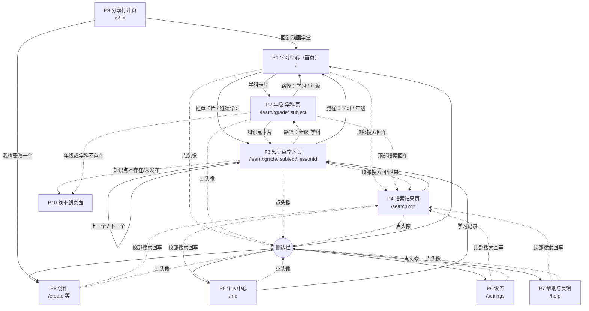

# 动画学堂 · 小学版页面规格（PRD）

> 版本：v1（已确认，2026-11-03）
> 上位文档：[小学版需求设计](./小学版需求设计.md)（范围、配置格式）、[教学平台方案](./教学平台方案.md)（架构、路线）
> 原型：https://claude.ai/artifact/4yBmxqu535rGPaeS36iDpW
> 本文档补齐：逐页规格（固定模板）、页面流程图、全局交互规则、业务规则、状态、验收标准。**开发和验收以本文档为准**；与原型不一致处见第 9 节。
> 第 7 节的待确认问题已全部按默认确认。所有可调的数值和文案（联系邮箱、默认值、条数上限等）统一放在公共配置文件 `site.yaml`，见 2.7。

---

## 0. 产品摘要

### 0.1 要解决的问题

小学生学数学和科学时，很多知识点是“过程”或“变化”（凑十、钟表走动、物态变化、影子移动），课本上的静态图和文字讲不清“为什么”。家长辅导时也缺少能直观演示的工具。

### 0.2 目标（第一版）

1. 孩子能在 3 次点击以内，从首页找到本年级某个知识点并开始播放。
2. 每个知识点能完整播放（讲解 + 朗读），并支持单步、回看、动手调参数。
3. 新增一个知识点**只需要配置文件和素材**，不改代码（以阶段 1 的三个知识点验证）。
4. 在电脑、iPad、手机（含微信内置浏览器）上都能正常学习。

### 0.3 不做（第一版）

| 不做 | 原因 |
|---|---|
| 账号、云端同步 | 先验证内容和体验；本机记录已能满足单设备使用 |
| 练习题、测验、错题本、积分、排行榜 | 第一版聚焦“看懂”，练习属于另一类产品能力；已记入[需求池](./需求池.md)，评估后再排期 |
| 用户投稿、评论 | 需要账号和内容审核 |
| 数据统计、埋点 | 面向未成年人，第一版不收集任何使用数据 |
| App | 网页版验证后再考虑 |

### 0.4 用户故事（按优先级）

**孩子**
- 我想打开网站就看到我这个年级的内容，不用每次都找。
- 我想点开一个知识点就能听着讲解看动画，看不懂可以退回上一步再看。
- 我想自己拖滑块试一试（比如把饼分成更多份），看看会怎样。
- 我想下次打开时接着上次的地方继续看。
- 我想知道自己学完了哪些。

**家长**
- 我想搜一个词（比如“分数”）就找到相关知识点，陪孩子一起看。
- 我想把一个知识点的链接发到家长群，别人点开就能看。
- 我想调大字号、关掉朗读，适合不同场合。

**内容作者（你）**
- 我想只写配置文件就新增知识点，本地预览，推送后自动上线。
- 我想让没做完的知识点先显示“即将上线”，不出现空白页。

---

## 1. 页面流程图



---

## 2. 全局规则

### 2.1 URL 与深层链接

| 规则 | 说明 |
|---|---|
| 每个页面都有独立网址 | 刷新、收藏、分享都能回到同一页面 |
| 年级用数字 1–6，学科用英文 id | 如 `/learn/1/math`、`/learn/3/science/water-states` |
| 知识点网址不带步骤 | 别人打开分享的知识点链接，总是从第 1 步开始 |
| 刷新学习页 | 回到**本机记录的上次所在步**，暂停状态（不自动播放） |
| 网址不合法 | 年级不在 1–6、学科不存在、知识点 id 不存在或未发布 → P10 找不到页面 |

### 2.2 返回逻辑

| 场景 | 行为 |
|---|---|
| 浏览器 / 手机返回键 | 回到上一个浏览过的页面（浏览器历史） |
| 层级路径上的链接 | 跳到明确的上级页面，与历史无关 |
| 从分享链接或外部直接进入（没有站内历史） | 路径链接照常可用；浏览器返回会离开本站，这是预期行为 |
| 在学科页切换年级/学科 | **替换**当前历史记录（不新增），避免返回时要一层层退回每次切换 |
| 在学习页切换年级/学科 | **新增**历史记录并跳到新的年级·学科页（离开当前知识点是一次真正的跳转） |
| 打开侧边栏、下拉、搜索框 | 不产生历史记录；按返回键时先关闭它们（手机上尤其重要） |

### 2.3 年级的两种含义

| 概念 | 存在哪里 | 作用 |
|---|---|---|
| **在读年级** | 本机，个人中心里设置 | 每次打开网站时，首页默认显示的年级 |
| **当前浏览年级** | 本次访问内有效 | 顶部栏年级下拉切换的就是它；关掉网页后下次又回到在读年级 |

- 第一次打开网站，在读年级默认是**一年级**。
- 在个人中心修改在读年级，同时把当前浏览年级也切过去。
- 设置页**不再**单独提供“默认年级”（与在读年级重复），原型里的这一项删除。

### 2.4 通用状态

所有加载内容的页面都要处理下面几种状态：

| 状态 | 表现 |
|---|---|
| 加载中 | 骨架屏（卡片形状的灰色占位），不超过 300 毫秒不显示，避免闪一下 |
| 加载失败（网络错误等） | 页面中部：“内容没加载出来” + “重试”按钮；顶部栏照常可用 |
| 找不到 | 进入 P10 |
| 内容为空 | 各页面单独规定（如“即将上线”） |
| 朗读不可用（浏览器不支持） | 隐藏所有朗读开关；学习页字幕照常显示，不报错 |
| 本机存储不可用（隐私模式等） | 照常学习；不记录进度；个人中心提示“当前浏览模式下无法保存学习记录” |

### 2.5 通用组件：顶部栏

**目的**：告诉用户“我在哪”，并提供打开菜单、搜索、切换年级/学科的入口。

| 元素 | 规则 |
|---|---|
| 头像 | 点击打开侧边栏。头像颜色来自个人中心 |
| 模块名 / 层级路径 | 一级页面（P1、P5、P6、P7、P8）显示模块名；P2、P3 显示路径，前面每一级可点击；路径过长时中间级省略为“…”，最后一级不省略 |
| 搜索 | 默认图标。点击展开输入框并聚焦；输入框失去焦点且内容为空时收起；内容不为空时保持展开；回车跳转 P4；按 Esc 收起 |
| 年级下拉 | P1、P2、P3、P4 显示；选择后关闭面板并按 2.2 规则跳转/刷新 |
| 学科下拉 | P2、P3 显示 |
| 下拉面板 | 点击面板外、按 Esc、选择一项后关闭；同一时间只开一个面板；打开面板时自动收起搜索框 |

**手机**：路径两行显示（上级路径小字可点击返回上一级，下面一行为当前页名）；年级和学科合并为一个按钮，面板里先选年级再选学科，**两项都选完或点空白处才关闭**；搜索展开时覆盖整个顶部栏，带“取消”。

**验收**
- [ ] 在 P3 点击路径中的“数学”，进入对应年级的数学学科页。
- [ ] 搜索框展开后不输入、点击页面空白处，收起为图标；输入文字后点空白处，保持展开。
- [ ] 打开年级面板后点击搜索图标，年级面板关闭、搜索框展开。
- [ ] 手机上打开侧边栏后按返回键，侧边栏关闭，页面不后退。

### 2.6 通用组件：侧边栏

| 元素 | 规则 |
|---|---|
| Logo + 动画学堂 | 点击回到首页并关闭侧边栏 |
| 个人信息卡 | 头像、昵称、在读年级、已学完数量；点击进入 P5 |
| 菜单 | 学习（P1）、创作（P8）、学习记录（P5 并定位到学习记录区）、设置（P6）、帮助与反馈（P7）；当前模块高亮 |
| 关闭 | 点遮罩、关闭按钮、按 Esc 或返回键 |
| 底部提示 | “学习记录和作品保存在这台设备上” |

**验收**
- [ ] 侧边栏打开时，背后的页面不能滚动。
- [ ] 点击菜单项后侧边栏关闭并跳转。

### 2.7 公共配置文件 site.yaml

所有**站点级**的可调项集中在一个文件 `packages/content/site.yaml`，改这个文件不需要改代码。代码里不允许写死下表中的任何值；`pnpm content:check` 按 JSON Schema 校验它，缺项时用表中的默认值。

```yaml
# packages/content/site.yaml
site:
  name: 动画学堂
  slogan: 看动画，动手试，弄明白为什么
  logo: assets/brand/logo.svg
contact:                 # 全部留空 → 帮助页隐藏反馈区
  email: ""              # 例：hello@example.com
  wechat: ""
defaults:                # 第一次打开时的默认值；用户改过后以本机设置为准
  grade: 1
  subject: math
  uiTheme: light         # light | dark | auto
  animTheme: cute        # flat | cute | chalk | pro
  fontSize: normal       # normal | large
  narrate: true          # 自动朗读
  speechRate: normal     # slow | normal | fast
  speed: 1               # 0.5 | 1 | 1.5 | 2
  autoplayOnFirstOpen: true
learning:
  recordLimit: 200
  continueCount: { desktop: 3, pad: 2, phone: 2 }
  recommendedLimit: 4
  prevNextCrossGrade: false
  prevNextCrossSubject: false
search:
  hints: [分数, 钟表, 凑十, 植物, 水]
  maxResults: 50
share:
  apiBase: /api          # 分享接口地址；换到自己的服务器时只改这里
help:
  faq: help.yaml         # 常见问题较长，单独一个文件，由这里引用
texts: texts.yaml        # 界面文案（按钮、提示、标题等）：分组 → 键 → 文字，代码里用 t('分组.键') 读取
style: style.yaml        # 动画主题（配色、圆角、字体）和导出视频/GIF 的画面样式
```

| 分组 | 说明 | 用到的页面 |
|---|---|---|
| site | 名称、标语、Logo | 顶部栏、侧边栏、设置·关于、网页标题 |
| contact | 联系方式，空值不显示 | P7 帮助与反馈 |
| defaults | 首次打开时的各项默认值 | P1、P3、P6 |
| learning | 学习记录上限、继续学习条数、推荐条数、上一个/下一个范围 | P1、P3、P5 |
| search | 常用标签、结果上限 | P4、顶部栏搜索 |
| share | 分享接口地址 | P3、P8、P9 |
| help | 常见问题文件 | P7 |
| texts | 界面文案文件，所有页面的按钮、提示、标题都在这里改 | 全部页面 |
| style | 动画主题、导出视频/GIF 的尺寸和字幕样式 | P3、P8 |

不放在这里的：年级与学科（`curriculum/grades.yaml`）、课程目录、知识点、素材清单——它们是**内容**配置，各有自己的文件；部署密钥（Cloudflare KV 绑定等）放在部署配置里，不进内容仓库的公共配置。

**验收**
- [ ] 把 `contact.email` 填上并重新构建，帮助页出现邮箱且可复制；清空后反馈区消失。
- [ ] 把 `defaults.grade` 改为 3，清空本机数据后首次打开首页显示三年级。
- [ ] 把 `site.name` 改掉，顶部栏、侧边栏、网页标题、设置·关于同时变化。
- [ ] `site.yaml` 写错类型（如 `grade: 七`）时，`pnpm content:check` 报错并指出行号。

---

## 3. 业务规则

### 3.1 学习记录（本机）

每个知识点在本机保存一条记录：

| 字段 | 含义 |
|---|---|
| lastStep | 上次所在的步骤 |
| maxStep | 到达过的最远步骤 |
| completed | 是否已学完 |
| completedAt | 学完的时间 |
| lastOpenedAt | 上次打开的时间 |

- **产生记录的条件**：打开学习页并**至少播放或切换过一步**。只打开不操作，不产生记录，避免误触也算“学过”。
- 学习记录最多保留 `learning.recordLimit` 条（默认 200），超出时删除最久没打开的。

### 3.2 已学完的判定

满足任意一条即标记为已学完：

1. 在**播放状态**下，最后一步的讲解完整播完（拖动进度条直接跳到最后一步不算）。
2. 点击字幕框右上角的进度环（没学完时，悬停和朗读提示为“我学会了”）。

- **撤销**：已学完后进度环变为绿色圆形对勾（提示“已学完”），点击后出现“取消已学完”确认，确认后取消。
- 已学完后再看一遍，不会取消已学完状态。

### 3.3 继续学习（首页）

- 显示最近打开过的知识点，按 lastOpenedAt 从近到远排序。**未学完的排在前面**，已学完的排在后面。
- 电脑最多 3 条，iPad 2 条，手机 2 条。
- 进度显示“第 lastStep / 共 N 步”，已学完显示“已学完”。
- 点击后从 lastStep 开始，暂停状态；已学完的从第 1 步开始。
- 没有任何记录时，整个“继续学习”区块不显示。
- 不按年级过滤：孩子看过别的年级的内容，也会出现在这里。

### 3.4 学习天数

- 本机上“产生或更新过学习记录”的**不同日期**的数量，按设备本地时区计算。
- 只增不减；清除学习记录时归零。

### 3.5 上一个 / 下一个

- 顺序 = 课程目录配置中，同一年级、同一学科的单元顺序 + 单元内知识点顺序。
- **可以跨单元**：单元最后一个知识点的“下一个”，是下一个单元的第一个。
- **不跨年级、不跨学科**：
  - 第一个知识点没有“上一个”，这个位置显示“回到{年级}{学科}”；
  - 最后一个知识点的“下一个”位置显示“{年级}{学科}都学完了，回到目录”。
- 跳过状态为“即将上线”的知识点。

### 3.6 知识点状态（来自配置）

| 配置 status | 线上表现 | 本地开发表现 |
|---|---|---|
| published | 正常显示，可学习 | 同左 |
| reviewed | 不显示（只能通过网址打开时进 P10） | 显示，带“待发布”标记 |
| draft | 不显示 | 显示，带“草稿”标记 |
| 目录中列出但没有配置文件 | 显示为“即将上线”，不可点击 | 同左 |

### 3.7 搜索

- **范围**：所有已发布知识点的标题、简介、标签、所属单元名。
- **匹配**：不区分大小写；多个词（空格分隔）需要同时匹配；至少 1 个字。
- **排序**：当前浏览年级的结果在前；同年级内标题命中优先于其他字段命中。
- 关键词写在网址里（`/search?q=分数`），刷新和分享都保留。

---

## 4. 逐页规格

每页按固定模板：目的与入口 → 页面元素 → 交互规则 → 状态 → 跳转与返回 → 数据来源 → 验收标准。

### P1 学习中心（首页）`/`

**目的**：让孩子最快找到本年级的内容，或接着上次学。
**入口**：打开网站；Logo；侧边栏“学习”；层级路径中的“学习”和年级。

**页面元素**

| 区块 | 内容 |
|---|---|
| 顶部栏 | 模块名“学习”；搜索；年级下拉 |
| 问候 | “{昵称}，你好！今天学点什么？”；没设昵称时为“你好！今天学点什么？”；下一行“正在看{年级}的内容，可以在右上角换年级” |
| 学科卡片 | 数学、科学，各显示：学科图标、名称、“{年级} · N 个知识点”、已学完进度条与数量 |
| 继续学习 | 见 3.3 |
| {年级}推荐 | 当前年级中配置了 `recommended: true` 的已发布知识点，最多 `learning.recommendedLimit` 个（默认 4）；“查看全部”进入该年级数学学科页 |

**交互规则**
- 切换年级：页面内容就地刷新，网址不变，不新增历史。
- 学科卡片在该年级没有已发布知识点时，显示“即将上线”，仍可点击进入（学科页会显示单元目录和“即将上线”）。

**状态**

| 情况 | 表现 |
|---|---|
| 当前年级没有任何已发布内容 | 学科卡片显示“即将上线”；推荐区显示“{年级}的动画正在制作中，敬请期待。” |
| 没有推荐（有内容但没标推荐） | 推荐区改为显示该年级最先排序的 4 个已发布知识点 |
| 没有学习记录 | 不显示“继续学习” |

**跳转与返回**：学科卡片 → P2（当前年级 + 该学科）；推荐卡片、继续学习卡片 → P3。

**数据来源**：年级、学科（配置）；知识点、推荐（配置）；昵称、在读年级、学习记录（本机）。

**验收**
- [ ] 第一次打开网站，首页显示一年级。
- [ ] 在个人中心把在读年级改为三年级，关掉网页再打开，首页显示三年级。
- [ ] 顶部栏切到二年级后刷新页面，仍显示二年级（本次访问内有效）。
- [ ] 学过两个知识点（一个学完、一个没学完），“继续学习”中没学完的排第一。

### P2 年级·学科页 `/learn/:grade/:subject`

**目的**：按单元浏览某年级某学科的全部知识点，看到哪些学过。
**入口**：首页学科卡片；层级路径；学习页“回到目录”；顶部栏年级/学科下拉。

**页面元素**

| 区块 | 内容 |
|---|---|
| 顶部栏 | 路径“学习 › {年级} › {学科}”；搜索；年级下拉；学科下拉 |
| 学科横幅 | 学科图标、“{年级} · {学科}”、“N 个单元 · M 个知识点 · 已学完 K 个” |
| 单元 | “第 n 单元”、单元名、“已学完 a / b” |
| 知识点卡片 | 缩略图、名称、一句话简介、时长、状态（已学完 / 学习中 / 未学 / 即将上线） |

**交互规则**
- “学习中”= 有学习记录但未学完；卡片上显示“第 x / N 步”。
- “即将上线”的卡片半透明、不可点击，鼠标悬停提示“即将上线”。
- 切换年级或学科：替换网址和历史（见 2.2），页面回到顶部。

**状态**

| 情况 | 表现 |
|---|---|
| 目录里没有这个年级·学科 | “{年级}{学科}的动画正在制作中，敬请期待。” + “回到首页” |
| 有单元但全部即将上线 | 正常显示单元和“即将上线”卡片 |

**跳转与返回**：知识点卡片 → P3；路径“学习”/年级 → P1（切到该年级）。

**数据来源**：课程目录（配置）；知识点元数据（配置）；学习状态（本机）。

**验收**
- [ ] 打开 `/learn/1/math`，看到一年级数学的所有单元，顺序与配置一致。
- [ ] 打开 `/learn/7/math`，进入找不到页面。
- [ ] 在学科页把学科切成科学，再按浏览器返回，回到切换之前的上一个页面（而不是数学学科页）。

### P3 知识点学习页 `/learn/:grade/:subject/:lessonId`

**目的**：通过动画、讲解和动手尝试，看懂一个知识点。
**入口**：首页推荐与继续学习、学科页、搜索结果、个人中心学习记录、上一个/下一个、分享链接。

**页面元素**

| 区块 | 内容 |
|---|---|
| 顶部栏 | 路径“学习 › {年级} › {学科} › {单元}”（单元点击回到该学科目录，路径里不再重复写知识点名）；搜索；年级下拉；学科下拉 |
| 标题区 | 知识点名（不带例子里的数字）在左；有动手做时，学习方式（看一看 / 跟着做 / 自己做）在同一行的最右侧 |
| 舞台 | 动画画面；右上角小字“{时长} · 共 N 步”；右下角工具扇形菜单；跟着做、自己做时，轮到孩子的步骤可以在舞台上拖动零件 |
| 工具扇形菜单 | 舞台右下角的圆形菜单按钮（三条线图标），点开后以它为圆心向外展开分享、导出（手机上没有导出）、全屏三个图标按钮；再点一下收起，点任一工具后也收起；按住可以拖动，松手后吸附到最近的左边或右边（像苹果手机的辅助触控圆点），高度可以自己选；展开方向跟着位置走（靠右向左、在下半边向上），不会超出舞台 |
| 字幕 | 左侧是朗读开关（点击开关朗读，同时显示是否朗读）；第一行“第 n 步 / 共 N 步 · {步骤标题}”，右上角是学完状态：没学完显示进度环（点一下标为已学完），已学完显示绿色圆形对勾（点一下可取消）；下面是讲解句子（参数会代入，如“平均分成 6 份”）；轮到孩子时显示“轮到你了”、任务提示、做错的提示，以及“看我做一遍”按钮 |
| 播放控制 | 上一步、播放/暂停、下一步、调速（手机上隐藏）；进度条上有每一步的进度点（点一下回到那一步的开头，位置在这一步开头）；手机上进度条在上，播放、上一步、下一步居中放在它下面 |
| 放完后的提示 | 有动手做时：看一看放完 → “轮到你跟着做” + 跟着做；跟着做放完 → “试试自己做” + 自己做；自己做放完 → “全部做对了” + 换一题、再做一遍 |
| 动手试一试 | 配置了 `explore` 才显示：控件（滑块、按钮组、开关）及当前值；“回到标准讲解”。有动手做的知识点只在“自己做”时显示 |
| 要点 | 配置的 keyPoints，2–4 条，撑满整行宽度 |
| 上一个 / 下一个 | 见 3.5 |

**交互规则**
- **打开时**：首次学习从第 1 步开始并**自动播放**（带朗读）；有学习记录则停在 lastStep、暂停。
- **手动操作暂停**：单步、点步骤点、拖进度、调整“动手试一试”控件，都会暂停播放。
- **动手试一试**：
  - 控件有三类：**点选换例子**（配置里的 `presets`，如凑十法的 9 + 4、8 + 6、7 + 5）、滑块、按钮组/开关；点选和滑块都会改参数；
  - 由参数算出来的值（如“要拆出几个”）在配置的 `derived` 里写，讲解、零件、要点里都能用；
  - 调整任一控件后，画面立刻更新，跳到配置中声明的“结果步骤”（默认最后一步），字幕和要点代入新参数；
  - 出现“回到标准讲解”，点击后参数恢复配置值，回到第 1 步，暂停；
  - 调过的参数**不保存**，刷新后恢复标准讲解；
  - 控件取值超出范围时自动收回到范围内（例如“取几份”不能超过“分成几份”）；范围可以是由其他参数算出来的式子（如凑十法“小数”的下限是 `11 - 大数`）。
  - 界面文字（标题、按钮）来自 `site.yaml` 的 `explore.texts`；
  - 配置检查：标准取值、每个点选例子、滑块能取到的每一种组合都要能正常画出来，否则 `pnpm content:check` 报错。
- **动手做（看一看 / 跟着做 / 自己做）**：知识点的步骤里配置了 `try`（这一步由孩子来做）时出现。
  - 同一份配置三种用法：`do` 是标准做法，看一看时自动播放，也用于“看我做一遍”和做对后的画面；`try` 写任务提示、怎么判断做对、做错时的提示。
  - **看一看**：照常播放（和没有动手做的知识点一样），导出视频也用它。
  - **跟着做**：照常讲解；到有 `try` 的步骤停在这一步开头，字幕显示“轮到你了”和任务提示并朗读；孩子做对后朗读“做对了！”和这一步的讲解，放完这一步接着往下。
  - **自己做**：不自动播放，也不朗读讲解，从头到尾都由孩子自己拖或点。直接从第一个要孩子做的步骤开始（前面的讲解步骤不播，画面已经是那一步开头的样子），只读任务提示；做对后说“做对了！”，再进入下一个要做的步骤，最后一步显示结果；没有播放按钮，进度点里不用做的步骤变淡、点不了；有错才纠正（见下面的逐级引导）。放完出现“换一题”（从例子里随机挑一个不一样的）和“再做一遍”，下方是“动手试一试”，换例子后从头做。
  - **做错的逐级引导**（次数在 `player.handsOn`）：做错 1 次，零件弹回原处并给出提示（配置的 `hints` 依次给出，没写用通用提示）；做错 `targetAfterMisses` 次起，高亮该放到哪里；做错 `demoAfterMisses` 次，自动“看我做一遍”（按标准做法放一遍这一步），停一会儿后让孩子自己再做。任何时候都可以点“看我做一遍”。
  - 等孩子动手时：“下一步”和右方向键不可用，不显示拖动进度条（步骤点仍可点）；做对过的步骤再回来不用重做。
  - 第一种动手方式是**拖动**（`drag`）：把一组计数块一个一个拖到目标零件上，拖够 `count` 个算做对；放在目标外面（容差 `scene.tryIt.dropPadding`）算做错。拖动时页面不滚动；键盘可以在零件上按回车直接放进目标。
  - 切换学习方式、换一题、再做一遍，播放器都从第 1 步重新开始。“看一看”或“自己做”放完最后一步都会标为已学完。
- **页面间距**：知识点页的各块之间间距比其他页面紧凑（约 12px），动画区域里不留多余的空白（舞台高度按内容定，如凑十法 800 × 360）。
- **朗读**：开关状态全站共用（来自设置）；关掉朗读时按讲解字数估算停留时间。
- **全屏**：舞台、字幕、控制条进入全屏；手机或浏览器不支持时按钮隐藏。
- 键盘：空格播放/暂停，左右方向键上一步/下一步（输入框获得焦点时不响应）。

**状态**

| 情况 | 表现 |
|---|---|
| 加载中 | 舞台位置显示骨架 |
| 知识点不存在或未发布 | P10 |
| 网址里的年级/学科与知识点实际所属不一致 | 自动跳转到正确网址（替换历史） |
| 模板不认识（内容比网站代码新） | “这个动画需要更新网站才能播放” + “刷新”按钮 |
| 素材加载失败 | 对应位置显示灰色占位，动画继续 |

**跳转与返回**：路径各级 → P1/P2；上一个/下一个 → P3；切换年级/学科 → P2（新增历史）；分享 → 复制链接 `/learn/...`（打开后从第 1 步开始）。

**数据来源**：知识点配置（模板、参数、步骤、讲解、explore、keyPoints）；素材（配置）；学习记录、朗读与速度偏好（本机）。

**验收**
- [ ] 第一次打开“认识分数”，自动从第 1 步开始播放并朗读，播完最后一步后自动标为已学完。
- [ ] 播放到第 2 步时刷新页面，回到第 2 步且处于暂停状态。
- [ ] 拖动“平均分成几份”到 6，字幕变为“…平均分成 6 份…”，饼图分成 6 份；点“回到标准讲解”，恢复为 4 份、第 1 步。
- [ ] 把“分成几份”从 6 调到 3 时，若“取几份”是 5，自动变为 3。
- [ ] 单元最后一个知识点的“下一个”指向下一单元第一个知识点；学科最后一个知识点显示“都学完了，回到目录”。
- [ ] 打开 `/learn/3/math/不存在的id`，进入找不到页面。
- [ ] “凑十法”选“跟着做”：讲到第 4 步停下，字幕显示“轮到你了 · 把 1 个橙色圆片拖进十格框”；拖到空白处圆片弹回并提示，第 2 次做错十格框高亮，第 3 次自动“看我做一遍”，演示后说“现在你来试试”；拖进十格框后说“做对了”，接着讲完；放完提示“试试自己做”。
- [ ] “凑十法”选“自己做”：不朗读讲解，很快到第 4 步；做对后放完出现“换一题”，点它换成另一个例子并从头做。
- [ ] 手机、iPad 上用手指能拖动圆片，拖动时页面不滚动。

### P4 搜索结果页 `/search?q=`

**目的**：用关键词找知识点。
**入口**：任意页面顶部栏搜索框回车。

**页面元素**

| 区块 | 内容 |
|---|---|
| 顶部栏 | 模块名“搜索”；搜索框**保持展开**并填入当前关键词；年级下拉 |
| 结果数 | “找到 N 个和“{关键词}”有关的知识点” |
| 结果列表 | 按 3.7 排序；每条：缩略图、名称（命中的字高亮）、“{年级} · {学科} · {单元}”、简介 |

**交互规则**
- 在本页修改关键词并回车，替换网址（不新增历史）。
- 切换年级只改变排序（当前年级在前），不过滤。

**状态**

| 情况 | 表现 |
|---|---|
| 关键词为空（如直接打开 `/search`） | 显示“输入关键词找知识点”和几个常用标签（来自 `site.yaml` 的 `search.hints`） |
| 没有结果 | “没有找到和“{关键词}”有关的知识点。” + 换个词的建议 + 常用标签 |

**跳转与返回**：结果 → P3；浏览器返回 → 搜索前的页面。

**数据来源**：知识点索引（配置构建时生成）；常用标签（配置）。

**验收**
- [ ] 搜“分数”，能找到三年级的“认识分数”，“分数”两个字高亮。
- [ ] 当前浏览年级是一年级时，一年级的结果排在前面。
- [ ] 搜一个不存在的词，显示无结果提示和常用标签。

### P5 个人中心 `/me`

**目的**：设置本机的孩子资料，查看学习情况。
**入口**：侧边栏个人信息卡；侧边栏“学习记录”（定位到学习记录区）。

**页面元素**

| 区块 | 内容 |
|---|---|
| 顶部栏 | 模块名“个人中心” |
| 资料 | 头像（4 种颜色可选）、昵称（最多 8 个字）、在读年级（一到六年级） |
| 说明 | “这些资料和学习记录只保存在这台设备上，不会上传。” |
| 统计 | 已学完 N 个知识点、学过 M 个知识点、学习天数 D 天 |
| 学习记录 | 筛选：全部 / 已学完；每条：缩略图、名称、“{年级} · {学科}”、时间（今天 / 昨天 / n 天前 / 日期）、状态 |

**交互规则**
- 资料修改**即时保存**，无需点保存按钮；昵称为空时显示“你好”式的无昵称问候。
- 修改在读年级时同步当前浏览年级（见 2.3）。
- 学习记录按 lastOpenedAt 倒序；超过 20 条时分页加载（滚动到底部加载更多）。

**状态**

| 情况 | 表现 |
|---|---|
| 没有学习记录 | 统计都为 0；记录区显示“还没有学习记录，去首页看看吧” + 按钮 |
| 本机存储不可用 | 资料修改后提示“当前浏览模式下无法保存” |

**跳转与返回**：学习记录 → P3。

**数据来源**：全部来自本机。

**验收**
- [ ] 把昵称改成“小红”，回到首页问候语变成“小红，你好！…”。
- [ ] 学完一个知识点，已学完数量 +1，学习天数在当天至少为 1。

### P6 设置 `/settings`

**目的**：调整外观、语言、朗读和数据。
**入口**：侧边栏“设置”。

**页面元素与规则**

| 分组 | 项目 | 规则 |
|---|---|---|
| 外观 | 界面主题：浅色 / 深色 / 跟随系统 | 立即生效；默认值来自 `site.yaml` 的 `defaults.uiTheme`（浅色） |
| | 动画主题：四种 | 只作用于没有指定主题的知识点和新建作品 |
| | 字号：标准 / 大 | 立即生效，全站放大约 15% |
| 语言 | 界面语言：简体中文 | 第一版只有一项 |
| 朗读 | 自动朗读开关、朗读声音（含试听）、语速（慢一点 / 正常 / 快一点） | 浏览器不支持朗读时整组隐藏，显示说明 |
| 学习 | 默认播放速度 | 0.5× / 1× / 1.5× / 2× |
| 数据 | 导出备份、导入、清除学习记录 | 清除需要再点一次确认；只清学习记录，不清作品和资料 |
| 关于 | 名称、版本号 | |

所有设置即时保存在本机。左侧分组导航点击后滚动到对应分组（手机上分组导航隐藏，页面直接纵向排列）。

**验收**
- [ ] 切换为深色，所有页面背景、文字、卡片都使用深色配色，文字对比度达标。
- [ ] 清除学习记录后，首页“继续学习”消失，个人中心统计归零，作品仍在。

### P7 帮助与反馈 `/help`

**目的**：解答常见问题，并给出反馈的方式。
**入口**：侧边栏“帮助与反馈”。

**页面元素**

| 区块 | 内容 |
|---|---|
| 常见问题 | 可折叠的问答列表，内容来自配置 `help.yaml`。第一版至少包括：怎么换年级；为什么听不到朗读；怎么把动画发给别人；学习记录存在哪里、换设备怎么办；在微信里打开有什么限制 |
| 反馈 | 显示联系方式（来自 `site.yaml` 的 `contact`，可一键复制）；“复制设备信息”按钮（浏览器、系统、网站版本，方便描述问题）。第一版不做站内提交表单（没有后端存储反馈） |
| 版本 | 当前网站版本号 |

**状态**：`site.yaml` 的 `contact` 全部为空时，隐藏反馈区块。

**验收**
- [ ] 点击“复制设备信息”，剪贴板中是浏览器、系统和版本号；剪贴板不可用时，显示可手动选择的文本。

### P8 创作 `/create`、`/mine`、`/edit/:id`、`/play/:id`

**目的**：用表单做自己的动画（沿用已完成的功能）。
**入口**：侧边栏“创作”。

**与现有功能相比的调整**
- 顶部栏换成新版（模块名“创作”，不显示年级/学科）。
- “创作”首页合并原“我的作品”：新建动画、我的作品、从模板开始。
- 原“动画广场”的通用示例（TCP、排序等）放在“从模板开始”下方作为示例。
- 编辑器、播放页、分享、导出的规则不变（见[产品原型](./产品原型.md)和[技术方案](./技术方案.md)）。

**验收**：已有的 M1–M5 端到端测试在新导航下全部通过。

### P9 分享打开页 `/s/:id`

**目的**：别人打开分享链接时直接观看。
**入口**：外部链接。
**规则**：沿用现有功能。顶部栏只显示 Logo、“动画学堂”和“我也要做一个”，不显示头像、搜索和年级/学科。
**状态**：链接不存在 →“这个分享链接不存在，或者已经失效了” + “去动画学堂看看”；网络错误 → 重试。

### P10 找不到页面

**触发**：任何无效网址；未发布的知识点。
**内容**：“这个页面不存在，可能是链接写错了，或者内容还没上线。” + “回到首页” + 搜索框。
**验收**：[ ] 打开 `/abc` 显示本页，顶部栏可正常使用。

---

## 5. 需求优先级

| 级别 | 需求 |
|---|---|
| **P0（第一版必须）** | P1、P2、P3、P10；顶部栏和侧边栏；3.1–3.6 业务规则；2.1–2.4、2.7 全局规则（含 site.yaml）；场景模板 + fraction / clock 模板；配置校验 |
| **P1（第一版应该有，可稍后补）** | P4 搜索；P5 个人中心；P6 设置中的深色主题；P7 帮助与反馈；导出视频 |
| **P2（以后）** | 账号与同步；练习题、错题本、排行榜（见[需求池](./需求池.md)）；英文界面；离线使用 |

P1 的意思是：如果时间紧，可以先上线 P0，再补 P1；但架构上一开始就按 P1 设计，不返工。

---

## 6. 成功标准

第一版**不收集任何使用数据**，所以用以下可人工检验的标准判断：

| 标准 | 检验方式 |
|---|---|
| 3 次点击内开始学习 | 从首页到任一已发布知识点开始播放，点击次数 ≤ 3 |
| 只用配置新增知识点 | 阶段 1 的三个知识点，提交记录里只有配置和素材文件 |
| 多设备可用 | 在 Windows/Mac 浏览器、iPad Safari、安卓手机、微信内置浏览器上，按第 4 节验收清单逐项通过 |
| 孩子能独立使用 | 你观察孩子独立完成：找到知识点 → 看完 → 拖一次滑块 |

---

## 7. 待确认问题

全部按默认确认（2026-11-03）。

| # | 问题 | 结论 | 是否阻塞开发 |
|---|---|---|---|
| 1 | 在读年级与当前浏览年级分开（2.3） | 分开；设置里去掉“默认年级” | 是（影响首页和设置） |
| 2 | 首次打开知识点是否自动播放（P3） | 是，带朗读 | 否 |
| 3 | 已学完的判定（3.2） | 播放中自然播完最后一步，或点“我学会了”；可撤销 | 否 |
| 4 | 上一个/下一个不跨年级、不跨学科（3.5） | 是 | 否 |
| 5 | 界面主题默认浅色（P6） | 浅色 | 否 |
| 6 | 帮助与反馈的联系方式 | 填在 `site.yaml` 的 `contact`；未填时不显示反馈区 | 否 |
| 7 | 搜索、个人中心、设置、帮助列为 P1 | 是 | 否 |

---

## 8. 与上位文档的关系

- 范围、配置格式、模板和零件清单：以[小学版需求设计](./小学版需求设计.md)为准。
- 本文档的页面行为、规则、状态与它冲突时，以**本文档**为准，并回头更新它。

## 9. 与原型的差异

| 原型里 | 以本文档为准 |
|---|---|
| 所有知识点卡片都进入“认识分数” | 进入各自的知识点 |
| 年级、单元归属、数量是示意 | 以课程目录配置为准 |
| 设置里有“默认年级” | 删除，改为个人中心的“在读年级”（待确认问题 1） |
| 首页继续学习固定 3 条示例 | 按 3.3 规则 |
| 没有搜索结果页、帮助与反馈页、找不到页面 | 按 P4、P7、P10 实现，视觉沿用现有风格 |
